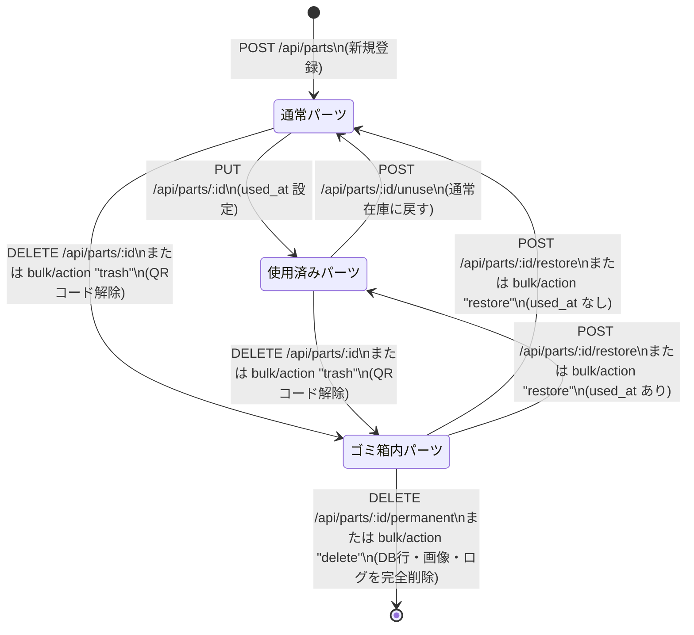

# API仕様書

## 1. 概要
- エンドポイントのベースURLは、開発・ローカル環境では `http://localhost:3001` です。
- 全てのAPIは `/api` プレフィックスを持ちます。
- AWS本番環境（Lambda環境）ではCloudFront経由でアクセスされ、直接アクセス遮断のため `x-origin-verify` リクエストヘッダーが必須です（未設定・不一致の場合は `403 Forbidden`）。

---

## 2. この文書の運用ルール
1. **実装と文書の一致**: ルートを追加・変更・削除した際は、必ず同一のPull Request内で本仕様書（`docs/API.md`）も更新してください。
2. **自動テストによる保証**: `scripts/test/apiEndpoints.test.js` により、サーバーの全ルートと本仕様書の見出しが完全に双方向一致（過不足なし・重複なし）していることが自動検証されます。
3. **ルート定義を正とする原則**: 仕様書の記載と `server/routes/*.js` の実装が食い違う場合は、常に**サーバー実装（ルート定義）を正**とし、仕様書の誤記を改訂対象として扱ってください。

---

## 3. 共通事項

### 認証 (API トークン認証)

本システムは、LAN 内運用および MCP サーバー連携向けに **API トークン認証**（オプトイン）をサポートします。

- **有効化**: 環境変数 `EPM_API_TOKEN` に任意の文字列（例: 32バイト乱数の base64url）を設定すると有効化されます。未設定または空の場合は無認証で動作します（後方互換性維持）。
- **認証方式**: リクエストヘッダーに `Authorization: Bearer <token>` を指定します。
- **未認証・認証失敗時のレスポンス**:
  - HTTP ステータス: `401 Unauthorized`
  - レスポンスヘッダー: `WWW-Authenticate: Bearer realm="epm"`
  - レスポンスボディ:
    ```json
    {
      "error": "Unauthorized",
      "code": "API_TOKEN_REQUIRED"
    }
    ```
- **免除されるリクエスト**:
  - `OPTIONS` プリフライトリクエスト
  - `GET` および `HEAD` の `/api/health`（死活監視・更新スクリプト用）
  - AWS Lambda 環境における `POST /api/backup/export/worker`（非同期エクスポートワーカー内部呼出用。LAN環境では免除されません）
  - ※ループバックアドレス（`127.0.0.1` / `::1`）からの要求であっても免除されません（Vite preview プロキシ経由時のバイパス防止のため）。
- **対象外のパス**:
  - `/uploads/*` の静的画像・データシート配信（ブラウザの `` や `<a>` タグからヘッダー付与が困難なため保護対象外）。
- **AWS 本番環境での扱い**:
  - AWS 環境では CloudFront の Basic 認証が `Authorization` ヘッダーを使用するため、同一ヘッダーを奪い合う `Authorization: Bearer` 方式のトークン認証は併用できません。AWS 環境では従来どおり CloudFront Basic 認証のみで保護し、`EPM_API_TOKEN` は設定しません。

### エラー形式
エラー時のレスポンスボディは原則として以下のJSON形式です。
```json
{
  "error": "エラーメッセージ文字列"
}
```

### ID の検証規則
以下のエンドポイントでは、パスパラメータ `:id` に正の整数の厳密な検証を行います（不正なら 400 `Invalid ID`）:
- `DELETE /api/parts/:id`
- `DELETE /api/parts/:id/permanent`
- `POST /api/parts/:id/restore`
- `DELETE /api/categories/:id`
- `DELETE /api/locations/:id`

※その他のエンドポイントでは、存在しない ID に対して 404 または空データを返却します。

### パーツの状態定義
パーツテーブル（`parts`）のレコードは、2つのタイムスタンプカラムによって以下の3つの状態に分類されます。

| 状態 | `deleted_at` | `used_at` | 説明 |
|---|---|---|---|
| **通常パーツ (active)** | `NULL` | `NULL` | 通常の在庫一覧に表示される現役パーツ |
| **使用済みパーツ (used)** | `NULL` | NOT NULL | 実装・製作等で使用され保管場所から出たパーツ（`used_at`, `used_for`, `used_note` を保持） |
| **ゴミ箱内パーツ (trash)** | NOT NULL | 任意 | 削除操作によりゴミ箱に入ったパーツ。通常・使用済み一覧からは除外される |

---

## 4. パーツ管理 (`/api/parts`)

#### `GET /api/parts`
- **用途**: パーツ一覧を検索・フィルタ・ソートして取得します。
- **リクエスト**:
  - クエリパラメータ:
    - `search` (string): 検索キーワード（名前、型番、説明、購入先の部分一致）
    - `category_id` (number): カテゴリIDで絞り込み
    - `location_id` (number): 保管場所IDで絞り込み
    - `tag_id` (number): タグIDで絞り込み
    - `status` (string): `'trash'`（ゴミ箱）、`'used'`（使用済み）、未指定時は通常パーツ
    - `used_for` (string): 用途キーワードで絞り込み
    - `shop` (string): 購入先の部分一致で絞り込み
    - `sort` (string): ソートキー (`name`, `category`, `location`, `created_at`, `quantity`, `used_for`, `used_at`, `part_number`)
    - `order` (string): 並び順 (`ASC`, `DESC`)。デフォルトは `DESC`
- **レスポンス**: 200 OK
  ```json
  [
    {
      "id": 1,
      "name": "抵抗 10kΩ",
      "part_number": "CF1/4W-10k",
      "description": "カーボン抵抗 1/4W",
      "quantity": 100,
      "category_id": 2,
      "location_id": 3,
      "image_path": "/uploads/123.jpg",
      "datasheet_url": "https://example.com/sheet.pdf",
      "shop": "秋月電子通商",
      "purchased_at": "2026-03-01",
      "unit_price": 1.5,
      "qr_code": "P-0001",
      "used_at": null,
      "used_for": null,
      "used_note": null,
      "deleted_at": null,
      "category_name": "受動部品",
      "location_name": "引き出しA-1",
      "tags": "抵抗,リード部品"
    }
  ]
  ```
- **エラー**: 500
- **副作用**: なし

#### `GET /api/parts/stats`
- **用途**: 在庫統計（通常、使用済み、ゴミ箱、在庫切れ、在庫少、カテゴリ別件数、保管場所数、AI判定保留数）を取得します。
- **リクエスト**: なし
- **レスポンス**: 200 OK
  ```json
  {
    "active": 120,
    "used": 15,
    "trash": 3,
    "lowStock": 4,
    "outOfStock": 1,
    "locations": 10,
    "aiPending": 2,
    "categories": [
      { "id": 1, "name": "IC", "count": 25 }
    ],
    "uncategorized": 5,
    "lowStockThreshold": 5
  }
  ```
- **エラー**: 500
- **副作用**: なし

#### `GET /api/parts/shops`
- **用途**: 購入先の入力候補を、登録件数の多い順（同数は名前順）で取得します。ゴミ箱内の部品と空の購入先は含みません。
- **レスポンス**: 200 OK
  ```json
  [
    { "name": "秋月電子通商", "count": 12 },
    { "name": "マルツ", "count": 3 }
  ]
  ```
- **エラー**: 500

#### `GET /api/parts/:id`
- **用途**: 指定したIDのパーツ詳細情報を取得します。
- **リクエスト**: パスパラメータ `:id`（正の整数）
- **レスポンス**: 200 OK（パーツオブジェクト）。存在しない場合は 404
- **エラー**: 404 `{ error: "Part not found" }`, 500
- **副作用**: なし

#### `POST /api/parts`
- **用途**: 新規パーツを登録します（`multipart/form-data` または `application/json` に対応）。
- **リクエスト**: `multipart/form-data` または `application/json`
  - ボディ:
    - `name` (string, 必須): 部品名（1〜200文字、前後の空白は自動トリム）
    - `part_number` (string, 任意): 型番（最大100文字）
    - `description` (string, 任意): 説明
    - `category_id` (number, 任意): カテゴリID（存在する正の整数）
    - `location_id` (number, 任意): 保管場所ID（存在する正の整数）
    - `quantity` (number, 任意): 数量（0以上の整数。デフォルト: 0）
    - `tags` (string | array, 任意): カンマ区切りタグ文字列、または文字列の配列
    - `datasheet_url` (string, 任意): データシートURL
    - `shop` (string, 任意): 購入先（最大100文字）
    - `purchased_at` (string, 任意): 購入日（`YYYY-MM-DD`。実在する日付のみ）
    - `unit_price` (number, 任意): 単価（円。0以上、1e9以下）
    - `image` (file, 任意, multipartのみ): 画像ファイル（最大20MB、JPG/PNG/GIF/WEBP）
    - `datasheet` (file, 任意, multipartのみ): データシートPDFファイル（最大20MB）
- **レスポンス**: 201 Created (`{ id: <新パーツID> }`)
- **エラー**: 400（必須項目不足、不正な数量、存在しない外部キー等）、413（ファイルサイズ超過）、500
- **副作用**: パーツレコード作成、タグ紐付け、画像・データシート保存

#### `POST /api/parts/:id/quantity`
- **用途**: パーツの在庫数量を増減または絶対値で原子的に更新します（MCPツールや入庫処理向け）。
- **リクエスト**: `application/json`
  - パスパラメータ: `:id` (正の整数)
  - ボディ:
    - `delta` (number, 任意): 増減値（0以外の整数。正で増加、負で減少）。`absolute` との排他指定。
    - `absolute` (number, 任意): 設定する絶対値（0以上の整数）。`delta` との排他指定。
    - `reason` (string, 任意): 変更理由（最大200文字。サーバーログおよびレスポンスに反映）。
- **レスポンス**: 200 OK
  ```json
  {
    "part_id": 1,
    "previous_quantity": 10,
    "new_quantity": 15,
    "delta": 5,
    "reason": "秋月で購入"
  }
  ```
- **エラー**:
  - 400: 不正なID、`delta` と `absolute` の未指定または重複指定、小数の指定、200文字超の理由、計算後の在庫数が負になる場合
  - 404: パーツが存在しない、またはゴミ箱（`deleted_at IS NOT NULL`）もしくは使用済み（`used_at IS NOT NULL`）の場合
  - 500: サーバー内部エラー
- **副作用**: `parts.quantity` および `parts.updated_at` の更新（`absolute` で数量不変の場合は `updated_at` を更新しない）、サーバーログへの出力

#### `PUT /api/parts/:id`
- **用途**: パーツ情報を包括的に更新します（マルチパート対応）。
- **リクエスト**: `multipart/form-data`
  - パスパラメータ: `:id`
  - ボディ: `POST /api/parts` と同様のフィールド。`part_number`・`shop`・`purchased_at`・`unit_price` は未送信の場合は既存値を保持、空文字の場合はNULLクリア。
- **レスポンス**: 200 OK（更新後のパーツオブジェクト）
- **エラー**: 400（入力不備・画像破損等）、409（QRコード重複）、413（ファイルサイズ超過）、500
- **副作用**: 新規ファイル添付時の古いファイルの削除（S3またはローカル）、タグ付けの更新

#### `PATCH /api/parts/:id`
- **用途**: パーツの指定フィールドのみを部分更新します（数量ステッパー操作や即時フィールド更新で使用）。
- **リクエスト**: `application/json`
  - パスパラメータ: `:id`
  - ボディ: 更新対象のキー・値のオブジェクト（`quantity`, `name`, `part_number`, `description`, `category_id`, `location_id`, `shop`, `purchased_at`, `unit_price`, `tags` など。`shop`・`purchased_at`・`unit_price` は `null` または空文字で消去）
- **レスポンス**: 200 OK（更新後のパーツオブジェクト）
- **エラー**: 400（更新キーなし・不正なID等）、404（パーツが存在しない、または**ゴミ箱内にある**）、409（QRコード重複）、500
- **副作用**: 該当フィールドの更新、`updated_at` の現在時刻更新

#### `DELETE /api/parts/:id`
- **用途**: パーツをゴミ箱へ移動します（論理削除）。
- **リクエスト**: パスパラメータ `:id`
- **レスポンス**: 200 OK
  ```json
  {
    "message": "Moved to trash",
    "id": 1
  }
  ```
- **エラー**: 400（ID不正）、404（パーツが見つからないか、既にゴミ箱にある）、500
- **副作用**: `deleted_at` に現在時刻を設定し、**`qr_code` を NULL に初期化します**（QRコードを即時再利用可能にするため。復元しても戻りません）。

#### `DELETE /api/parts/:id/permanent`
- **用途**: ゴミ箱内のパーツを 1 件完全に削除します（取り消し不可）。
- **リクエスト**: パスパラメータ `:id`
- **レスポンス**: 200 OK
  ```json
  {
    "message": "Permanently deleted",
    "affected": 1
  }
  ```
- **エラー**: 400（ID不正）、404（パーツが見つからないか、ゴミ箱にない。**ゴミ箱外のパーツは完全削除できません**）、500
- **副作用**:
  - `storage_logs` の対象パーツの履歴行を削除
  - `purchase_records` は削除せず、対象パーツへのひも付け（`part_id`）と候補（`suggested_part_id` / `suggestion_note`）だけ `NULL` に戻す
  - `part_tags` および `ai_name_suggestions` は CASCADE により自動削除
  - DB確定後に画像およびデータシートファイル（S3またはローカル）をストレージから完全削除

#### `POST /api/parts/:id/restore`
- **用途**: ゴミ箱内のパーツを 1 件復元します。
- **リクエスト**: パスパラメータ `:id`
- **レスポンス**: 200 OK
  ```json
  {
    "message": "Restored successfully",
    "id": 1
  }
  ```
- **エラー**: 400（ID不正）、404（パーツが見つからないか、ゴミ箱にない）、500
- **副作用**: `deleted_at` を `NULL` にクリア。元のパーツに `used_at` があった場合は使用済みパーツとして復元されます。QRコードは戻りません。保管場所が削除済みだった場合は `location_id` は NULL（場所未設定）のままとなります。

#### `POST /api/parts/:id/unuse`
- **用途**: 使用済みパーツを通常在庫に復帰させます。
- **リクエスト**: パスパラメータ `:id`
- **レスポンス**: 200 OK
  ```json
  {
    "message": "Part restored to active inventory"
  }
  ```
- **エラー**: 500
- **副作用**: `used_at`, `used_for`, `used_note` を `NULL` にクリアし、`updated_at` を更新します。

#### `POST /api/parts/bulk/action`
- **用途**: 複数のパーツに対して一括操作（ゴミ箱移動、復元、完全削除）を実行します。
- **リクエスト**: `application/json`
  ```json
  {
    "action": "trash",
    "ids": [1, 2, 3]
  }
  ```
  - `action`:
    - `'trash'`: ゴミ箱へ移動（`deleted_at` 設定、`qr_code = NULL` 解除。対象はゴミ箱外のパーツのみ）
    - `'restore'`: ゴミ箱から復元（`deleted_at = NULL`。対象はゴミ箱内のパーツのみ）
    - `'delete'`: **完全削除（復元不可）**。付随入庫ログ・画像ファイルも削除（対象はゴミ箱内のパーツのみ）
  - `ids`: 正の整数の配列（1〜500件、重複は自動除去）
- **レスポンス**: 200 OK
  ```json
  {
    "message": "Moved 3 items to trash",
    "affected": 3
  }
  ```
  ※`affected` には実際に処理された件数が返ります。対象外の状態のパーツは処理されず除外されます（エラーにはなりません）。
- **エラー**: 400（`ids` 不正・件数超過、`action` 不正）、500
- **副作用**: アクションに応じた状態遷移、ファイル削除、QRコード解除

#### `POST /api/parts/bulk/update`
- **用途**: 複数のパーツのカテゴリ・保管場所・タグを一括変更します。
- **リクエスト**: `application/json`
  ```json
  {
    "ids": [1, 2, 3],
    "updates": {
      "category_id": 2,
      "location_id": 5,
      "add_tags": ["高精度"],
      "remove_tags": ["旧製品"]
    }
  }
  ```
  - `ids`: 正の整数の配列（1〜500件）
  - `updates`:
    - `category_id`: カテゴリID、または `null` / `""` で解除
    - `location_id`: 保管場所ID、または `null` / `""` で解除
    - `add_tags`: 追加するタグ名配列
    - `remove_tags`: 削除するタグ名配列
- **レスポンス**: 200 OK
  ```json
  {
    "message": "Updated 3 items"
  }
  ```
- **エラー**: 400（`ids` 不正、`updates` なし）、500
- **副作用**: 対象パーツのカテゴリ・保管場所・タグ付けの更新

#### `PUT /api/parts/:id/qr`
- **用途**: 既存パーツにQRコードを紐付けます。
- **リクエスト**: `application/json`
  - パスパラメータ: `:id`
  - ボディ: `{ "qr_code": "P-0001" }`
- **レスポンス**: 200 OK `{ "message": "QRコードを紐付けました" }`
- **エラー**: 409（QRコードが別のパーツまたは保管場所に登録済み）、500
- **副作用**: パーツの `qr_code` と `updated_at` を更新

---

## 5. マスタデータ管理 (`/api/categories`, `/api/locations`, `/api/tags`, `/api/master`)

### カテゴリ (`/api/categories`)

#### `GET /api/categories`
- **用途**: 全カテゴリの一覧を表示順昇順で取得します。
- **リクエスト**: なし
- **レスポンス**: 200 OK
  ```json
  [
    { "id": 1, "name": "IC", "display_order": 0 }
  ]
  ```
- **エラー**: 500
- **副作用**: なし

#### `POST /api/categories`
- **用途**: 新規カテゴリを作成します。
- **リクエスト**: `application/json` `{ "name": "センサー" }`
- **レスポンス**: 201 Created `{ "id": 2, "name": "センサー", "display_order": 1 }`
- **エラー**: 500
- **副作用**: カテゴリの作成、末尾の `display_order` 自動割り当て

#### `PUT /api/categories/:id`
- **用途**: カテゴリ名を変更します。
- **リクエスト**: `application/json` `{ "name": "高精度センサー" }`
- **レスポンス**: 200 OK `{ "message": "Category updated" }`
- **エラー**: 500
- **副作用**: カテゴリ名の更新

#### `DELETE /api/categories/:id`
- **用途**: カテゴリを削除します。
- **リクエスト**: パスパラメータ `:id`
- **レスポンス**: 200 OK
  ```json
  {
    "message": "Category deleted",
    "detachedTrashedParts": 1
  }
  ```
- **エラー**:
  - 400: ID不正。または**ゴミ箱外（通常・使用済み）**のパーツがこのカテゴリに残っている（エラー文に件数を含む）
  - 404: カテゴリが存在しない
  - 500
- **副作用**: ゴミ箱内のパーツの `category_id` を NULL（未分類）に解除した上で、カテゴリを削除します。

---

### 保管場所 (`/api/locations`)

#### `GET /api/locations`
- **用途**: 全保管場所の一覧を表示順昇順で取得します。
- **リクエスト**: なし
- **レスポンス**: 200 OK
  ```json
  [
    {
      "id": 1,
      "name": "棚A-1",
      "description": "電子部品棚 1段目",
      "image_path": "/uploads/loc-1.jpg",
      "qr_code": "LOC-001",
      "display_order": 0
    }
  ]
  ```
- **エラー**: 500
- **副作用**: なし

#### `POST /api/locations`
- **用途**: 新規保管場所を作成します（画像添付対応）。
- **リクエスト**: `multipart/form-data`
  - ボディ: `name` (必須), `description` (任意), `image` (file, 任意)
- **レスポンス**: 201 Created `{ "id": 1, "name": "棚A-1", "description": "", "image_path": "/uploads/...", "display_order": 0 }`
- **エラー**: 400（画像形式不正・破損等）、413（ファイルサイズ超過）、500
- **副作用**: 画像アップロード保存、末尾の `display_order` 自動割り当て

#### `PUT /api/locations/:id`
- **用途**: 保管場所情報（名前、説明、QRコード、画像）を更新します。
- **リクエスト**: `multipart/form-data`
  - ボディ: `name` (必須), `description` (任意), `qr_code` (任意), `image` (file, 任意)
- **レスポンス**: 200 OK `{ "message": "Location updated" }`
- **エラー**: 400（画像形式不正等）、409（QRコード重複）、413（ファイルサイズ超過）、500
- **副作用**: 画像更新時の古いファイルの削除、QRコード重複検証

#### `DELETE /api/locations/:id`
- **用途**: 保管場所を削除します。
- **リクエスト**: パスパラメータ `:id`
- **レスポンス**: 200 OK
  ```json
  {
    "message": "Location deleted",
    "detachedTrashedParts": 2,
    "deletedLogs": 3
  }
  ```
- **エラー**:
  - 400: ID不正。または**ゴミ箱外（通常・使用済み）**のパーツがこの場所にある（エラー文に件数を含む）
  - 404: 保管場所が存在しない
  - 500
- **副作用**:
  - ゴミ箱内のパーツの `location_id` を NULL（場所未設定）に解除
  - この保管場所宛ての入庫履歴（`storage_logs`）を全削除
  - DB確定後に保管場所の登録画像ファイルをストレージから削除

---

### タグ (`/api/tags`)

#### `GET /api/tags`
- **用途**: 全タグの一覧を表示順昇順で取得します。
- **リクエスト**: なし
- **レスポンス**: 200 OK `[{ "id": 1, "name": "表面実装", "display_order": 0 }]`
- **エラー**: 500
- **副作用**: なし

#### `POST /api/tags`
- **用途**: 新規タグを作成します。
- **リクエスト**: `application/json` `{ "name": "表面実装" }`
- **レスポンス**: 201 Created `{ "id": 1, "name": "表面実装", "display_order": 0 }`
- **エラー**: 400（名前なし）、500
- **副作用**: タグ作成、末尾の `display_order` 自動割り当て

#### `PUT /api/tags/:id`
- **用途**: タグ名を変更します。
- **リクエスト**: `application/json` `{ "name": "SMD" }`
- **レスポンス**: 200 OK `{ "id": "1", "name": "SMD" }`
- **エラー**: 400（名前なし）、500
- **副作用**: タグ名の更新

#### `DELETE /api/tags/:id`
- **用途**: タグを削除します。
- **リクエスト**: パスパラメータ `:id`
- **レスポンス**: 200 OK `{ "message": "Deleted successfully" }`
- **エラー**: 500
- **副作用**: `part_tags` の紐付けレコードは CASCADE により自動削除

---

### 並び順一括保存 (`/api/master/reorder`)

#### `POST /api/master/reorder`
- **用途**: カテゴリ、保管場所、タグのドラッグ＆ドロップ並び順を一括保存します。
- **リクエスト**: `application/json`
  ```json
  {
    "type": "categories",
    "ids": [3, 1, 2]
  }
  ```
  - `type`: `'categories'` | `'locations'` | `'tags'`
  - `ids`: 配列インデックス順が新しい `display_order` (0, 1, 2...) に反映されるID配列
- **レスポンス**: 200 OK `{ "message": "Reordered" }`
- **エラー**: 400（無効な type または ids）、500
- **副作用**: トランザクション内で該当テーブルの `display_order` を一括更新

---

## 6. QRコード管理 (`/api/qr`)

#### `GET /api/qr/lookup/:qrCode`
- **用途**: スキャンしたQRコードから該当する保管場所（中身のパーツ含む）またはパーツ情報を逆引きします。
- **リクエスト**: パスパラメータ `:qrCode`
- **レスポンス**: 200 OK
  - 保管場所の場合: `{ "type": "location", "data": { ...location, "parts": [...] } }`
  - パーツの場合: `{ "type": "part", "data": { ...part, "category_name": "...", "location_name": "..." } }`
  - 未登録の場合: `{ "type": "unknown", "data": null }`
- **エラー**: 500
- **副作用**: なし

#### `POST /api/qr/store`
- **用途**: パーツを保管場所に「しまう」（紐付け）し、入庫ログ（`storage_logs`）を記録します。すでに同じ保管場所にある場合は更新・ログ追加を行わず `unchanged: true` を返します。
- **リクエスト**: `application/json`
  ```json
  {
    "part_id": 1,
    "location_id": 2,
    "memo": "棚の左奥に収納"
  }
  ```
- **レスポンス**: 200 OK
  - 新規移動時:
    ```json
    {
      "message": "保管場所にしまいました",
      "log_id": 123,
      "part_id": 1,
      "location_id": 2,
      "previous_location_id": 1,
      "previous_location_name": "棚A",
      "unchanged": false
    }
    ```
  - 同一保管場所時:
    ```json
    {
      "message": "既にこの保管場所にあります",
      "log_id": null,
      "part_id": 1,
      "location_id": 2,
      "previous_location_id": 2,
      "previous_location_name": "棚B",
      "unchanged": true
    }
    ```
- **エラー**:
  - 400（`part_id` または `location_id` が正の整数でない、または欠落）
  - 404（部品が見つからない［ゴミ箱・使用済みを含む］、または保管場所が見つからない）
  - 500
- **副作用**: パーツの `location_id` と `updated_at` の更新、`storage_logs` への履歴行追加（同一保管場所時は副作用なし）

#### `POST /api/qr/store/undo`
- **用途**: 直前の「しまう」操作を取り消し、部品を元の保管場所に戻します（入庫ログは削除）。
- **リクエスト**: `application/json`
  ```json
  {
    "log_id": 123
  }
  ```
- **レスポンス**: 200 OK
  ```json
  {
    "message": "取り消しました",
    "part_id": 1,
    "restored_location_id": 1,
    "restored_location_name": "棚A",
    "previous_location_missing": false
  }
  ```
- **エラー**:
  - 400（`log_id` が正の整数でない、または欠落）
  - 404（ログが存在しない、既に取り消し済み、または部品が見つからない）
  - 409（部品の現在の保管場所がログの移動先と異なる場合：その後に別の場所へ移されているため取り消し不可）
  - 500
- **副作用**: パーツの `location_id` と `updated_at` を移動前の保管場所に復元、`storage_logs` の該当ログレコードを削除

#### `POST /api/qr/register-location`
- **用途**: QRスキャン画面から保管場所を新規登録します（画像添付対応）。
- **リクエスト**: `multipart/form-data`
  - ボディ: `qr_code` (必須), `name` (必須), `description` (任意), `image` (file, 任意)
- **レスポンス**: 201 Created `{ "id": 1, "qr_code": "LOC-001", "name": "棚A" }`
- **エラー**: 400（画像形式不正・破損等）、409（QRコード重複）、413（ファイルサイズ超過）、500
- **副作用**: 画像アップロード保存、QRコード重複チェック、保管場所レコードの作成

#### `POST /api/qr/register-part`
- **用途**: QRスキャン画面からパーツを新規登録します（画像添付対応）。
- **リクエスト**: `multipart/form-data`
  - ボディ: `qr_code` (必須), `name` (必須), `part_number` (任意), `description` (任意), `quantity` (任意), `category_id` (任意), `location_id` (任意), `image` (file, 任意)
- **レスポンス**: 201 Created `{ "id": 1, "qr_code": "P-001", "name": "LED" }`
- **エラー**: 400（型番バリデーションエラー・画像破損等）、409（QRコード重複）、413（ファイルサイズ超過）、500
- **副作用**: 画像アップロード保存、QRコード重複チェック、パーツレコードの作成

#### `PUT /api/qr/assign-location/:id`
- **用途**: 既存の保管場所にQRコードを紐付けます。
- **リクエスト**: `application/json` `{ "qr_code": "LOC-001" }`
- **レスポンス**: 200 OK `{ "message": "QRコードを紐付けました" }`
- **エラー**: 409（QRコード重複）、500
- **副作用**: 保管場所の `qr_code` 更新

#### `PUT /api/qr/assign-part/:id`
- **用途**: 既存のパーツにQRコードを紐付けます。
- **リクエスト**: `application/json` `{ "qr_code": "P-001" }`
- **レスポンス**: 200 OK `{ "message": "QRコードを紐付けました" }`
- **エラー**: 409（QRコード重複）、500
- **副作用**: パーツの `qr_code` と `updated_at` 更新

#### `GET /api/qr/storage-logs`
- **用途**: 入庫ログの履歴一覧を取得します。
- **リクエスト**:
  - クエリパラメータ: `part_id` (任意), `location_id` (任意), `limit` (任意、デフォルト50)
- **レスポンス**: 200 OK
  ```json
  [
    {
      "id": 1,
      "part_id": 10,
      "location_id": 2,
      "memo": null,
      "created_at": "2026-10-10 12:00:00",
      "part_name": "NE555P",
      "part_qr_code": "P-001",
      "location_name": "引き出しA",
      "location_qr_code": "LOC-001"
    }
  ]
  ```
- **エラー**: 500
- **副作用**: なし

---

## 7. AI 部品名判定 (`/api/ai-naming`)

#### `GET /api/ai-naming/status`
- **用途**: AI機能の有効状態、本日の実行件数、日次上限、デフォルトモデルを取得します。
- **リクエスト**: なし
- **レスポンス**: 200 OK
  ```json
  {
    "enabled": true,
    "todayCount": 12,
    "dailyLimit": 200,
    "defaultModel": "gemini-1.5-flash"
  }
  ```
- **エラー**: 500
- **副作用**: なし

#### `GET /api/ai-naming/models`
- **用途**: 利用可能なGeminiモデル一覧を取得します。
- **リクエスト**: なし
- **レスポンス**: 200 OK
  ```json
  [
    { "id": "gemini-1.5-flash", "name": "Gemini 1.5 Flash", "description": "高速・低コスト" }
  ]
  ```
- **エラー**: 500
- **副作用**: なし

#### `GET /api/ai-naming/suggestions`
- **用途**: 判定済み未採用（pending）の候補一覧を取得します。
- **リクエスト**: なし
- **レスポンス**: 200 OK（候補レコード配列）
- **エラー**: 500
- **副作用**: なし

#### `POST /api/ai-naming/suggest/:id`
- **用途**: 単一パーツの写真からGemini APIで部品名・型番・メーカー等を判定します。
- **リクエスト**: `application/json`
  - パスパラメータ: `:id`（パーツID）
  - ボディ: `{ "model": "gemini-1.5-flash", "force": false }`
- **レスポンス**: 200 OK（判定候補オブジェクト）
- **エラー**: 400, 429（日次上限到達）, 500
- **副作用**: 外部Gemini API呼び出し、`ai_name_suggestions` レコードの作成または更新

#### `POST /api/ai-naming/apply/:id`
- **用途**: 判定結果を採用してパーツ情報に反映します。
- **リクエスト**: `application/json`
  - パスパラメータ: `:id`（候補ID）
  - ボディ: `{ "name": "NE555P", "category_id": 1, "apply_category": true, "part_number": "NE555P" }`
- **レスポンス**: 200 OK（更新結果オブジェクト）
- **エラー**: 400（写真変更後の不整合等）, 500
- **副作用**: パーツ情報の更新、候補ステータスを `applied` に変更

#### `POST /api/ai-naming/apply-batch`
- **用途**: 複数の判定結果を一括採用します。
- **リクエスト**: `application/json`
  - ボディ: `items`（個別手直し配列）、`suggestion_ids`（ID配列）、または `min_confidence`（信頼度閾値）
- **レスポンス**: 200 OK
  ```json
  {
    "total": 5,
    "appliedCount": 5,
    "skippedCount": 0,
    "applied": [...],
    "skipped": []
  }
  ```
- **エラー**: 400, 500
- **副作用**: 対象パーツ情報の一括更新、各候補ステータスを `applied` に変更

#### `POST /api/ai-naming/reject/:id`
- **用途**: 判定結果を却下します。
- **リクエスト**: パスパラメータ `:id`（候補ID）
- **レスポンス**: 200 OK
- **エラー**: 500
- **副作用**: 候補ステータスを `rejected` に変更

#### `POST /api/ai-naming/reject-batch`
- **用途**: 複数の判定結果を一括却下します。
- **リクエスト**: `application/json` `{ "suggestion_ids": [1, 2, 3] }`
- **レスポンス**: 200 OK `{ "total": 3, "rejectedCount": 3, "rejected": [...] }`
- **エラー**: 400, 500
- **副作用**: 対象候補ステータスを `rejected` に変更

---

## 8. バックアップ・データ管理 (`/api/backup`)

#### `GET /api/backup/config`
- **用途**: バックアップのS3利用可否とバケット設定状態を取得します。
- **リクエスト**: なし
- **レスポンス**: 200 OK `{ "s3Enabled": true, "bucket": "my-backup-bucket" }`
- **エラー**: なし
- **副作用**: なし

#### `POST /api/backup/export/start`
- **用途**: 非同期エクスポートジョブを開始します（S3トリガー経由）。
- **リクエスト**: なし
- **レスポンス**: 202 Accepted `{ "jobId": "export_1728640000000" }`
- **エラー**: 500
- **副作用**: S3トリガーファイルの配置

#### `GET /api/backup/export/status`
- **用途**: 非同期エクスポートジョブの進捗状態を取得します。
- **リクエスト**: クエリパラメータ `jobId`
- **レスポンス**: 200 OK `{ "status": "running", "progress": 50, "message": "画像取得中..." }`
- **エラー**: 400（jobIdなし）、404（ジョブ不在）、500
- **副作用**: なし

#### `POST /api/backup/export/worker`
- **用途**: エクスポートワーカー（LambdaまたはS3イベントハンドラ）を実行します。
- **リクエスト**: `application/json` `{ "jobId": "export_..." }` または S3 Event JSON
- **レスポンス**: 200 OK `{ "done": true }`
- **エラー**: 400, 500
- **副作用**: 全DBダンプおよび添付画像ZIPの生成、S3へのアップロード、署名付きダウンロードURLの発行

#### `GET /api/backup/export/full`
- **用途**: 全データ（DB+画像+PDF）の同期ZIPエクスポートを取得します。
- **リクエスト**: なし
- **レスポンス**:
  - S3環境: 200 OK `{ "url": "https://...", "fileName": "full_backup_....zip" }`
  - ローカル環境: ZIPファイルの添付ダウンロード（`application/zip` ストリーム）
- **エラー**: 500
- **副作用**: ZIPアーカイブの生成

#### `POST /api/backup/import/full`
- **用途**: 小容量バックアップZIPファイルから完全復元します（マルチパート直接アップロード）。
- **リクエスト**: `multipart/form-data`（`file`: ZIPファイル）
- **レスポンス**: 200 OK `{ "message": "Full restore successful" }`
- **エラー**: 400（ファイルなし・Zip Slip検出）、500
- **副作用**: **既存の全データ（DB・画像）を完全消去**し、ZIP内のデータで上書き復元。購入履歴（`purchase_records` と取り込みバッチ）も置き換わるため、購入履歴を含まない古いバックアップから復元すると購入履歴は空になります

#### `GET /api/backup/import/presigned-url`
- **用途**: 大容量バックアップファイルを直接S3へアップロードするための署名付きURLを発行します。
- **リクエスト**: クエリパラメータ `fileName` (任意)
- **レスポンス**: 200 OK `{ "url": "https://...", "key": "imports/..." }`
- **エラー**: 500
- **副作用**: S3 PUT署名付きURLの発行

#### `POST /api/backup/import/download`
- **用途**: S3にアップロードされた大容量バックアップZIPをサーバー側ローカル/EFS一時領域へダウンロードします（インポートStep 1）。
- **リクエスト**: `application/json` `{ "key": "imports/backup.zip" }`
- **レスポンス**: 200 OK `{ "message": "Download to EFS successful" }`
- **エラー**: 400（キー不正・パス走査検出）、500
- **副作用**: 一時ファイル `import_temp.zip` のダウンロード保存

#### `POST /api/backup/import/restore`
- **用途**: 一時領域にダウンロードされたZIPを展開し、完全復元を実行します（インポートStep 2）。
- **リクエスト**: `application/json` `{ "s3Key": "imports/backup.zip" }`
- **レスポンス**: 200 OK `{ "message": "Restore successful" }`
- **エラー**: 400, 404（一時ファイル不在）, 500
- **副作用**: **既存の全データ（DB・画像）を完全消去**して上書き復元、一時ファイルおよびS3アップロードファイルの削除

#### `POST /api/backup/reset`
- **用途**: パーツデータ・入庫ログ・購入履歴（取り込みバッチを含む）・アップロード画像ファイルを全消去します（マスタデータは保持）。
- **リクエスト**: なし
- **レスポンス**: 200 OK `{ "message": "Reset successful" }`
- **エラー**: 500
- **副作用**: `parts`, `part_tags`, `storage_logs`, `purchase_records`, `purchase_import_batches`, `purchase_import_changes` の全レコード削除、`uploads/` ディレクトリ内の全画像・PDFファイル削除

---

## 9. ヘルスチェック (`/api/health`)

#### `GET /api/health`
- **用途**: サーバー稼働状態およびデータベース疎通を確認します（自動更新スクリプトや死活監視用）。
- **リクエスト**: なし
- **レスポンス**:
  - 正常時: 200 OK `{ "status": "ok", "uptime": 123 }`
  - DB接続異常時: 503 Service Unavailable `{ "status": "error" }`
- **エラー**: 503
- **副作用**: なし

---

## 10. 付録: パーツの状態遷移図



---

## 11. 購入履歴 (`/api/purchases`)

メールの注文内容などから取り込んだ購入明細（注文の 1 明細が 1 レコード）を管理します。部品（`parts`）とは `part_id` で任意にひも付けます。ひも付けたとき（`PATCH` で `part_id` を設定、または候補の承認）に、部品の `shop` / `purchased_at` / `unit_price` を「最新の購入の要約」として自動更新します（後述）。外貨の単価は換算せず、`currency` とともにそのまま保存します。

**明細の項目**

| 項目 | 型 | 説明 |
|---|---|---|
| `shop` | 文字列（必須） | 購入店。改行・タブは空白に置換して trim、1〜100文字 |
| `order_id` | 文字列 / null | 注文番号（数値は文字列化）。最大100文字 |
| `line_no` | 整数 / null | 注文内の明細行番号（0以上） |
| `purchased_at` | 文字列 / null | 注文日（実在する `YYYY-MM-DD`） |
| `code` | 文字列 / null | 店の通販コードまたはメーカー型番（最大100文字） |
| `name` | 文字列（必須） | 商品名（1〜500文字） |
| `unit_price` | 数値 / null | 単価（0以上 1e9以下。通貨は `currency`） |
| `currency` | 文字列 | 通貨コード（3文字の英字、大文字に変換）。未指定・null・空文字は `JPY` |
| `quantity` | 整数 / null | 数量（0以上） |
| `part_id` | 整数 / null | ひも付ける部品の ID |
| `source_msg_id` | 文字列 / null | 元になったメールのメッセージ ID（最大200文字） |
| `note` | 文字列 / null | メモ（最大2000文字） |
| `suggested_part_id` | 整数 / null | ひも付け候補の部品 ID（AI が迷ったものを登録し、人が承認する）。`part_id` と同時には使いません（`part_id` を設定すると候補は消えます） |
| `suggestion_note` | 文字列 / null | 候補の判断理由（最大1000文字） |

任意項目に文字列 `null`（大文字小文字不問）を渡すと `null` として扱います。

**重複判定**: `(shop, dedupe_key)` が同じ明細は同一とみなします。`dedupe_key` は次のように作ります（`name` は NFKC 正規化・空白の連続を 1 つに・前後空白の除去・英字の小文字化をしてから使います）。
- `order_id` と `line_no` があるとき: `o:<order_id>|l:<line_no>`
- `order_id` があり `line_no` がないとき: `o:<order_id>|n:<name>`
- `order_id` がなく `source_msg_id` があるとき: `m:<source_msg_id>|n:<name>`
- `order_id` も `source_msg_id` もないとき: 登録できません（400 / 明細エラー）

注意: `line_no` の有無でキーが変わるので、同じ店では `line_no` を付けるかどうかをそろえてください。

各レスポンスの明細には、上記の項目に加えて `id`、`dedupe_key`、`import_batch_id`（新規登録したバッチの ID。バッチなしは `null`）、`created_at`、`updated_at` と、ひも付け先の部品名 `part_name`（ひも付けなし、または部品が存在しなければ `null`）、候補の部品名 `suggested_part_name`（候補なし、または部品が存在しなければ `null`）が含まれます。

**部品側の自動更新**: 明細を部品にひも付けたとき（`PATCH` で `part_id` を前と違う値にした、または候補を承認した）に、部品（ゴミ箱を除く）の購入情報を次の規則で更新します。実際に値が変わる項目だけを更新し、`updated_at` も更新します。
- 明細に `purchased_at` がある: 部品の `purchased_at` が空、または明細の日付が部品の日付と同じかそれより新しいときに、`shop`・`purchased_at`・`unit_price` を明細の値にします（`unit_price` は通貨が `JPY` で単価があるときだけ）。部品側のほうが新しければ何も変えません。
- 明細に `purchased_at` がない: 部品側の空欄だけを埋めます（`shop`、および `JPY` のときの `unit_price`）。
- 更新した内容は、レスポンスの `part_updated`（`{ part_id, fields: { shop?, purchased_at?, unit_price? } }`。更新しなかったときは `null`）で返します。
- ひも付けを外しても部品側は戻しません。`POST /api/purchases/import` でひも付けた明細では更新しません（バッチの取り消しで戻せないため）。

#### `GET /api/purchases`
- **用途**: 購入明細を絞り込んで取得します。並びは注文日の新しい順（`purchased_at DESC, shop, order_id, line_no, id`）です。
- **リクエスト**: クエリパラメータ（すべて任意）
  - `search`: 商品名・コード・注文番号の部分一致
  - `shop`: 購入店（完全一致）
  - `order_id`: 注文番号（完全一致）
  - `part_id`: ひも付け先の部品 ID
  - `batch_id`: 取り込みバッチの ID（そのバッチで新規登録した明細だけに絞る）
  - `linked`: `true` でひも付け済みのみ、`false` で未ひも付けのみ
  - `link_status`: `linked`（`part_id` あり）、`unlinked`（`part_id` なし。候補の有無は問わない）、`suggested`（`part_id` なしで `suggested_part_id` あり）。`linked` と両方指定したときは AND
  - `from` / `to`: 注文日の範囲（`YYYY-MM-DD`、両端を含む）
  - `currency`: 通貨コード
  - `limit`（既定 100、最大 1000）/ `offset`（既定 0）
- **レスポンス**: 200 OK
  ```json
  {
    "total": 698,
    "items": [
      {
        "id": 1, "shop": "秋月電子通商", "order_id": "A-1", "line_no": 1, "purchased_at": "2026-03-01",
        "code": "I-001", "name": "LED", "unit_price": 10, "currency": "JPY", "quantity": 5,
        "part_id": 3, "part_name": "赤色LED 5mm", "suggested_part_id": null, "suggestion_note": null, "suggested_part_name": null, "source_msg_id": null, "note": null,
        "dedupe_key": "o:A-1|l:1", "import_batch_id": 3, "created_at": "2026-03-02 00:00:00", "updated_at": "2026-03-02 00:00:00"
      }
    ]
  }
  ```
  ※`total` は `limit` / `offset` に関係なく、条件に合う全件数です。
- **エラー**: 400（`part_id`・`batch_id`・`linked`・`link_status`・`from`・`to` の形式不正）、500
- **副作用**: なし

#### `GET /api/purchases/shops`
- **用途**: 購入店の一覧を、明細数の多い順（同数は名前順）で取得します。
- **レスポンス**: 200 OK
  ```json
  [
    { "name": "秋月電子通商", "count": 467 },
    { "name": "Amazon", "count": 30 }
  ]
  ```
- **エラー**: 500
- **副作用**: なし

#### `GET /api/purchases/batches`
- **用途**: 取り込みバッチの一覧を、新しい順に取得します。
- **リクエスト**: クエリパラメータ `limit`（任意。既定 50、最大 200）
- **レスポンス**: 200 OK（バッチの配列。各バッチの全列）
  ```json
  [
    {
      "id": 5, "source": "muse", "note": "初回", "on_duplicate": "skip",
      "total": 698, "created_count": 690, "updated_count": 0, "skipped_count": 5, "error_count": 3,
      "created_at": "2026-10-31 10:00:00", "undone_at": null
    }
  ]
  ```
  ※`created_at` は取り込みの完了時刻です。`undone_at` は取り消し済みなら日時、そうでなければ `null` です。
- **エラー**: 500
- **副作用**: なし

#### `GET /api/purchases/batches/:id`
- **用途**: 取り込みバッチを 1 件取得します。
- **レスポンス**: 200 OK（バッチオブジェクト）
- **エラー**: 400（ID 不正）、404 `{ error: "取り込みバッチが見つかりません" }`、500
- **副作用**: なし

#### `POST /api/purchases/batches/:id/undo`
- **用途**: 取り込みバッチを取り消します。そのバッチで新規登録した明細は削除し、上書きした明細は更新前の全列（`part_id` を含む）に戻します。取り込み後に PATCH した内容やひも付けも、削除または元に戻されます。
- **リクエスト**: `application/json` `{ "dry_run": true }` または `?dry_run=true`（任意。`true` のときは DB に一切書き込まず、取り消した場合の件数だけを返します。409 になる条件も同じように判定します）
- **レスポンス**: 200 OK
  ```json
  { "batch_id": 5, "dry_run": false, "deleted": 690, "restored": 5, "missing": 0, "linked_deleted": 2, "modified_after_import": 1 }
  ```
  - `deleted`: 削除した明細数、`restored`: 元に戻した明細数、`missing`: すでに存在しない明細数
  - `linked_deleted`: 削除した明細のうち `part_id` が入っていたもの（取り込み後にひも付けたもの）
  - `modified_after_import`: 対象の明細のうち、取り込みの完了後に更新されていたもの（更新時刻はミリ秒まで比較します）
- **エラー**: 400（ID 不正・`dry_run` 不正）、404（バッチなし）、409（取り消し済み、あとの取り消していないバッチが同じ明細を変更している、元に戻すと別の明細とキーが重なる）、500
- **副作用**: 明細の削除・復元（1 つのトランザクション、直列に処理）と、バッチの `undone_at` の設定。バッチと変更記録は残ります

#### `GET /api/purchases/:id`
- **用途**: 指定した ID の購入明細を 1 件取得します（`part_name` 付き）。
- **レスポンス**: 200 OK（明細オブジェクト）
- **エラー**: 400（ID 不正）、404 `{ error: "購入明細が見つかりません" }`、500
- **副作用**: なし

#### `POST /api/purchases/import`
- **用途**: 購入明細を一括で取り込みます。同じ明細は重複登録されません（再実行しても安全です）。
- **リクエスト**: `application/json`。本文は次のどちらかです。
  - 明細の配列そのもの（`on_duplicate` は `skip`）
  - `{ "records": [...], "on_duplicate": "skip" | "update", "dry_run": false, "source": "muse", "note": "メモ" }`
  - `on_duplicate`・`dry_run`・`source`・`note` はクエリパラメータ（`?on_duplicate=update`、`?dry_run=true`、`?source=...`、`?note=...`）でも指定できます。配列本文で使うときはクエリで指定します（本文の指定が優先）。
  - `dry_run`: `true` にすると、DB に一切書き込まず（トランザクションも開始せず）、本番と同じ判定だけを行って結果を返します。何も登録せず、バッチも作りません。投入前に件数と内容を確認するために使います。
  - `source`（最大100文字）/ `note`（最大1000文字）: 取り込みバッチに残す任意の記録です。
  - 1 回に最大 5000 件（超えると 400）
  - 同時に複数の取り込みを送った場合は、サーバー側で 1 本ずつ順に処理します
  - `on_duplicate`: `skip`（既定）は既存の明細を変更しません。`update` は送られた項目で既存の明細を上書きします（送られていない項目は変更しません。`part_id` が `null` または未指定なら既存のひも付けを、`currency` が `null` または空なら既存の通貨を残します）。
  - 明細には `suggested_part_id` と `suggestion_note` も指定できます（形式は `PATCH` と同じ）。存在しない `suggested_part_id` は `NULL` にして `warning` を付けます（`part_id` と同じ扱い）。取り込みでは部品側の購入情報を自動更新しません。
- **レスポンス**: 200 OK。`results` には全件を入れます。`status` は `created` / `updated` / `skipped` / `error` です。本番の取り込みは、取り込みバッチの ID を `batch_id` で返します（取り消しに使います）。`dry_run` のときは `batch_id` の代わりに `dry_run: true` を返し、`created` の result に `id` を付けません（ROLLBACK されるため）。また各 result に、正規化後の値 `record`（`dedupe_key` を除く）を付け、`updated` の result には更新前の値 `before` も付けます。
  ```json
  {
    "total": 3, "created": 1, "updated": 0, "skipped": 1, "errors": 1, "batch_id": 5,
    "results": [
      { "index": 0, "status": "created", "id": 10, "warning": "part_id 999 の部品が見つからないため、ひも付けずに登録しました" },
      { "index": 1, "status": "skipped", "id": 4 },
      { "index": 2, "status": "error", "error": "unit_price は0以上の数値で指定してください" }
    ]
  }
  ```
  ※存在しない `part_id` は、新規登録では `NULL` にして登録し、`on_duplicate=update` では無視して既存のひも付けを維持します。どちらも `warning` を付けます。同じリクエスト内で同じキーになった 2 件目以降にも `warning`（最初の index を示す）を付けます。検証エラーの明細は登録せず `error` にし、ほかの明細の処理は続けます。同じリクエスト内の重複も、2 件目以降は同じ規則（`skip` / `update`）で処理します。
- **エラー**: 400（本文が配列でも `{ records }` でもない・空・5000 件超・`on_duplicate`・`dry_run`・`source`・`note` の不正）、409（取り込み中にほかの更新と UNIQUE 制約が重なった。ロールバック済みなので再実行できます）、500
  ※取り込みの判定のあとに明細が削除された場合、その明細は `status: "error"`（「取り込み中に明細が削除されたため更新できませんでした」）になり、`updated` / `errors` の件数にも反映されます。
- **副作用**: `purchase_records` への登録・更新と、取り込みバッチ（`purchase_import_batches`）・変更記録（`purchase_import_changes`）の作成（全体を 1 つのトランザクションで実行。失敗時はロールバック）。`dry_run` では何も残りません。新規登録した行には `import_batch_id` を入れ、更新した行は更新前の全列を変更記録に残します（`skipped` と `error` は記録しません）

#### `PATCH /api/purchases/:id`
- **用途**: 購入明細の指定した項目だけを更新します。部品とのひも付けは `part_id`、解除は `part_id: null` です。
- **リクエスト**: `application/json`。明細の項目のうち更新するものだけを指定します（`shop` / `name` は消去できません）。
- **レスポンス**: 200 OK（更新後の明細オブジェクト、`part_name`・`suggested_part_name` 付き）に、部品側を更新したときの `part_updated` を加えたもの（更新しなかったときは `null`）
  ```json
  { "id": 10, "part_id": 3, "suggested_part_id": null, "...": "...", "part_updated": { "part_id": 3, "fields": { "shop": "秋月電子通商", "purchased_at": "2026-03-01", "unit_price": 10 } } }
  ```
- **エラー**: 400（更新項目なし・値の不正・存在しない `part_id` / `suggested_part_id`・`order_id` と `source_msg_id` がともになくなる更新）、404、409 `{ error: "同じ明細がすでにあります（id: N）" }`。UNIQUE 制約違反も 409、500
- **副作用**: `shop`・`order_id`・`line_no`・`name`・`source_msg_id` のいずれかが変わると、既存の値とマージして `dedupe_key` を作り直します。`updated_at` を現在時刻に更新します。`part_id` を null 以外の前と違う値にすると、候補（`suggested_part_id` / `suggestion_note`）を `NULL` に戻し、部品側の購入情報を自動更新します（上記）。

#### `POST /api/purchases/:id/approve-suggestion`
- **用途**: ひも付け候補を承認します。`part_id` に `suggested_part_id` を入れ、候補を消し、部品側の購入情報を自動更新します。
- **レスポンス**: 200 OK `{ "record": <明細（suggested_part_name 付き）>, "part_updated": { "part_id": 3, "fields": { ... } } | null }`
- **エラー**: 400（ID 不正）、404、409（候補がない、すでに `part_id` がある、候補の部品が存在しない・ゴミ箱にある。最後の場合は候補を消さない）、500
- **副作用**: 明細の更新と、部品の `shop` / `purchased_at` / `unit_price` の更新（直列に処理）

#### `POST /api/purchases/:id/reject-suggestion`
- **用途**: ひも付け候補を却下します（`suggested_part_id` と `suggestion_note` を `NULL` に戻します）。
- **レスポンス**: 200 OK `{ "record": <明細> }`
- **エラー**: 400（ID 不正）、404、409（候補がない）、500

#### `POST /api/purchases/approve-suggestions`
- **用途**: 候補を一括で承認します。1 件ずつ `approve-suggestion` と同じ処理を行い、失敗した明細はスキップして続けます。
- **リクエスト**: `application/json` `{ "ids": [1, 2, 3] }`（1〜500件の正の整数）
- **レスポンス**: 200 OK
  ```json
  {
    "approved": 2, "failed": 1,
    "results": [
      { "id": 1, "status": "approved", "part_updated": { "part_id": 3, "fields": { "shop": "秋月電子通商" } } },
      { "id": 2, "status": "approved", "part_updated": null },
      { "id": 3, "status": "error", "error": "承認できる候補がありません" }
    ]
  }
  ```
- **エラー**: 400（`ids` が空・501件以上・正の整数でない）、500
- **副作用**: 取り込みや取り消しと同じ直列化キューの中で実行します。

#### `DELETE /api/purchases/:id`
- **用途**: 購入明細を 1 件物理削除します（取り消し不可）。
- **レスポンス**: 200 OK `{ "deleted": true, "id": 10 }`
- **エラー**: 400（ID 不正）、404、500
- **副作用**: 該当行の削除

---
