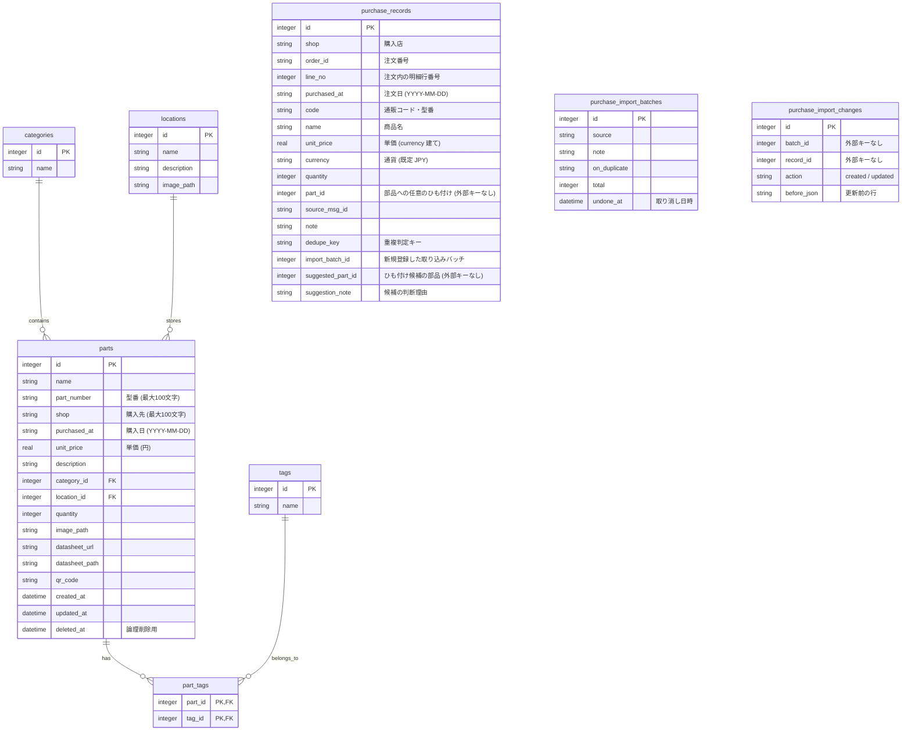

# データベース設計

データベースには **SQLite** を使用しています。
ファイルの実体は `server/database.sqlite` に保存されます。

## ER図 (概念)

`purchase_records.part_id` は `parts.id` を指しますが、外部キー制約は付けていません（下記参照）。

## テーブル定義詳細

### `parts` (パーツ情報)
| カラム名 | 型 | 説明 |
| --- | --- | --- |
| `id` | INTEGER | 主キー (AUTOINCREMENT) |
| `name` | TEXT | パーツ名 (必須) |
| `part_number` | TEXT | 型番 (任意、最大100文字、インデックス `idx_parts_part_number` 設定。完全一致・前方一致や `ORDER BY part_number` ソートに有効。※中間一致検索 `LIKE '%...%'` ではインデックスは使用されません) |
| `shop` | TEXT | 購入先 (任意、最大100文字。マスタは持たず自由入力。過去の値は `GET /api/parts/shops` で候補表示) |
| `purchased_at` | TEXT | 購入日 (任意、`YYYY-MM-DD`) |
| `unit_price` | REAL | 単価 (任意、円、0以上) |
| `description` | TEXT | 詳細説明 |
| `category_id` | INTEGER | `categories.id` への外部キー |
| `location_id` | INTEGER | `locations.id` への外部キー |
| `quantity` | INTEGER | 在庫数 (デフォルト: 0) |
| `image_path` | TEXT | アップロードされた画像のパス (`/uploads/...`) |
| `datasheet_url` | TEXT | 外部データシートURL |
| `datasheet_path` | TEXT | アップロードされたPDFのパス (`/uploads/...`) |
| `qr_code` | TEXT | 個別QRコード (UNIQUE) |
| `created_at` | DATETIME | 作成日時 |
| `updated_at` | DATETIME | 更新日時 |
| `deleted_at` | DATETIME | 削除日時 (NULLなら有効、日時が入っていればゴミ箱) |

### `categories` (カテゴリマスタ)
| カラム名 | 型 | 説明 |
| --- | --- | --- |
| `id` | INTEGER | 主キー |
| `name` | TEXT | カテゴリ名 (例: Resistors, ICs) |
| `display_order` | INTEGER | 表示順 (0, 1, 2...) |

### `locations` (保管場所マスタ)
| カラム名 | 型 | 説明 |
| --- | --- | --- |
| `id` | INTEGER | 主キー |
| `name` | TEXT | 場所名 (例: Box A) |
| `description` | TEXT | 場所の説明 |
| `image_path` | TEXT | 保管場所の写真パス (`/uploads/...`) |
| `display_order` | INTEGER | 表示順 (0, 1, 2...) |

### `tags` (タグマスタ)
| カラム名 | 型 | 説明 |
| --- | --- | --- |
| `id` | INTEGER | 主キー |
| `name` | TEXT | タグ名 (UNIQUE) |
| `display_order` | INTEGER | 表示順 (0, 1, 2...) |

### `part_tags` (中間テーブル)
パーツとタグの多対多関係を管理します。
| カラム名 | 型 | 説明 |
| --- | --- | --- |
| `part_id` | INTEGER | `parts.id` への外部キー |
| `tag_id` | INTEGER | `tags.id` への外部キー |
-   複合主キー: `(part_id, tag_id)`
-   `ON DELETE CASCADE` により、親データ削除時に自動的に紐付けも削除されます。

### `storage_logs` (入庫・保管場所移動履歴)
QR「しまう」操作等による保管場所への移動履歴を記録します。
| カラム名 | 型 | 説明 |
| --- | --- | --- |
| `id` | INTEGER | 主キー (AUTOINCREMENT) |
| `part_id` | INTEGER | `parts.id` への外部キー |
| `location_id` | INTEGER | 移動先の `locations.id` への外部キー |
| `previous_location_id` | INTEGER | 移動前の保管場所ID（NULL可。保管場所削除を妨げないため外部キー制約は付けない） |
| `memo` | TEXT | メモ |
| `created_at` | DATETIME | 作成日時 |

### `purchase_records` (購入履歴)
メールの注文内容などから取り込んだ購入明細です。1 レコードが注文の 1 明細で、何をいつどこでいくつ買ったかを記録する台帳として使います。`parts` の `shop` / `purchased_at` / `unit_price`（最新の購入の要約）とは基本的に独立していますが、明細を部品にひも付けたとき（`PATCH` で `part_id` を設定、または候補の承認）に、部品側を「最新の購入の要約」として自動で更新します（規則は `docs/API.md` 11章）。一括取り込みでのひも付けでは更新しません。
| カラム名 | 型 | 説明 |
| --- | --- | --- |
| `id` | INTEGER | 主キー (AUTOINCREMENT) |
| `shop` | TEXT | 購入店 (必須、最大100文字) |
| `order_id` | TEXT | 注文番号 (任意、最大100文字) |
| `line_no` | INTEGER | 注文内の明細行番号 (任意、0以上) |
| `purchased_at` | TEXT | 注文日 (任意、`YYYY-MM-DD`) |
| `code` | TEXT | 店の通販コードまたはメーカー型番 (任意、最大100文字) |
| `name` | TEXT | メール記載の商品名 (必須、最大500文字) |
| `unit_price` | REAL | 単価 (任意、0以上。`currency` 建てで、換算はしない) |
| `currency` | TEXT | 通貨コード (必須、デフォルト `JPY`) |
| `quantity` | INTEGER | 数量 (任意、0以上) |
| `part_id` | INTEGER | ひも付ける `parts.id` (任意)。**外部キー制約は付けない**。部品の完全削除時にアプリ側 (`permanentlyDeleteParts`) が `NULL` に戻す |
| `source_msg_id` | TEXT | 元になったメールのメッセージ ID (任意、最大200文字) |
| `note` | TEXT | メモ (任意、最大2000文字) |
| `dedupe_key` | TEXT | 重複判定キー (必須)。作り方は API 仕様書 (`docs/API.md` 11章) を参照 |
| `import_batch_id` | INTEGER | この行を新規登録した取り込みバッチ (`purchase_import_batches.id`)。外部キーは付けない。バッチを使わずに作った行は NULL |
| `suggested_part_id` | INTEGER | ひも付け候補の `parts.id` (任意)。AI が迷ったものを登録し、人が画面で承認すると `part_id` に移る。**外部キー制約は付けない**。部品の完全削除時に `NULL` に戻す |
| `suggestion_note` | TEXT | 候補にした判断理由 (任意、最大1000文字)。候補を承認・却下・`part_id` 設定したときは `NULL` に戻す |
| `created_at` | DATETIME | 作成日時 |
| `updated_at` | DATETIME | 更新日時 (アプリが更新するときはミリ秒まで記録する) |

インデックス:
-   `idx_purchase_records_dedupe`: `(shop, dedupe_key)` の UNIQUE。同じ明細の二重登録を防ぎます
-   `idx_purchase_records_part_id`: `part_id`
-   `idx_purchase_records_order`: `(shop, order_id)`
-   `idx_purchase_records_suggested`: `suggested_part_id`

バックアップ (`backup_data.json`) には `purchaseRecords`、`purchaseImportBatches`、`purchaseImportChanges` として含まれます。復元は全置換のため、`purchaseRecords` を含まない古いバックアップから復元すると購入履歴は空になります。

### `purchase_import_batches` (購入履歴の取り込みバッチ)
`POST /api/purchases/import`（`dry_run` なし）1 回につき 1 行が作られます。取り込み単位で取り消す（`POST /api/purchases/batches/:id/undo`）ための記録で、取り消したあとも残ります。
| カラム名 | 型 | 説明 |
| --- | --- | --- |
| `id` | INTEGER | 主キー (AUTOINCREMENT) |
| `source` | TEXT | 取り込み元の名前 (任意、最大100文字。例: `muse`) |
| `note` | TEXT | メモ (任意、最大1000文字) |
| `on_duplicate` | TEXT | `skip` または `update` |
| `total` | INTEGER | 受け取った明細数 |
| `created_count` | INTEGER | 新規登録した件数 |
| `updated_count` | INTEGER | 上書きした件数 |
| `skipped_count` | INTEGER | 重複でスキップした件数 |
| `error_count` | INTEGER | エラーの件数 |
| `created_at` | DATETIME | 取り込みの完了時刻 (ミリ秒まで。取り消し時に「取り込み後に変更された明細」を判定する基準) |
| `undone_at` | DATETIME | 取り消した日時 (取り消していなければ NULL) |

### `purchase_import_changes` (取り込みバッチの変更記録)
バッチが変更した明細の記録です。`skipped` と `error` は記録しません。外部キー制約は付けません。
| カラム名 | 型 | 説明 |
| --- | --- | --- |
| `id` | INTEGER | 主キー (AUTOINCREMENT)。取り消しはこの降順に行う |
| `batch_id` | INTEGER | `purchase_import_batches.id` |
| `record_id` | INTEGER | `purchase_records.id` |
| `action` | TEXT | `created`（新規登録。取り消しで削除）または `updated`（上書き。取り消しで `before_json` に戻す） |
| `before_json` | TEXT | `updated` のときの更新前の行 (`purchase_records` の全列を JSON で)。同じバッチで同じ行を複数回変えても、取り込み前の 1 回分だけ残す |

インデックス: `idx_purchase_import_changes_batch` (`batch_id`)、`idx_purchase_import_changes_record` (`record_id`)
