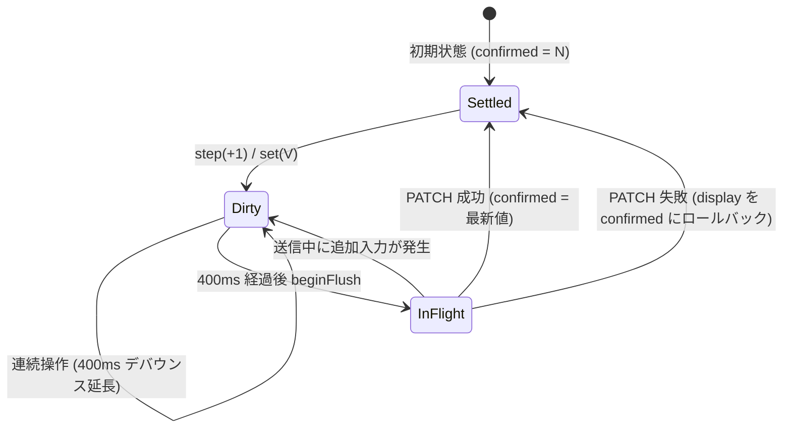

# フロントエンド設計

## 概要
Vue 3 (Composition API) + Vite で構築されたシングルページアプリケーション（SPA）です。
デスクトップでの高密度な業務効率（Linear / Raycast 風の精緻な 1px ボーダーと等幅型番表示）と、スマートフォン（幅 768px 以下 / 390px PWA）での快適な片手操作性を両立したデザインシステムを採用しています。

フォントには欧文・数字に `Geist` / `Geist Mono`、和文に `Noto Sans JP` を採用し、CSS カスタムプロパティ（CSS 変数）による厳密なトークン管理を行っています。

---

## 1. デザイントークン体系 (`client/src/style.css`)

CSS 変数はダークテーマ（デフォルト）とライトテーマで自動/手動切り替えに対応しています。未定義変数や直接の生カラー（#hex, rgba()）は排され、テストランナーでゼロが保証されています。

### 色トークン
| トークン名 | ダーク値（例） | ライト値（例） | 用途 |
|---|---|---|---|
| `--bg` | `#0e0f12` | `#fbfbfc` | アプリケーション最背面背景 |
| `--surface` | `#15171c` | `#ffffff` | カード、サイドバー、モーダル背景 |
| `--surface-2` | `#1c1f25` | `#f3f4f6` | 入力欄背景、サブセクション背景 |
| `--surface-hover` | `#1c1f25` | `#f3f4f6` | ホバー時の面背景 |
| `--border` | `#262a31` | `#e5e7eb` | 基本 1px ボーダー |
| `--border-strong` | `#3a3f4a` | `#d1d5db` | 強調ボーダー、ホバー時ボーダー |
| `--text` | `#e8eaed` | `#111827` | 本文・主見出しテキスト |
| `--text-2` | `#a8aebb` | `#4b5563` | 補助テキスト、ラベル、型番なしの部品名 |
| `--text-3` | `#8a909c` | `#9ca3af` | 補足テキスト、メタ情報、注記 |
| `--accent` | `#8b93ff` | `#4f46e5` | 主アクセント、選択状態、フォーカスリング |
| `--accent-soft` | `rgba(139, 147, 255, 0.16)` | `rgba(79, 70, 229, 0.1)` | アクセント背景（選択バッジ等） |
| `--ok` / `--ok-bg` / `--ok-fg` | `#4ade80` / `rgba(74,222,128,0.12)` | `#16a34a` / `#dcfce7` | 在庫あり（正常・成功） |
| `--warn` / `--warn-bg` / `--warn-fg` | `#fbbf24` / `rgba(251,191,36,0.12)` | `#d97706` / `#fef3c7` | 残りわずか（警告） |
| `--ng` / `--ng-bg` / `--ng-fg` | `#f87171` / `rgba(248,113,113,0.14)` | `#dc2626` / `#fee2e2` | 在庫切れ（エラー・危険） |
| `--overlay` | `rgba(0, 0, 0, 0.6)` | `rgba(17, 19, 24, 0.4)` | モーダル背景幕 |
| `--cat-0` 〜 `--cat-7` | 各種パレット色 | 各種パレット色 | カテゴリ識別用インジケータードット |

### 寸法・タイポグラフィ・シャドウ
- **フォント**: `--font-sans`（Geist + Noto Sans JP）、`--font-mono`（Geist Mono）
- **文字サイズ**: `--fs-11` (11px), `--fs-12` (12px), `--fs-13` (13px), `--fs-14` (14px), `--fs-16` (16px), `--fs-20` (20px)
- **角丸**: `--radius-sm` (6px), `--radius-md` (8px), `--radius-lg` (10px), `--radius-xl` (12px)
- **シャドウ**: `--shadow-sm`, `--shadow-md`, `--shadow-lg`

---

## 2. レイアウト構成

画面幅 769px 以上のデスクトップ環境と、768px 以下のモバイル環境でレイアウトがレスポンシブに切り替わります。

### PC レイアウト
```mermaid
flowchart LR
    subgraph PCLayout [デスクトップレイアウト (幅 > 768px)]
        Sidebar[AppSidebar: 240px<br/>ロゴ / ナビ / カテゴリ集計 / テーマ]
        subgraph MainArea [メインコンテンツエリア]
            TopBar[AppTopBar: 52px<br/>パンくず / 検索⌘K / 表示切替]
            FilterBar[FilterBar<br/>状態フィルタ / 在庫僅少 / ソート]
            Content[PartsList / Views<br/>Grid S/M/L または Table リスト]
            TopBar --> FilterBar --> Content
        end
        Sidebar --- MainArea
    end
```

### モバイル レイアウト
```mermaid
flowchart TD
    subgraph MobileLayout [モバイルレイアウト (幅 <= 768px)]
        MobileTopBar[AppTopBar<br/>検索 / 簡易表示切替]
        MobileFilter[FilterBar<br/>横スクロールチップ]
        MobileList[PartsList<br/>スタック行表示固定]
        CameraFab[CameraFab<br/>右下固定カメラボタン]
        TabBar[MobileTabBar: 64px<br/>パーツ / 保管庫 / 使用済 / QR / その他]
        MoreSheet[MobileMoreSheet<br/>ボトムシートメニュー]

        MobileTopBar --> MobileFilter --> MobileList
        MobileList -. 重なり防止 .-> CameraFab
        MobileList -. 重なり防止 .-> TabBar
        TabBar -. タップ .-> MoreSheet
    end
```

---

## 3. 数量同期エンジン (`useQuantitySync`)

部品の数量変更（ステッパーの `+` / `-` 連打、数字クリックによる直接入力）において、UI の即時追従（楽観的更新）とサーバー整合性を保証する堅牢な同期ロジックです。



### ライフサイクル保護
- **即時保存 (`flushAll`)**: 画面遷移（サイドバーでの別ビュー選択）、コンポーネントアンマウント時に保留中の変更を即座に送信。
- **ブラウザ離脱保護**: `visibilitychange`、`pagehide`、`beforeunload` イベントを監視し、未送信キューがある場合は即時 flush を実行。`beforeunload` では警告を表示。
- **直列送信保護**: 1 部品あたりのリクエストは常に直列化され、並行 PATCH による競合を防止。

---

## 4. トースト通知基盤 (`useToast` / `ToastHost.vue`)

- **通知上限**: 最大 3 件。新しい通知が入ると古い通知から自然に押し出されます。
- **自動消去と一時停止**:
  - success / info: 2500ms
  - warning: 4000ms
  - error: 5000ms
  - トーストへのマウスホバー（`mouseenter`）やフォーカス（`focusin`）中はタイマーが一時停止し、離れると再開します。
- **アクセシビリティ (ARIA)**:
  - `role="status"` (`aria-live="polite"`): 通常の完了通知用
  - `role="alert"` (`aria-live="assertive"`): エラー通知用
  - 2 つの独立した常設ライブリージョンに分離し、読み上げ競合を解消しています。

---

## 5. キーボードショートカット (`useShortcuts.js`)

PC 環境での高速操作を支援するキーバインドが提供されています。

| キー | 動作 | 条件・ガード |
|---|---|---|
| `/` | 検索欄へフォーカス | input / textarea フォーカス外、IME 変換中でないこと |
| `⌘K` / `Ctrl+K` | 検索欄へフォーカス | どこからでも発火可能（入力中も含む） |
| `n` | 新規パーツ登録モーダルを開く | input / textarea フォーカス外、モーダル表示中でないこと |
| `Esc` | 検索クリア / モーダルやシートを閉じる | モーダルやシートが開いている場合はそれを優先して閉じる |

---

## 6. 主要コンポーネント構成 (`client/src/components/`)

### パーツ一覧・表示
- `PartsList.vue`: パーツ管理の主画面。件数集計、複数選択一括操作、ページネーション/グリッドサイズ管理。
- `parts/PartCard.vue`: 案A 高密度パーツカード。型番（等幅）優先表示、カテゴリドット、保管場所、在庫バー、ステッパー。
- `parts/PartRow.vue`: テーブル行（PC table モード）およびスタック行（モバイル stack モード）の描画。
- `parts/QuantityStepper.vue`: sm / md 対応の数量ステッパー。数字クリックでの直接入力（IME 対応・Esc 取消）をサポート。
- `parts/FilterBar.vue`: カテゴリ・保管場所・タグ・在庫状態（すべて / 僅少 / 切れ）の絞り込みバー。
- `parts/PartCardSkeleton.vue`: card / row / stack 各形状に対応したシマー骨組み。

### シェル・レイアウト
- `layout/AppSidebar.vue`: PC 左サイドバー。カテゴリ別件数バッジ、マスタ/データ管理導線、テーマ切替。
- `layout/AppTopBar.vue`: 上部バー。パンくず、検索バー（⌘K）、グリッド（S/M/L）/リスト切り替え。
- `layout/MobileTabBar.vue`: モバイル下部 5 タブ固定バー（セーフエリア対応）。
- `layout/MobileMoreSheet.vue`: モバイル「その他」ボトムシート。
- `layout/CameraFab.vue`: モバイル用カメラ起動フローティングアクションボタン。
- `layout/ThemeSwitch.vue`: システム / ダーク / ライトの 3 択セグメントスイッチ。

### モーダル・詳細
- `PhotoLightboxModal.vue`: 写真の拡大表示（ライトボックス）。テーマ非依存の暗いクローム、Esc・背景/余白クリック・× ボタンで閉じる。「詳細・編集」ボタンから PartForm へ遷移。ダイアログ a11y（`role="dialog"`, `aria-modal="true"`）およびフォーカストラップ・復帰制御を実装。
- `PartForm.vue`: パーツの新規追加および詳細・編集モーダル。

### 写真クリックの挙動
一覧（PartCard / PartRow）の写真サムネイルをクリック（タップ）した際、`hasPreviewablePhoto` により写真が登録されている部品は `PhotoLightboxModal` が開き高解像度プレビューが表示されます。写真が未設定の部品をクリックした場合は直接 `PartForm`（編集モーダル）が開きます。ライトボックス内の「詳細・編集」ボタンからも編集モーダルへ遷移可能です。
