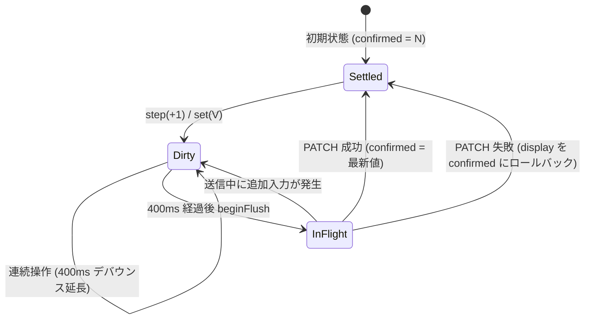

# フロントエンド設計

## 概要
Vue 3 (Composition API) + Vite で構築されたシングルページアプリケーション（SPA）です。
デスクトップでの高密度な業務効率（Linear / Raycast 風の精緻な 1px ボーダーと等幅型番表示）と、スマートフォン（幅 768px 以下 / 390px PWA）での快適な片手操作性を両立したデザインシステムを採用しています。

フォントには欧文・数字に `Geist` / `Geist Mono`、和文に `Noto Sans JP` を採用し、CSS カスタムプロパティ（CSS 変数）による厳密なトークン管理を行っています。

---

## 1. デザイントークン体系 (`client/src/style.css`)

CSS 変数はダークテーマ（デフォルト）とライトテーマで自動/手動切り替えに対応しています。未定義変数や直接の生カラー（#hex, rgba()）は排され、テストランナーでゼロが保証されています。

### 色トークン
| トークン名 | ダーク値（例） | ライト値（例） | 用途 |
|---|---|---|---|
| `--bg` | `#0e0f12` | `#fbfbfc` | アプリケーション最背面背景 |
| `--surface` | `#15171c` | `#ffffff` | カード、サイドバー、モーダル背景 |
| `--surface-2` | `#1c1f25` | `#f3f4f6` | 入力欄背景、サブセクション背景 |
| `--surface-hover` | `#1c1f25` | `#f3f4f6` | ホバー時の面背景 |
| `--border` | `#262a31` | `#e5e7eb` | 基本 1px ボーダー |
| `--border-strong` | `#3a3f4a` | `#d1d5db` | 強調ボーダー、ホバー時ボーダー |
| `--text` | `#e8eaed` | `#111827` | 本文・主見出しテキスト |
| `--text-2` | `#a8aebb` | `#4b5563` | 補助テキスト、ラベル、型番なしの部品名 |
| `--text-3` | `#8a909c` | `#9ca3af` | 補足テキスト、メタ情報、注記 |
| `--accent` | `#8b93ff` | `#4f46e5` | 主アクセント、選択状態、フォーカスリング |
| `--accent-soft` | `rgba(139, 147, 255, 0.16)` | `rgba(79, 70, 229, 0.1)` | アクセント背景（選択バッジ等） |
| `--ok` / `--ok-bg` / `--ok-fg` | `#4ade80` / `rgba(74,222,128,0.12)` | `#16a34a` / `#dcfce7` | 在庫あり（正常・成功） |
| `--warn` / `--warn-bg` / `--warn-fg` | `#fbbf24` / `rgba(251,191,36,0.12)` | `#d97706` / `#fef3c7` | 残りわずか（警告） |
| `--ng` / `--ng-bg` / `--ng-fg` | `#f87171` / `rgba(248,113,113,0.14)` | `#dc2626` / `#fee2e2` | 在庫切れ（エラー・危険） |
| `--overlay` | `rgba(0, 0, 0, 0.6)` | `rgba(17, 19, 24, 0.4)` | モーダル背景幕 |
| `--cat-0` 〜 `--cat-7` | 各種パレット色 | 各種パレット色 | カテゴリ識別用インジケータードット |

### 寸法・タイポグラフィ・シャドウ
- **フォント**: `--font-sans`（Geist + Noto Sans JP）、`--font-mono`（Geist Mono）
- **文字サイズ**: `--fs-11` (11px), `--fs-12` (12px), `--fs-13` (13px), `--fs-14` (14px), `--fs-16` (16px), `--fs-20` (20px)
- **角丸**: `--radius-sm` (6px), `--radius-md` (8px), `--radius-lg` (10px), `--radius-xl` (12px)
- **シャドウ**: `--shadow-sm`, `--shadow-md`, `--shadow-lg`

---

## 2. レイアウト構成

画面幅 769px 以上のデスクトップ環境と、768px 以下のモバイル環境でレイアウトがレスポンシブに切り替わります。

### PC レイアウト
```mermaid
flowchart LR
    subgraph PCLayout [デスクトップレイアウト (幅 > 768px)]
        Sidebar[AppSidebar: 240px<br/>ロゴ / ナビ / カテゴリ集計 / テーマ]
        subgraph MainArea [メインコンテンツエリア]
            TopBar[AppTopBar: 52px<br/>パンくず / 検索⌘K / 表示切替]
            FilterBar[FilterBar<br/>状態フィルタ / 在庫僅少 / ソート]
            Content[PartsList / Views<br/>Grid S/M/L または Table リスト]
            TopBar --> FilterBar --> Content
        end
        Sidebar --- MainArea
    end
```

### モバイル レイアウト
```mermaid
flowchart TD
    subgraph MobileLayout [モバイルレイアウト (幅 <= 768px)]
        MobileTopBar[AppTopBar<br/>検索 / 簡易表示切替]
        MobileFilter[FilterBar<br/>横スクロールチップ]
        MobileList[PartsList<br/>スタック行表示固定]
        CameraFab[CameraFab<br/>右下固定カメラボタン]
        TabBar[MobileTabBar: 64px<br/>パーツ / 保管庫 / 使用済 / QR / その他]
        MoreSheet[MobileMoreSheet<br/>ボトムシートメニュー]
        QrScanner[QrScanner<br/>QRスキャン / 入出庫画面]

        MobileTopBar --> MobileFilter --> MobileList
        MobileList -. 重なり防止 .-> CameraFab
        MobileList -. 重なり防止 .-> TabBar
        TabBar -. タップ .-> MoreSheet
        TabBar -. タップ (QR画面でも常時表示) .-> QrScanner
    end
```

#### 画面切り替えとナビゲーション
- **ハッシュルーティング**: `#/qr` で QR 画面（`QrScanner`）、それ以外（`#/` 等）で通常画面（`.app-shell`）を切り替えます。
- **QR 画面からの復帰動線**: QR 画面でも `MobileTabBar` が常時表示され、他タブ選択時に `leaveQrPage()` を経由して通常画面へ復帰します。また、ヘッダーの「← メイン画面」リンクは `href="#/"` による再読み込み無しの SPA 内遷移です。

#### セーフエリア対応（ノッチ / Dynamic Island / ホームバー）
- **設計作法**: セーフエリアInsetは CSS の `calc(既存の余白 + env(safe-area-inset-*))` で付与します。
- **上部余白 (`safe-area-inset-top`)**: 通常画面のトップバー（`.app-topbar`）および QR 画面（`.qr-app`）に付与し、PWA standalone モード（`viewport-fit=cover`）でのステータスバーやノッチとの重なりを防止します。
- **下部余白 (`safe-area-inset-bottom`)**: タブバー（`MobileTabBar`）、浮動ボタン（`CameraFab`）、ボトムシート（`MobileMoreSheet`）、トースト（`ToastHost`）、および QR 画面のスクロール領域下部（`padding-bottom: calc(var(--tabbar-h) + env(safe-area-inset-bottom) + 0.5rem)`）に付与し、ホームインジケーターやタブバーとの被りを防止します。

---

## 3. 数量同期エンジン (`useQuantitySync`)

部品の数量変更（ステッパーの `+` / `-` 連打、数字クリックによる直接入力）において、UI の即時追従（楽観的更新）とサーバー整合性を保証する堅牢な同期ロジックです。



### ライフサイクル保護
- **即時保存 (`flushAll`)**: 画面遷移（サイドバーでの別ビュー選択）、コンポーネントアンマウント時に保留中の変更を即座に送信。
- **ブラウザ離脱保護**: `visibilitychange`、`pagehide`、`beforeunload` イベントを監視し、未送信キューがある場合は即時 flush を実行。`beforeunload` では警告を表示。
- **直列送信保護**: 1 部品あたりのリクエストは常に直列化され、並行 PATCH による競合を防止。

---

## 4. トースト通知基盤 (`useToast` / `ToastHost.vue`)

- **通知上限**: 最大 3 件。新しい通知が入ると古い通知から自然に押し出されます。
- **自動消去と一時停止**:
  - success / info: 2500ms
  - warning: 4000ms
  - error: 5000ms
  - トーストへのマウスホバー（`mouseenter`）やフォーカス（`focusin`）中はタイマーが一時停止し、離れると再開します。
- **アクセシビリティ (ARIA)**:
  - `role="status"` (`aria-live="polite"`): 通常の完了通知用
  - `role="alert"` (`aria-live="assertive"`): エラー通知用
  - 2 つの独立した常設ライブリージョンに分離し、読み上げ競合を解消しています。

---

## 5. キーボードショートカット (`useShortcuts.js`)

PC 環境での高速操作を支援するキーバインドが提供されています。

| キー | 動作 | 条件・ガード |
|---|---|---|
| `/` | 検索欄へフォーカス | input / textarea フォーカス外、IME 変換中でないこと |
| `⌘K` / `Ctrl+K` | 検索欄へフォーカス | どこからでも発火可能（入力中も含む） |
| `n` | 新規パーツ登録モーダルを開く | input / textarea フォーカス外、モーダル表示中でないこと |
| `Esc` | 検索クリア / モーダルやシートを閉じる | モーダルやシートが開いている場合はそれを優先して閉じる |

---

## 6. 主要コンポーネント構成 (`client/src/components/`)

### パーツ一覧・表示
- `PartsList.vue`: パーツ管理の主画面。件数集計、複数選択一括操作、ページネーション/グリッドサイズ管理。
- `parts/PartCard.vue`: 案A 高密度パーツカード。型番（等幅）優先表示、カテゴリドット、保管場所、在庫バー、ステッパー。
- `parts/PartRow.vue`: テーブル行（PC table モード）およびスタック行（モバイル stack モード）の描画。
- `parts/QuantityStepper.vue`: sm / md 対応の数量ステッパー。数字クリックでの直接入力（IME 対応・Esc 取消）をサポート。
- `parts/FilterBar.vue`: カテゴリ・保管場所・タグ・在庫状態（すべて / 僅少 / 切れ）の絞り込みバー。
- `parts/PartCardSkeleton.vue`: card / row / stack 各形状に対応したシマー骨組み。

### シェル・レイアウト
- `layout/AppSidebar.vue`: PC 左サイドバー。カテゴリ別件数バッジ、マスタ/データ管理導線、テーマ切替。
- `layout/AppTopBar.vue`: 上部バー。パンくず、検索バー（⌘K）、グリッド（S/M/L）/リスト切り替え。
- `layout/MobileTabBar.vue`: モバイル下部 5 タブ固定バー（セーフエリア対応）。
- `layout/MobileMoreSheet.vue`: モバイル「その他」ボトムシート。
- `layout/CameraFab.vue`: モバイル用カメラ起動フローティングアクションボタン。
- `layout/ThemeSwitch.vue`: システム / ダーク / ライトの 3 択セグメントスイッチ。

### モーダル・詳細
- `PhotoLightboxModal.vue`: 写真の拡大表示（ライトボックス）。テーマ非依存の暗いクローム、Esc・背景/余白クリック・× ボタンで閉じる。「詳細・編集」ボタンから PartForm へ遷移。ダイアログ a11y（`role="dialog"`, `aria-modal="true"`）およびフォーカストラップ・復帰制御を実装。
- `PartForm.vue`: パーツの新規追加および詳細・編集モーダル。編集時かつゴミ箱外（`canTrash`）ではフッター左端に「ゴミ箱へ移動」ボタンを表示（QRコード解除の警告付き確認ダイアログ）。ゴミ箱内から開いた場合（`canRestore`）は排他的に「ゴミ箱から復元」ボタンを表示（編集内容破棄の確認付き）。一覧の一括操作バー（`PartsList.vue`）でもゴミ箱移動（QR解除警告付き）・完全削除（取り消し不可警告付き）の確認ダイアログおよび連打防止（`bulkBusy`）を提供。
- `AiSuggestionReviewModal.vue`: AI 部品名判定の候補確認・編集・一括採用モーダル。判定時写真のホバー拡大プレビューおよびクリックによる詳細拡大ダイアログを統合。
- `ImageZoomDialog.vue`: モーダル上の写真確認専用の軽量拡大ダイアログ（`z-index: 1200`）。ダイアログ a11y、フォーカストラップ、Escape / 背景クリックでのクローズ、背面スクロール抑止を提供。

### 写真クリックの挙動
一覧（PartCard / PartRow）の写真サムネイルをクリック（タップ）した際、`hasPreviewablePhoto` により写真が登録されている部品は `PhotoLightboxModal` が開き高解像度プレビューが表示されます。写真が未設定の部品をクリックした場合は直接 `PartForm`（編集モーダル）が開きます。ライトボックス内の「詳細・編集」ボタンからも編集モーダルへ遷移可能です。
AI 判定候補レビュー画面では、写真サムネイルが `<button class="thumb-btn">` として機能し、マウス環境でのホバー拡大ポップアップ（250ms 遅延、最大 480px、左側優先）に加え、クリックまたはタップにより `ImageZoomDialog` が開いて大きく閲覧できます。

---

## 7. PWA キャッシュ制御と新バージョン自動検知・適用基盤

iOS Safari / PWA（standalone）環境において、デプロイ後も古い Service Worker プリキャッシュ（`index.html` 等）が永続保持されて新画面が反映されない問題を防ぐため、新バージョン自動検知・パージ・安全リロード基盤を導入しています。

### アーキテクチャと検知フロー
1. **ビルド識別子の発行 (`__APP_BUILD_ID__` / `version.json`)**:
   - ビルド時にコミットハッシュとタイムスタンプからユニークな `buildId` を生成し、JS 内（`__APP_BUILD_ID__`）および静的成果物 `dist/version.json` の双方へ出力。
2. **Service Worker 登録制御 (`registerServiceWorker.js`)**:
   - `workbox-window` を用いて自前登録。`skipWaiting: true`, `clientsClaim: true` により新 SW を即時アクティベートしつつ、標準の無条件リロードを抑止。
3. **定期・復帰時の鮮度検証 (`useAppUpdate.js` / `updatePolicy.js`)**:
   - 起動時（`onMounted`）およびアプリ復帰時（`visibilitychange: visible`）に、60秒のインターバル制御を挟み `/version.json`（`Cache-Control: no-store`）を取得。
   - `vite:preloadError`（遅延チャンク取得失敗）および SW の `activated`（新 SW 有効化）時は、間隔制御を通さず即時に更新判定を実施。
4. **安全な適用とユーザー作業保護**:
   - **編集中・モーダル表示中・一括選択中・数量同期送信待ち (`isBusy: true`)**: 自動リロードを行わず、操作ボタン付きのトースト（「新しいバージョンがあります」[更新]）で通知。リロード直前にも `isBusy` を再確認して作業内容を保護（手動の「更新」ボタン押下時は即時適用）。
   - **通常時 (`isBusy: false`)**: `controllerchange` の伝播を待ってから `window.location.reload()` を実行（待機発生時はトースト表示。初期化時から既に切り替わっている場合は待たずに即時適用）。
5. **リロードループ防止（ガード機構）**:
   - `sessionStorage` の `epm_update_guard` に試行状況を記録。同一バージョンに対する自動リロードは最大 1 回までに制限し、解決しない場合は警告通知を出して停止。
6. **プリキャッシュ削除のスコープ限定**:
   - コントローラー切り替えのフォールバック時（8秒以内に新しい SW への切り替えが完了しなかった場合のみ）、削除対象は `workbox-precache` で始まるプリキャッシュのみに限定。正常に切り替わった場合は削除を行わず、新しいオフラインキャッシュを維持。日本語フォントキャッシュ（`epm-fonts-jp`）も常に維持し、オフライン時・回線節約に影響を与えません。

---

## 8. QR「しまう」連続格納・部品カード表示と取り消し（アンドゥ）

QR入出庫の「しまう」モードにおいて、連続スキャン作業の視認性と誤操作時のリカバリー性を高めるため、スキャン済み部品カードリストと「戻す（取り消し）」機能を提供しています。

### アーキテクチャとコンポーネント構成
1. **部品カード部品 (`components/qr/StoredPartCard.vue`)**:
   - 写真サムネイル（40×40、`object-fit: cover`、未設定時は `chip` アイコンプレースホルダー）、部品名（1行省略記号）、型番（等幅フォント `.mono`）、数量、元の保管場所（`元: 棚A`）を表示。
   - スキャン直後・更新直後は背景が 0.6 秒間 `--accent-soft` でハイライト。
   - 状態（`status`）に応じたスタイルと操作制御：
     - `stored`: 通常表示。「戻す」ボタン表示。
     - `undoing`: 処理中。「戻しています…」でボタン無効化。
     - `undone`: 半透明（`opacity: 0.6`）、部品名に取り消し線、「取り消しました（→ 元の場所）」を表示。「戻す」ボタン非表示。
     - `unchanged`: 「既にこの保管場所にあります」を表示。「戻す」ボタン非表示。
     - `error`: エラーメッセージを `--ng-fg` で表示。再試行不可（409等）の場合は「戻す」ボタン非表示、通信エラー等の場合は再試行ボタンとして維持。
2. **純粋関数状態管理 (`utils/storeSession.js`)**:
   - `addStoreResult`: スキャン結果を配列先頭に追加（新しい順）。同じ部品が既にあり未取り消しの場合は先頭に移動し件数は増やさない。
   - `markUndoing` / `markUndone` / `markUndoError`: イミュータブルに状態を更新。
   - `activeCount`: 格納済み（`stored`）の有効件数を算出。
   - `shouldIgnoreScan`: 同じ QR コードが 3 秒以内に連続検出された場合に再読み取りを無視。
3. **連続スキャンの最適化 (`html5-qrcode` pause / resume)**:
   - 「しまう」の部品スキャン（`scan-store-part`）時のみ、カメラ停止・再起動（`stopScanner` / `startScanner`）によるチラつきや遅延を避けるため、読み取り成功時に `pause(true)` で映像を一時停止し、API完了後に `resume()` で即時再開。例外時は `startScanner` へ安全にフォールバック。
   - メニュー復帰や完了画面遷移、アンマウント時は完全に `stopScanner()` を実行し、カメラリソースを解放。
4. **レイアウトと操作性（モバイルファースト）**:
   - 上から順に「スキャン指示（しまった件数表示）」→「カメラ枠（ガタつき防止の `min-height: 240px`）」→「アクションボタン（✅ 完了 / ← 戻る）」→「スキャン済み部品カード一覧（新しい順）」と配置。
   - 登録完了画面（`store-done`）でも同一の部品カード一覧が表示され、完了画面上からも即座に取り消しが可能。

---

## 9. AI 部品名判定レビューと写真プレビュー（ホバー拡大 / ダイアログ）

AI が写真から部品名を推定した候補の確認・手直し画面（`AiSuggestionReviewModal.vue`）において、小さな部品形状や刻印を迅速かつ確実に目視確認できるよう、ホバー拡大プレビューと拡大ダイアログを提供しています。

### ホバー拡大プレビュー (`useHoverImagePreview.js` / `hoverPreview.js`)
- **マウス環境限定の安全表示**: `(hover: hover) and (pointer: fine)` のメディアクエリを判定し、マウス環境でのみホバープレビューを起動（タッチ端末では誤表示を抑止）。
- **250ms 遅延**: 写真の上をマウスが通過しただけではポップアップせず、意図的にカーソルを置いたときのみ素早く表示。
- **左側優先の位置計算純粋関数 (`computeHoverPreviewPosition`)**:
  - 中央寄せモーダル（960px 幅）の左余白を優先して最大 480×480px の拡大画像（`object-fit: contain`）を配置。これから編集する部品名・型番の入力欄を遮りません。
  - 左余白が不足する場合は写真の右側へフォールバックし、画面端（マージン 16px）からはみ出さないよう自動調整。
- **厳密な非表示制御（D7）**:
  - `mouseleave`、写真押下（`mousedown`）、Escape キー押下、モーダル本体のスクロール（`@scroll`, `@wheel.passive`）、ウィンドウのフォーカス外れ・タブ切り替え（`blur`, `visibilitychange`）、コンポーネント破棄（`onUnmounted`）で即座に非表示。
  - カード採用・却下・一括採用時および件数変更時（`watch`）にも先頭で確実に破棄し、画面上に浮遊・残存する現象を徹底防止。
- **非干渉レンダリング**:
  - `<Teleport to="body">` によりモーダルの `overflow: hidden` に遮られず表示。
  - `pointer-events: none` によりポップアップ自身がマウスイベントを奪って生じるホバーちらつきを防止。

### クリック・タップによる拡大ダイアログ (`ImageZoomDialog.vue`)
- 写真をクリック（または iPhone 等のタッチ環境でタップ、キーボードでの Tab + Enter）すると、ホバープレビューを隠して全画面の暗クローム拡大ダイアログを表示。
- レビューモーダル（`z-index: 1100`）より上位の `z-index: 1200` で前面表示し、Escape キー、背景クリック、右上の閉じるボタンで簡単に閉じ、フォーカスを開く前のボタンへ復元。


