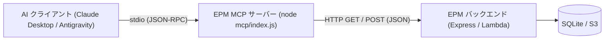
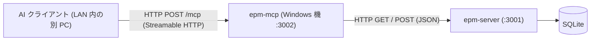

# 外部AI連携 MCP サーバー（参照・更新ツール）

電子パーツ管理アプリ（EPM）は、Model Context Protocol (MCP) を通じた外部 AI アシスタント（Claude Desktop や Antigravity 等）との連携に対応しています。
本 MCP サーバーには、AI クライアントと同じマシンで起動する **stdio 版**（`mcp/index.js`）と、サーバー機に常駐させて LAN 内の別 PC から HTTP で接続する **リモート版**（Streamable HTTP、`mcp/http.js`）があります。リモート版の使い方は「[8. リモート MCP（LAN 内 HTTP 接続）](#8-リモート-mcplan-内-http-接続)」を参照してください。
どちらも同じツールを公開し、在庫の検索・詳細確認・マスタデータ取得などの**参照系**に加え、新規部品の登録、在庫数量の増減・更新、保管場所の格納などの**更新系**操作を自然言語で行えます。

---

## 1. 概要とアーキテクチャ

MCP サーバーは EPM の REST API ラッパーとして動作します。
データベース（SQLite）へ直接アクセスせず、既存の HTTP API を経由してデータを取得・更新するため、DB ロック競合を回避し、LAN 内の Windows サーバーや AWS 本番環境に対しても安全に接続できます。



リモート版では、サーバー機（Windows 機）で MCP を常駐させ、LAN 内の別 PC の AI クライアントから HTTP で接続します。



> [!IMPORTANT]
> **stdio 版の MCP プロセスは AI クライアントが動作するマシン上で起動します**（リモート版を使う場合は不要です）。
> 例えば、Mac 上の Claude Desktop から Windows LAN 機の EPM サーバーに接続する場合、Mac 上に本リポジトリを clone してルートで `npm install` を実行し、Mac 上の Node で `mcp/index.js` を起動します。
> （Windows 機側では `update-and-restart.ps1` が自動更新時に `npm ci` を実行するため、依存関係は自動で解決されます）

---

## 2. 公開ツール一覧

本サーバーは 13 個のツールを公開します（参照系 6 ツール、書き込み系 7 ツール）。

| ツール名 | 分類 | 冪等性 | 説明 |
|---|---|---|---|
| `search_parts` | 参照 (`readOnlyHint: true`) | 冪等 (`idempotentHint: true`) | 電子部品の検索（キーワード・カテゴリ・保管場所） |
| `get_part_detail` | 参照 (`readOnlyHint: true`) | 冪等 (`idempotentHint: true`) | 部品 ID を指定した完全な詳細情報取得 |
| `get_part_image` | 参照 (`readOnlyHint: true`) | 冪等 (`idempotentHint: true`) | 部品写真の画像コンテンツ取得（刻印・型番・形状確認） |
| `list_master_data` | 参照 (`readOnlyHint: true`) | 冪等 (`idempotentHint: true`) | カテゴリ一覧・保管場所一覧の取得 |
| `create_part` | 更新 (`readOnlyHint: false`) | 非冪等 (`idempotentHint: false`) | 新規電子部品の登録（名前解決・型番重複チェック付き） |
| `update_part` | 更新 (`readOnlyHint: false`) | 非冪等 (`idempotentHint: false`) | 既存部品の汎用更新（名前・型番・説明・カテゴリ・購入情報・タグ・数量・保管場所） |
| `update_part_quantity` | 更新 (`readOnlyHint: false`) | 非冪等 (`destructiveHint: true`) | 在庫数量の増減（delta）または絶対値上書き（absolute） |
| `store_part_location` | 更新 (`readOnlyHint: false`) | 冪等 (`idempotentHint: true`) | 部品の保管場所への格納（入出庫ログ記録） |
| `search_purchase_items` | 参照 (`readOnlyHint: true`) | 冪等 (`idempotentHint: true`) | 購入履歴（メール由来の購入明細）の検索 |
| `import_purchase_items` | 更新 (`readOnlyHint: false`) | 冪等 (`idempotentHint: true`) | 購入明細の一括取り込み（重複は登録されない） |
| `update_purchase_item` | 更新 (`readOnlyHint: false`) | 冪等 (`idempotentHint: true`) | 購入明細の更新（部品とのひも付け・解除を含む） |
| `list_import_batches` | 参照 (`readOnlyHint: true`) | 冪等 (`idempotentHint: true`) | 購入履歴の取り込みバッチの一覧 |
| `undo_import_batch` | 更新 (`readOnlyHint: false`) | 非冪等 (`destructiveHint: true`) | 取り込みバッチの取り消し（`confirm: true` が無いときは件数の確認のみ） |

### 2-1. `search_parts`（電子部品検索）

電子部品の在庫をキーワードやカテゴリ、保管場所、購入先で検索します。通常のアクティブな部品のみが対象で、使用済みやゴミ箱の部品は除外されます。

- **入力パラメータ**:
  - `query` (string, 任意): 部品名・型番・説明・購入先の部分一致検索キーワード（最大200文字）
  - `category_id` (integer, 任意): カテゴリID（正の整数）
  - `location_id` (integer, 任意): 保管場所ID（正の整数）
  - `shop` (string, 任意): 購入先での部分一致絞り込み（最大100文字）
  - `limit` (integer, 任意, 既定値: `50`): 返却件数の上限（1〜200）

- **返却例**:
  ```json
  {
    "total": 12,
    "returned": 12,
    "truncated": false,
    "parts": [
      {
        "id": 10,
        "name": "10kΩ 金属皮膜抵抗",
        "part_number": "MF25-10K",
        "shop": "秋月電子通商",
        "quantity": 100,
        "description": "許容差±1%、1/4W…",
        "category": { "id": 1, "name": "抵抗" },
        "location": { "id": 3, "name": "引き出しA-1" },
        "tags": ["抵抗", "リード部品"],
        "image_url": "http://localhost:3001/uploads/mf25.jpg",
        "status": "active",
        "qr_code": "P-0010"
      }
    ]
  }
  ```

### 2-2. `get_part_detail`（部品詳細取得）

部品 ID を指定して、データシートURL、QRコード、作成・更新日時、使用記録などを含む完全な詳細情報（購入先・購入日・単価を含む）を取得します。

- **入力パラメータ**:
  - `id` (integer, 必須): 部品ID（正の整数）

- **返却例**:
  ```json
  {
    "id": 10,
    "name": "10kΩ 金属皮膜抵抗",
    "part_number": "MF25-10K",
    "shop": "秋月電子通商",
    "quantity": 100,
    "description": "許容差±1%、1/4W、金属皮膜抵抗器です。",
    "category": { "id": 1, "name": "抵抗" },
    "location": { "id": 3, "name": "引き出しA-1" },
    "tags": ["抵抗", "リード部品"],
    "image_url": "http://localhost:3001/uploads/mf25.jpg",
    "status": "active",
    "datasheet_url": "https://example.com/datasheet.pdf",
    "purchased_at": "2026-03-01",
    "unit_price": 1.5,
    "qr_code": "P-0010",
    "used_at": null,
    "used_for": null,
    "used_note": null,
    "deleted_at": null,
    "created_at": "2026-01-01T00:00:00.000Z",
    "updated_at": "2026-01-02T00:00:00.000Z"
  }
  ```

### 2-3. `get_part_image`（部品写真取得）

部品 ID を指定して、登録されている部品写真を画像コンテンツ（Base64）として取得します。マルチモーダル AI がチップの刻印や型番、形状、端子配置を視覚的に確認する用途に利用できます。読み取り専用モード（`EPM_MCP_READONLY=1`）でも使用可能です。

- **入力パラメータ**:
  - `id` (integer, 必須): 部品ID（正の整数）

- **対応画像形式**:
  - JPEG / PNG / GIF / WEBP に対応しています。
  - 先頭バイト（Magic Bytes）を最優先として判定し、次いで Content-Type、拡張子、既定値（`image/jpeg`）の順で MIME を決定します。

- **クライアントサイズ上限に関する注意**:
  - 一部のデスクトップ向け MCP クライアントには、ツール実行結果に約 1MiB のサイズ制限が存在することが報告されています。
  - Base64 エンコードによってデータ量は約 4/3 倍となるため、元画像が約 750KB を超える場合はクライアント側で表示エラーとなる可能性があります。
  - 750KB を超える画像の場合、返却テキストに注意文（目安）が付与されます。

- **返却例（画像登録時）**:
  ```json
  [
    {
      "type": "image",
      "data": "<Base64 エンコードされた画像バイナリ>",
      "mimeType": "image/jpeg"
    },
    {
      "type": "text",
      "text": "部品 ID 10 (10kΩ 金属皮膜抵抗) の登録写真です。"
    }
  ]
  ```

- **返却例（画像未登録時）**:
  ```json
  [
    {
      "type": "text",
      "text": "部品 ID 10 (10kΩ 金属皮膜抵抗) には画像が登録されていません。"
    }
  ]
  ```
  ※画像未登録の場合はエラーにならず、テキストのみが返却されます。

- **主なエラー応答**:
  - 部品が存在しない場合: `部品 ID 999 は見つかりません。`
  - 画像ファイルが見つからない場合: `部品 ID 10 (...) の画像を取得できませんでした: 画像ファイルが見つかりません`
  - 画像サイズ上限超過: `部品 ID 10 (...) の画像を取得できませんでした: 画像が大きすぎます（12.5 MB / 上限 10.0 MB）。EPM_IMAGE_MAX_BYTES で上限を変更できます。`
  - 非対応形式の場合: `部品 ID 10 (...) の画像形式（image/svg+xml）には対応していません。`

### 2-4. `list_master_data`（マスタデータ一覧取得）

カテゴリ一覧や保管場所一覧などのマスタデータを取得します。部品検索の条件設定や保管場所の把握に利用します。

- **入力パラメータ**:
  - `type` (enum, 任意, 既定値: `'all'`): `'all'` | `'categories'` | `'locations'`

---

### 2-5. `create_part`（電子部品登録）

新しい電子部品を登録します。実行するとデータが登録されます。必要に応じて事前に `search_parts` や `list_master_data` で既存データやマスタを確認してください。

- **入力パラメータ**:
  - `name` (string, 必須): 部品名（1〜200文字）
  - `part_number` (string, 任意): 型番（最大100文字）
  - `quantity` (integer, 任意, 既定値: `0`): 初期在庫数量（0以上の整数）
  - `category_id` (integer, 任意): カテゴリID（`category_name` との排他指定）
  - `category_name` (string, 任意): カテゴリ名（自動でIDに解決されます。`category_id` との排他指定）
  - `location_id` (integer, 任意): 保管場所ID（`location_name` との排他指定）
  - `location_name` (string, 任意): 保管場所名（自動でIDに解決されます。`location_id` との排他指定）
  - `description` (string, 任意): 説明文（最大2000文字）
  - `shop` (string, 任意): 購入先（最大100文字）
  - `purchased_at` (string, 任意): 購入日（`YYYY-MM-DD` 形式。実在しない日付はエラー）
  - `unit_price` (number, 任意): 単価（円。0以上の数値）
  - `allow_duplicate` (boolean, 任意, 既定値: `false`): 型番が既存部品と重複していても強制的に登録するかどうか

- **名前解決の規則**:
  - 大文字・小文字、全角・半角、前後の空白の表記ゆれを吸収して完全一致を探します。
  - 完全一致が複数件ある場合はエラー（`ambiguous`）となり、該当IDを提示してIDでの指定を促します。
  - 完全一致が 0 件の場合は部分一致の候補（最大5件）を提示してエラーとなり、自動作成は行われません。

- **型番重複チェック**:
  - `part_number` が指定され、かつ `allow_duplicate: false` の場合、既存パーツ（アクティブ）と型番が一致すると登録を中断し、既存パーツの ID・数量・保管場所を示して `update_part_quantity` による在庫追加を案内します。

- **返却例**:
  ```json
  {
    "created": true,
    "part": {
      "id": 45,
      "name": "赤色LED 5mm",
      "part_number": "OSR5JA5111A",
      "quantity": 10,
      "category": { "id": 2, "name": "LED" },
      "location": { "id": 5, "name": "引き出しB-2" },
      "status": "active"
    }
  }
  ```

### 2-6. `update_part_quantity`（電子部品数量更新）

電子部品の在庫数量を増減（`delta`）または絶対値（`absolute`）で更新します。

- **入力パラメータ**:
  - `id` (integer, 必須): 部品ID（正の整数）
  - `delta` (integer, 任意): 増減値（0以外の整数。正数で入庫・加算、負数で出庫・減算）。`absolute` との排他指定。
  - `absolute` (integer, 任意): 設定する絶対数量（0以上の整数）。`delta` との排他指定。
  - `reason` (string, 任意): 変更理由（最大200文字。サーバーログおよびレスポンスに出力）。

- **返却例**:
  ```json
  {
    "id": 45,
    "previous_quantity": 10,
    "new_quantity": 15,
    "delta": 5,
    "reason": "秋月電子にて追加購入"
  }
  ```
  ※計算後の数量が負になる場合はエラー（`400`）となり更新されません。
  ※ゴミ箱内のパーツや使用済みパーツは対象外（`404`）です。

> [!NOTE]
> **SPA画面操作との競合について**:
> SPA の在庫一覧画面で数量の ± ボタンを連打している最中に MCP から数量更新が行われた場合、SPA 側のデバウンス同期によって値が上書きされる可能性があります。通常の単独運用では問題ありませんが、画面操作の直後はご留意ください。

### 2-7. `store_part_location`（電子部品保管場所格納）

電子部品を指定した保管場所に格納（移動）します。実行すると部品の保管場所が更新され、入出庫履歴（`storage_logs`）にメモ `MCP` 付きで記録されます。

- **入力パラメータ**:
  - `part_id` (integer, 必須): 部品ID（正の整数）
  - `location_id` (integer, 必須): 格納先の保管場所ID（正の整数）

- **返却例**:
  ```json
  {
    "part_id": 45,
    "location_id": 3,
    "previous_location_id": 1,
    "previous_location_name": "一時保管トレイ",
    "unchanged": false,
    "log_id": 89
  }
  ```
  ※既にその保管場所に格納されている場合は `unchanged: true` となり、入出庫ログは新規記録されません。

### 2-8. `update_part`（電子部品更新）

既存の電子部品の項目を更新します。名前・型番・説明・カテゴリ・データシートURL・購入先・購入日・単価・タグ・数量・保管場所を更新できます。指定しなかった項目は変更されません。画像・QRコード・使用済み・ゴミ箱の操作はできません。

- **入力パラメータ**（`id` 以外はすべて任意ですが、更新項目を 1 つ以上指定する必要があります）:

  | 項目 | 型 | 説明 |
  |---|---|---|
  | `id` | integer（必須） | 部品ID（正の整数） |
  | `name` | string | 部品名（1〜200文字） |
  | `part_number` | string / null | 型番（最大100文字）。`null` で消去 |
  | `description` | string / null | 説明文（最大2000文字）。`null` で消去 |
  | `category_id` | integer / null | カテゴリID。`null` で未分類。`category_name` との排他指定 |
  | `category_name` | string | カテゴリ名（IDに解決）。`category_id` との排他指定 |
  | `datasheet_url` | string / null | データシートURL（最大2000文字）。`null` で消去 |
  | `shop` | string / null | 購入先（最大100文字）。`null` で消去 |
  | `purchased_at` | string / null | 購入日（`YYYY-MM-DD`）。`null` で消去 |
  | `unit_price` | number / null | 単価（円。0以上）。`null` で消去 |
  | `tags` | string の配列 | **全置換**です。指定した配列が新しいタグの全体になります（空配列で全タグを外します）。前後の空白と重複は取り除きます。空白だけの要素しかない場合はエラーです |
  | `quantity` | integer | 更新後の数量（絶対値。0以上）。専用処理で更新されログが残ります |
  | `quantity_reason` | string | 数量変更の理由（最大200文字）。`quantity` と一緒のときだけ指定できます |
  | `location_id` | integer | 格納先の保管場所ID。入出庫ログ（メモ `MCP`）が残ります。保管場所の消去はできません。`location_name` との排他指定 |
  | `location_name` | string | 保管場所名（IDに解決）。`location_id` との排他指定 |

- **処理の順序**: 入力の検証と名前解決をすべて済ませてから、(1) 項目の更新、(2) 数量の更新、(3) 保管場所の更新の順に実行します。途中で失敗した場合は、それまでに完了した手順（例:「項目（shop, unit_price）の更新は完了しましたが、数量の更新に失敗しました」）をエラーメッセージに含めます。タイムアウトで結果が不明な場合は `get_part_detail` での確認を促します。
- **対象外**: ゴミ箱内の部品は項目の更新ができず、ゴミ箱・使用済みの部品は数量の更新ができません（`404`）。

- **返却例**:
  ```json
  {
    "updated": true,
    "part": { "id": 45, "name": "赤色LED 5mm", "shop": "秋月電子通商", "purchased_at": "2026-03-01", "unit_price": 30, "quantity": 10 },
    "steps": {
      "fields": ["shop", "unit_price"],
      "quantity": { "previous": 3, "new": 10 },
      "location": { "previous_location_name": "一時保管トレイ", "unchanged": false }
    }
  }
  ```
  ※`steps.quantity` と `steps.location` は、その更新を行わなかった場合は `null`、`steps.fields` は項目の更新がなければ空配列です。更新後の詳細取得に失敗した場合は `part` を省き `warning` を付けて返します。

### 2-9. `search_purchase_items`（購入履歴検索）

メールの注文内容などから取り込んだ購入明細（何をいつどこでいくつ買ったか）を検索します。結果は注文日の新しい順です。外貨の単価は換算せず、`currency` とともにそのまま返します。

- **入力パラメータ**（すべて任意）:
  - `query` (string): 商品名・型番や通販コード・注文番号の部分一致（最大200文字）
  - `shop` (string): 購入店の完全一致（最大100文字）
  - `order_id` (string): 注文番号の完全一致
  - `part_id` (integer): ひも付け先の部品ID
  - `batch_id` (integer): 取り込みバッチのID（`import_purchase_items` が返す `batch_id`）。そのバッチで新規登録した明細に絞る（上書きされただけの明細は含まない）
  - `linked` (boolean): `true` でひも付け済みのみ、`false` で**部品に未ひも付けの明細のみ**
  - `link_status` (string): `linked`（ひも付け済み）、`unlinked`（`part_id` なし。候補の有無は問わない）、`suggested`（`part_id` がなく、人の承認待ちの候補がある）
  - `from` / `to` (string): 注文日の範囲（`YYYY-MM-DD`、両端を含む）
  - `currency` (string): 通貨コード（例: `USD`）
  - `limit` (integer): 最大件数（1〜100、デフォルト 50）
  - `offset` (integer): 先頭から読み飛ばす件数（デフォルト 0）
- **使い方の例**: 未ひも付けの明細を探すには `link_status: 'unlinked'`（または `linked: false`）を使います。結果の各明細には、候補があれば `suggested_part`（`{ id, name }`）と `suggestion_note`（AI の判断理由）が入ります。部品との照合では、`search_parts` で部品を探し、その `id` を `update_purchase_item` の `part_id` に指定します。
- **返却例**:
  ```json
  {
    "total": 467,
    "returned": 50,
    "offset": 0,
    "truncated": true,
    "hint": "続きは offset: 50 で取得できます。条件を絞ることもできます（limit は最大 100）",
    "items": [
      {
        "id": 12, "shop": "秋月電子通商", "order_id": "A-1", "line_no": 2, "purchased_at": "2026-03-01",
        "code": "I-001", "name": "LED", "unit_price": 10, "currency": "JPY", "quantity": 5,
        "part": { "id": 3, "name": "赤色LED 5mm" }, "source_msg_id": null, "note": null, "import_batch_id": 3
      }
    ]
  }
  ```
  ※`part` は部品にひも付いていなければ `null` です。`import_batch_id` は新規登録したバッチのIDです。

### 2-10. `import_purchase_items`（購入履歴取り込み）

購入明細（注文の 1 明細が 1 レコード）を一括で登録します。1 回に 1〜500 件までで、500 件を超えるときは分けて、順番に（並列にせず）呼んでください。大量のファイルは REST の `POST /api/purchases/import` に直接送れます（「[購入履歴の一括取り込み](#購入履歴の一括取り込み)」を参照）。

- **入力パラメータ**:
  - `records` (array, 必須): 明細のオブジェクトの配列（1〜500件）。各明細の項目は `shop`（必須）、`name`（必須）、`order_id`、`line_no`、`purchased_at`（`YYYY-MM-DD`）、`code`、`unit_price`、`currency`（既定 `JPY`）、`quantity`、`part_id`、`suggested_part_id`、`suggestion_note`、`source_msg_id`、`note`。形式や範囲の細かい検証はサーバー側で行い、明細ごとのエラーとして返します
  - `dry_run` (boolean, デフォルト `false`): `true` にすると何も登録せず、件数と内容（`preview`）だけを返します。**大量に取り込む前は `dry_run: true` で件数と内容を確認してください**
  - `source` (string, 任意, 最大100文字) / `note` (string, 任意, 最大1000文字): 取り込みバッチに残す記録
  - `on_duplicate` (`"skip"` | `"update"`, デフォルト `"skip"`): 重複する明細の扱い。`skip` は既存を変更せず、`update` は送った項目で上書きします（`part_id` が `null` や未指定なら既存のひも付けは残ります）
- **重複の判定キー**: 同じ `shop` の中で、次のキーが同じ明細は同一とみなします。同じデータを再度取り込んでも二重に登録されません。
  - `order_id` と `line_no` があるとき: `order_id` + `line_no`
  - `order_id` のみあるとき: `order_id` + 正規化した `name`（全角半角・空白・大文字小文字の違いを無視）
  - `order_id` がなく `source_msg_id` があるとき: `source_msg_id` + 正規化した `name`
  - `order_id` も `source_msg_id` もない明細はエラーになります
  - 注意: `line_no` の有無でキーが変わるので、同じ店では `line_no` を付けるかどうかをそろえてください。同じリクエスト内で同じキーになった明細には `warning` が付きます
- **存在しない `part_id`**: 新規登録ではひも付けずに登録し、`on_duplicate: "update"` では無視して既存のひも付けを維持します。どちらも `results` に `warning` を付けます。
- **`part_id` と `suggested_part_id` が両方ある明細**: ひも付けを優先して `suggested_part_id` と `suggestion_note` を無視し、`results` に `warning` を付けます。
- **返却例**（`results` はエラーまたは `warning` のある明細だけ。作成・更新された明細の ID は `ids` にまとまります）:
  ```json
  {
    "total": 3,
    "created": 1,
    "updated": 0,
    "skipped": 1,
    "errors": 1,
    "ids": [10],
    "results": [
      { "index": 0, "status": "created", "id": 10, "warning": "part_id 999 の部品が見つからないため、ひも付けずに登録しました" },
      { "index": 2, "status": "error", "error": "unit_price は0以上の数値で指定してください" }
    ]
  }
  ```
- **`batch_id`**: 本番の取り込みは、返却に取り込みバッチの `batch_id` を含みます。同じデータを再実行しても明細は重複しませんが、取り込みバッチの記録は毎回作られます。取り込みを取り消すには `undo_import_batch` にこの値を指定します。
- **`dry_run: true` の返却**: 集計（`total` / `created` / `updated` / `skipped` / `errors`）、エラーと `warning` のある明細（`results`）に加えて、`created` と `updated` の先頭20件を `preview`（`index`、`status`、正規化後の値 `record`、`updated` なら更新前の値 `before`）で返します。`batch_id` と `ids` は返しません。
- **タイムアウト時**: 結果不明のエラーになりますが、同じ内容で再実行しても重複は登録されません。

### 2-11. `update_purchase_item`（購入履歴更新）

購入明細 1 件の項目を更新します。指定しなかった項目は変更されません。

- **入力パラメータ**（`id` 以外はすべて任意ですが、更新項目を 1 つ以上指定する必要があります）:
  - `id` (integer, 必須): 購入明細ID（`search_purchase_items` で調べます）
  - `shop` (string, 1〜100文字) / `name` (string, 1〜500文字): 消去はできません
  - `order_id` / `line_no` / `purchased_at` / `code` / `unit_price` / `currency` / `quantity` / `source_msg_id` / `note`: 値の規則は `import_purchase_items` と同じ。`null` を指定すると消去できます（`currency` は `JPY` に戻ります）
  - `part_id` (integer / null): 部品とのひも付け。部品の `id` を指定すると付き、**`null` を指定すると外れます**。存在しない部品はエラーです。新しく付けたとき、候補（`suggested_part_id` / `suggestion_note`）は消え、部品側の購入先・購入日・単価が自動で更新されます（下の「部品側の自動更新」を参照）
  - `suggested_part_id` (integer / null): ひも付け候補の部品ID。迷うものに付けて、人が画面で承認するのを待ちます。`null` で候補を取り消します。存在しない部品はエラーです。**すでに `part_id` がある明細には設定できません**（400「ひも付け済みの明細には候補を設定できません」。解除したときに古い候補がよみがえるため。`part_id: null` と同時に送るか、先に解除してください）
  - `suggestion_note` (string / null, 最大1000文字): 候補にした判断理由。画面に表示されます
- **部品側の自動更新**: `part_id` を新しく設定すると、部品の `shop` / `purchased_at` / `unit_price`（最新の購入の要約）を次の規則で更新します。明細の注文日が部品の購入日と同じかそれより新しい（または部品側が空）ときに、3項目を上書きします。単価は通貨が `JPY` で単価があるときだけです。明細に注文日がないときは、部品側の空欄だけを埋めます。ゴミ箱の部品は更新しません。更新した項目は返却の `part_updated`（`{ part_id, fields }`。更新なしは `null`）に入ります。ひも付けを外しても部品側は元に戻りません。`import_purchase_items` でひも付けた明細では部品側を更新しません。
- **注意**: `shop`・`order_id`・`line_no`・`name`・`source_msg_id` を変えた結果、ほかの明細と同じ明細になる場合は競合エラーになります。
- **返却例**:
  ```json
  {
    "updated": true,
    "item": {
      "id": 12, "shop": "秋月電子通商", "order_id": "A-1", "line_no": 2, "purchased_at": "2026-03-01",
      "code": "I-001", "name": "LED", "unit_price": 10, "currency": "JPY", "quantity": 5,
      "part": { "id": 3, "name": "赤色LED 5mm" }, "suggested_part": null, "suggestion_note": null,
      "source_msg_id": null, "note": null, "import_batch_id": 3
    },
    "part_updated": { "part_id": 3, "fields": { "shop": "秋月電子通商", "purchased_at": "2026-03-01", "unit_price": 10 } }
  }
  ```

### 2-12. `list_import_batches`（取り込みバッチ一覧）

購入履歴の取り込みバッチ（`import_purchase_items` の 1 回分）を新しい順に返します。

- **入力パラメータ**: `limit` (integer, 1〜50、デフォルト 20)
- **返却例**:
  ```json
  {
    "returned": 1,
    "batches": [
      {
        "id": 5, "source": "muse", "note": "初回", "on_duplicate": "skip",
        "total": 698, "created": 690, "updated": 0, "skipped": 5, "errors": 3,
        "created_at": "2026-10-31 10:00:00", "undone_at": null
      }
    ]
  }
  ```
  ※`undone_at` は取り消し済みなら日時です。バッチの内容は `search_purchase_items` の `batch_id` で確認できます。

### 2-13. `undo_import_batch`（取り込みバッチの取り消し）

取り込みバッチを取り消します。そのバッチで新規登録した明細は削除し、上書きした明細は取り込み前の値（`part_id` を含む）に戻します。取り込み後に手で変更・ひも付けした内容も、削除または元に戻されます。

- **入力パラメータ**:
  - `batch_id` (integer, 必須): 取り消すバッチのID
  - `confirm` (boolean, デフォルト `false`): `true` のときだけ実際に取り消します。省略または `false` のときは何も変更せず、取り消した場合の件数だけを返します（`message` で `confirm: true` の指定を促します）
- **返却例**（`confirm: true`）:
  ```json
  { "batch_id": 5, "dry_run": false, "deleted": 690, "restored": 5, "missing": 0, "linked_deleted": 2, "modified_after_import": 1, "undone": true }
  ```
  - `deleted`: 削除する明細数、`restored`: 元に戻す明細数、`missing`: すでに存在しない明細数
  - `linked_deleted`: 削除する明細のうち、部品にひも付いているもの
  - `modified_after_import`: 取り込みの完了後に更新されていた明細数
- **エラー**: 取り消し済みのバッチ、あとの（取り消していない）バッチが同じ明細を変更しているバッチは取り消せません（あとのバッチを先に取り消してください）。
- 取り消したバッチの記録は残ります。

### AI エージェントによる購入明細のひも付け

取り込んだ購入明細を部品にひも付ける作業は、AI エージェントが MCP で行い、迷うものだけ人が画面（サイドバーの「購入履歴」）で承認します。承認・却下の MCP ツールはありません（人が行う操作のため）。

1. `search_purchase_items` に `link_status: 'unlinked'` を付けて、未ひも付けの明細を取ります（`limit` と `offset` で順に取得します）。`suggested_part` が入っている明細は、人の承認待ちなので飛ばす（候補を上書きしない）。
2. `search_parts` で、明細の `code`（型番・通販コード）や `name` に対応する部品を探します。
3. 確実なもの（型番やコードが一致するなど）は、`update_purchase_item` で `part_id` を設定します。部品側の購入先・購入日・単価も自動で更新されます（返却の `part_updated` で確認できます）。迷うものは `part_id` を付けず、`suggested_part_id` と `suggestion_note`（判断理由）を設定して候補として登録します。ひも付け済みの明細に `suggested_part_id` を設定するとエラー（400「ひも付け済みの明細には候補を設定できません」）になります。
4. 人が画面で候補を承認（`part_id` が設定され、部品側も更新される）または却下します。承認待ちの明細は `link_status: 'suggested'` で確認できます。

### 購入履歴の一括取り込み

メールの注文内容をまとめた JSON ファイル（`purchase-records.json`。明細の配列）は、MCP ツールを介さず REST API に直接送れます。1 回に最大 5000 件です。

```bash
curl -X POST -H 'Content-Type: application/json' --data-binary @purchase-records.json http://<サーバー>:3001/api/purchases/import
```

- トークン認証を有効にしている場合は `-H 'Authorization: Bearer <EPM_API_TOKEN>'` を付けてください。
- 既定では、すでにある明細は変更しません（`skip`）。送った項目で上書きするには `?on_duplicate=update` を付けます（例: `.../api/purchases/import?on_duplicate=update`）。
- 取り込みの運用手順:
  1. `?dry_run=true` を付けて送り、件数（`created` / `updated` / `skipped` / `errors`）と、各明細の内容（`record`、更新なら `before`）を確認します（何も登録されません）。例: `.../api/purchases/import?dry_run=true`
  2. 問題なければ、`dry_run` を外して本番で取り込みます。応答の `batch_id` を控えます。`?source=muse&note=...` で取り込み元とメモを残せます。
  3. おかしければ `POST /api/purchases/batches/<id>/undo` で取り込み単位で戻します（`?dry_run=true` で戻す件数を先に確認できます）。
- 同じファイルを再度送っても二重に登録されません。応答の `created` / `updated` / `skipped` / `errors` と、明細ごとの `results` で結果を確認できます。詳細は `docs/API.md` の「11. 購入履歴」を参照してください。

---

## 3. 環境変数

設定は環境変数で行います。未指定の場合はローカル開発環境用の既定値が適用されます。

| 環境変数 | 既定値 | 説明 |
|---|---|---|
| `EPM_API_URL` | `http://localhost:3001` | EPM バックエンドのベース URL。末尾のスラッシュや `/api` は自動的に除去・正規化されます。 |
| `EPM_AUTH_TOKEN` | なし | Bearer トークン認証用。サーバー側の環境変数 `EPM_API_TOKEN` と**同じ値**を設定します。 |
| `EPM_BASIC_AUTH` | なし | CloudFront やリモートホストへの Basic 認証情報（`username:password` 形式）。コロン必須。 |
| `EPM_MCP_READONLY` | `0` | `1` または `true` を設定すると、書き込み系ツール（`create_part`, `update_part`, `update_part_quantity`, `store_part_location`, `import_purchase_items`, `update_purchase_item`, `undo_import_batch`）を無効化し、参照専用モードとして起動します。 |
| `EPM_API_TIMEOUT_MS` | `10000` | API リクエストのタイムアウト時間（ミリ秒、正の整数）。 |
| `EPM_IMAGE_MAX_BYTES` | `10485760` (10MB) | `get_part_image` で取得を許可する画像ファイルの最大バイト数（正の整数、上限 50MB = 52428800）。 |

リモート版（`mcp/http.js`）専用の環境変数は「[8. リモート MCP](#8-リモート-mcplan-内-http-接続)」を参照してください（stdio 版は無視します）。

### トークン環境変数の対応表

| サービス / コンポーネント | 環境変数名 | 説明 |
|---|---|---|
| **EPM サーバー (Express)** | `EPM_API_TOKEN` | サーバー側で認証を有効化するためのシークレットトークン。 |
| **EPM MCP サーバー** | `EPM_AUTH_TOKEN` | MCP がリクエスト時に `Authorization: Bearer <token>` として付与するトークン。サーバーの `EPM_API_TOKEN` と同一の値を設定します。 |

> [!WARNING]
> `EPM_BASIC_AUTH` と `EPM_AUTH_TOKEN` は同じ `Authorization` ヘッダーを使用するため、同時に設定すると起動時エラー（終了コード 1）となります。

---

## 4. LAN でトークン認証を有効にする手順

LAN 内運用において外部 AI ツールからの安全なアクセスを担保し、不正なアクセスを防ぐための手順です。

1. **サーバー側のトークン設定**:
   Windows LAN 機などのサーバー環境の `server/.env` に `EPM_API_TOKEN` を設定します。
   ```bash
   # 生成例: node -e "console.log(require('crypto').randomBytes(32).toString('base64url'))"
   EPM_API_TOKEN=your-random-generated-token-string
   ```
2. **サーバーの再起動**:
   PM2 または Windows サービスでサーバーを再起動します。
   ```bash
   pm2 restart epm-server
   ```
3. **ブラウザ側での認証**:
   ブラウザで SPA アプリを開くと、初回 API 呼び出し時に「API トークンを入力してください」モーダルが表示されます。上記で設定したトークンを入力して「保存」をクリックします。トークンはブラウザの `localStorage` に安全に保持されます。
4. **MCP クライアントへの設定**:
   Claude Desktop や Antigravity の MCP 設定ファイル（`env` セクション）に `EPM_AUTH_TOKEN` を追加します。
   ```json
   "env": {
     "EPM_API_URL": "http://192.168.1.10:3001",
     "EPM_AUTH_TOKEN": "your-random-generated-token-string"
   }
   ```

---

## 5. MCP クライアント設定例

AI アプリケーションの MCP 設定ファイルに登録して利用します。

> [!CAUTION]
> **設定ファイルの `command` や `args` に `npm run mcp` を指定してはいけません。**
> npm は実行時にパッケージ名やバージョンのバナー行（`> electronic-parts-manager@1.0.0 mcp`）を標準出力（stdout）に出力します。stdio MCP プロトコルは stdout を JSON-RPC メッセージ専用とするため、バナーが混入するとプロトコルが破損しクライアントが接続不能になります。
> 必ず **node の絶対パス** と **`mcp/index.js` の絶対パス** を直接指定してください。

### 5-1. Claude Desktop (`claude_desktop_config.json`)

**LAN 内の Windows サーバー（192.168.1.10:3001）にトークン認証で接続する場合**:

```json
{
  "mcpServers": {
    "electronic-parts-manager": {
      "command": "/Users/<username>/.nvm/versions/node/v20.18.0/bin/node",
      "args": [
        "/Users/<username>/orca/electronic-parts-manager/mcp/index.js"
      ],
      "env": {
        "EPM_API_URL": "http://192.168.1.10:3001",
        "EPM_AUTH_TOKEN": "your-random-generated-token-string"
      }
    }
  }
}
```

**AWS 本番環境（CloudFront 経由、Basic 認証あり）に接続する場合**:

```json
{
  "mcpServers": {
    "electronic-parts-manager": {
      "command": "/Users/<username>/.nvm/versions/node/v20.18.0/bin/node",
      "args": [
        "/Users/<username>/orca/electronic-parts-manager/mcp/index.js"
      ],
      "env": {
        "EPM_API_URL": "https://dxxxxxxxxxxxx.cloudfront.net",
        "EPM_BASIC_AUTH": "admin:your-secret-password"
      }
    }
  }
}
```

### 5-2. Antigravity (`mcp_config.json`)

```json
{
  "mcpServers": {
    "electronic-parts-manager": {
      "command": "node",
      "args": [
        "/absolute/path/to/electronic-parts-manager/mcp/index.js"
      ],
      "env": {
        "EPM_API_URL": "http://localhost:3001",
        "EPM_AUTH_TOKEN": "your-random-generated-token-string"
      }
    }
  }
}
```

### 5-3. リモート MCP（HTTP）に接続する場合

サーバー機で `epm-mcp` が稼働していれば、クライアント側にはプログラムのインストールも環境変数の設定も不要で、URL を指定するだけで接続できます（`<Windows機のIP>` はサーバー機の LAN IP に置き換えてください）。

**Claude Code**:

```bash
claude mcp add --transport http epm http://<Windows機のIP>:3002/mcp
```

**Antigravity (`mcp_config.json`)**:

```json
{
  "mcpServers": {
    "electronic-parts-manager": {
      "serverUrl": "http://<Windows機のIP>:3002/mcp"
    }
  }
}
```

**Claude Desktop**（`claude_desktop_config.json`、`mcp-remote` 経由。`--allow-http` は平文 HTTP を許可するために必要です。この方法だけは、クライアント PC に Node.js（`npx`）が必要です）:

```json
{
  "mcpServers": {
    "electronic-parts-manager": {
      "command": "npx",
      "args": ["mcp-remote", "http://<Windows機のIP>:3002/mcp", "--allow-http"]
    }
  }
}
```

> [!NOTE]
> Claude Desktop の「カスタムコネクタ」（UI から URL を追加する方式）は Anthropic のクラウドから接続するため、LAN 内のサーバーには届きません。LAN 内のサーバーに接続するには、上記のとおり設定ファイルで `mcp-remote` 経由にしてください。

---

## 6. AWS 本番環境接続時の重要事項

1. **CloudFront ドメインの指定が必須**:
   EPM の Lambda バックエンドは CloudFront が付与する検証ヘッダー（`x-origin-verify`）を要求します。API Gateway や Lambda の URL を直接 `EPM_API_URL` に指定すると 403 Forbidden になります。必ず CloudFront ドメイン（`https://xxx.cloudfront.net`）を指定してください。
2. **Basic 認証との併用**:
   AWS 本番環境では CloudFront Function による Basic 認証で保護されています。CloudFront が Lambda へ転送するヘッダーは `Authorization` のみであるため、AWS 環境では `Authorization: Bearer` 方式のトークン認証は使用できません。MCP から AWS 環境へアクセスする際は、従来どおり `EPM_BASIC_AUTH` を指定してください（Basic 認証の内側にあるため、書き込み系ツールも安全に利用できます）。
3. **画像の Basic 認証と `get_part_image`**:
   `get_part_image` ツールは設定された `EPM_BASIC_AUTH` を用いて画像を取得するため、CloudFront 全体に Basic 認証が設定されている AWS 本番環境下でも、AI アシスタントへ安全に部品写真を渡すことができます。一方、`get_part_detail` 等で返却される `image_url` を AI クライアント自身が直接外部から開く場合は、引き続き認証情報が必要です。

---

## 7. トラブルシューティング

| 現象 | 主な原因と対処法 |
|---|---|
| **接続直後にクラッシュする / JSON-RPC parse error** | 設定ファイルで `npm run mcp` を使用していませんか？ `node` と `mcp/index.js` の絶対パス指定に修正してください。どうしても npm を使う場合は `npm run --silent mcp` を指定してください。 |
| **401 Unauthorized (サーバーが API トークンを要求しています)** | サーバーで `EPM_API_TOKEN` が設定されている一方、MCP 設定に `EPM_AUTH_TOKEN` が設定されていません。同じトークン文字列を `EPM_AUTH_TOKEN` に設定してください。 |
| **401 Unauthorized (API トークンが一致しません)** | MCP 設定の `EPM_AUTH_TOKEN` がサーバー側の `EPM_API_TOKEN` と一致していません。設定値を確認してください。 |
| **401 Unauthorized (Basic 認証に失敗しました)** | `EPM_BASIC_AUTH` のユーザー名またはパスワードが正しくありません。`username:password` のコロン区切り形式を確認してください。 |
| **403 Forbidden** | AWS 環境で API Gateway に直接接続していませんか？ `EPM_API_URL` を CloudFront の URL（`https://xxx.cloudfront.net`）に変更してください。 |
| **API サーバーに接続できません (network)** | バックエンドが起動していないか、IP アドレスやポート番号が間違っています。LAN 内の場合はファイアウォールや IP の変更を確認してください。 |
| **API から JSON 以外の応答が返りました (invalid_response)** | `EPM_API_URL` に SPA フロントエンド開発サーバー（Vite の `:5173` 等でプロキシ設定がされていないURL）を指定していませんか？ バックエンドポート（`:3001`）または正しいプロキシ・CloudFront URL を指定してください。 |
| **画像ではなく text/html が返りました** | 画像ファイルが削除されているか、S3 に存在しません。AWS 環境では S3 の 403/404 に対し CloudFront が index.html を 200 でフォールバック返却するため、このエラーメッセージとなります。 |
| **画像が大きすぎます** | 画像ファイルのサイズが `EPM_IMAGE_MAX_BYTES`（既定 10MB）を超えています。環境変数を調整するか、カメラの解像度を下げて再登録してください。 |
| **結果不明エラー (timeout / unknownOutcome)** | 書き込みリクエスト中にタイムアウトが発生しました。重複登録を防ぐため、自動再試行は行われません。`search_parts` または `get_part_detail` で反映状況を確認してから必要に応じて再実行してください。 |
| **リモート MCP に接続できない** | サーバー機のファイアウォールで TCP 3002 が許可されていますか？ また `pm2 ls` で `epm-mcp` が `online` か、`logs\pm2\epm-mcp.err.log` にエラーが出ていないかを確認してください。サーバー機上で `curl http://127.0.0.1:3002/health` が `{"status":"ok",...}` を返せば MCP 自体は動作しています。 |
| **リモート MCP が 403 Forbidden (Host header is not allowed)** | `EPM_MCP_ALLOWED_HOSTS` を設定している場合、接続に使った Host（IP アドレスまたはホスト名）がその一覧にありません。接続 URL のホストを一覧に追加し、`mcp/.env` を編集後に再起動してください（`localhost` / `127.0.0.1` / `[::1]` は常に許可されます）。 |
| **リモート MCP が 403 Forbidden (Origin is not allowed)** | リクエストに `Origin` ヘッダーが付いており、`EPM_MCP_ALLOWED_ORIGINS` の一覧にありません（既定では `Origin` 付きはすべて拒否）。ブラウザ上のクライアントから接続している場合は、その `Origin`（例: `http://192.168.1.10:5173`）を `EPM_MCP_ALLOWED_ORIGINS` に追加してください。通常のデスクトップ / CLI クライアントは `Origin` を付けないため、このエラーにはなりません。 |
| **リモート MCP が 405 Method Not Allowed** | `GET /mcp` / `DELETE /mcp` はステートレス動作のため非対応です。ブラウザで URL を開いても 405 になりますが異常ではありません。MCP クライアントは `POST /mcp` で接続します。 |
| **Node.js バージョンについて** | MCP サーバーは SQLite 等のネイティブモジュールに依存しないため、Node.js 18 以上の任意の環境（Node 20, 22, 24等）で動作します。 |

---

## 8. リモート MCP（LAN 内 HTTP 接続）

`mcp/http.js` は MCP を Streamable HTTP で公開するエントリポイントです。Windows サーバー機に常駐させ、LAN 内の別 PC の AI クライアントから `http://<Windows機のIP>:3002/mcp` を指定するだけで接続できます。公開ツールは stdio 版と同じです。

> [!WARNING]
> **クライアント → MCP サーバー間に認証はありません**。LAN 内の誰でも、書き込み系ツール（`create_part` など）を含めて実行できます。
> - **インターネットに公開しないでください**。ルーターのポート開放、リバースプロキシ、トンネルサービスによる公開は禁止です。
> - ブラウザ経由の攻撃への対策として、`Origin` ヘッダー付きのリクエスト（ブラウザ由来）は既定ですべて拒否します（MCP 仕様が求める Origin 検証）。DNS リバインディング対策の Host 検証は `EPM_MCP_ALLOWED_HOSTS` を設定すると有効になるため、設定を推奨します。
> - 更新系を使わせたくない場合は `EPM_MCP_READONLY=1` を設定してください。

### 8-1. 起動方法

- **PM2 運用（Windows 常駐）**: `scripts\pm2-register.bat` または `scripts\update-and-restart.bat` の実行で、`epm-server` / `epm-web` とともに `epm-mcp` が自動的に起動します。既存環境も次回の更新で自動的に追加されます。
- **手動起動**: リポジトリのルートで `npm run mcp:http`（`node mcp/http.js`）を実行します。

動作確認用に `GET /health` があり、`{"status":"ok","name":"electronic-parts-manager-mcp",...}` を返します（EPM API への疎通は確認しません）。

### 8-2. 環境変数

PM2 運用では **`mcp/.env`**（未追跡。`mcp/.env.example` をコピーして作成）に書くと `ecosystem.config.js` が読み込んで `epm-mcp` に渡します。`ecosystem.config.js` を直接編集しないでください（追跡ファイルを変更すると `update-and-restart` が中断します）。`mcp/http.js` 自体は `process.env` だけを参照するため、手動起動時は通常の環境変数で指定します。

| 環境変数 | 既定値 | 説明 |
|---|---|---|
| `EPM_MCP_HTTP_PORT` | `3002` | 待ち受けポート（0〜65535 の数字のみ）。 |
| `EPM_MCP_HTTP_HOST` | `0.0.0.0` | 待ち受けアドレス。LAN IP に限定すると、PM2 の運用スクリプトが行う `127.0.0.1` 宛てのヘルスチェックには応答しなくなり、`Test-EpmMcpHealthy` が WARN になります（MCP 自体は動作します）。 |
| `EPM_MCP_ALLOWED_HOSTS` | なし（検証しない） | 許可する Host ヘッダーのホスト名をカンマ区切りで指定（例: `192.168.1.10,epm-server.local`）。ポートは含めず、IPv6 は `[::1]` のように角括弧付きで書きます。設定すると、これ以外の Host（`localhost` / `127.0.0.1` / `[::1]` を除く）や、形式に合わない Host からのリクエストは 403 になります。 |
| `EPM_MCP_ALLOWED_ORIGINS` | なし（`Origin` 付きは全拒否） | 許可する `Origin` をカンマ区切りの URL で指定（例: `http://192.168.1.10:5173`）。`Origin` ヘッダーが付くのはブラウザ由来のリクエストだけで、Claude Code や `mcp-remote` など `Origin` を付けないクライアントには影響しません。許可リストに無い `Origin`（`Origin: null` を含む）は 403 になります。ブラウザ上の MCP クライアントを使う場合だけ設定してください。 |

その他の `EPM_API_URL` / `EPM_AUTH_TOKEN` / `EPM_BASIC_AUTH` / `EPM_MCP_READONLY` / `EPM_API_TIMEOUT_MS` / `EPM_IMAGE_MAX_BYTES` も同じ `mcp/.env` に書けます。

- `EPM_API_URL` の既定値は `http://127.0.0.1:3001`（`server/.env` の `PORT` が 3001 以外ならそのポート）です。
- `mcp/.env` に認証設定（`EPM_AUTH_TOKEN` / `EPM_BASIC_AUTH`）が無く、`server/.env` に `EPM_API_TOKEN` がある場合は、それを `EPM_AUTH_TOKEN` として自動的に引き継ぎます。同じ機で動くため、API トークンを有効にしていても MCP 側の追加設定は不要です。
- `mcp/.env` を変更したら、`scripts\pm2-restart.bat` で反映します。
- **設定を無効にするときは行を消さず `KEY=` と空にしてください**（例: `EPM_MCP_ALLOWED_HOSTS=`）。PM2 は前回起動時の環境変数をマージして残すことがあり、行を消しただけでは古い値が効き続けるためです。空にしても反映されない場合は、`pm2 delete epm-mcp` を実行してから `scripts\pm2-start.bat` または `update-and-restart` で再登録してください。

### 8-3. 既知の制約

- **ステートレス動作**: リクエストごとに処理が完結し、セッションは保持しません。`GET /mcp`（SSE ストリーム）と `DELETE /mcp` は 405 を返します。
- **`image_url` が `localhost` になる**: ツールの返す `image_url` は `EPM_API_URL` から組み立てられるため、既定のままではリモートのクライアントから開けません。`mcp/.env` で `EPM_API_URL=http://<Windows機のIP>:3001` を指定すると解消します。なお、部品写真そのものは `get_part_image` ツールで取得できるため、`image_url` を開けなくても AI は画像を確認できます。
