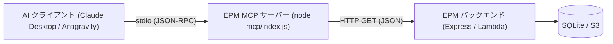

# 外部AI連携 MCP サーバー（stdio 参照系ツール）

電子パーツ管理アプリ（EPM）は、Model Context Protocol (MCP) を通じた外部 AI アシスタント（Claude Desktop や Antigravity 等）との連携に対応しています。
本 MCP サーバーは stdio トランスポートを用いた参照専用のサーバーであり、在庫の検索・詳細確認・マスタデータ取得を自然言語で行えます。

---

## 1. 概要とアーキテクチャ

MCP サーバーは EPM の REST API ラッパーとして動作します。
データベース（SQLite）へ直接アクセスせず、既存の HTTP API を経由してデータを取得するため、DB ロック競合を回避し、LAN 内の Windows サーバーや AWS 本番環境に対しても安全に接続できます。



> [!IMPORTANT]
> **MCP プロセスは AI クライアントが動作するマシン上で起動します**。
> 例えば、Mac 上の Claude Desktop から Windows LAN 機の EPM サーバーに接続する場合、Mac 上に本リポジトリを clone してルートで `npm install` を実行し、Mac 上の Node で `mcp/index.js` を起動します。
> （Windows 機側では `update-and-restart.ps1` が自動更新時に `npm ci` を実行するため、依存関係は自動で解決されます）

---

## 2. 公開ツール一覧

すべてのツールは参照専用（`readOnlyHint: true`）かつ冪等（`idempotentHint: true`）です。

### 2-1. `search_parts`（電子部品検索）

電子部品の在庫をキーワードやカテゴリ、保管場所で検索します。通常のアクティブな部品のみが対象で、使用済みやゴミ箱の部品は除外されます。

- **入力パラメータ**:
  - `query` (string, 任意): 部品名・型番・説明の部分一致検索キーワード（最大200文字）
  - `category_id` (integer, 任意): カテゴリID（正の整数）
  - `location_id` (integer, 任意): 保管場所ID（正の整数）
  - `limit` (integer, 任意, 既定値: `50`): 返却件数の上限（1〜200）

- **返却例**:
  ```json
  {
    "total": 12,
    "returned": 12,
    "truncated": false,
    "parts": [
      {
        "id": 10,
        "name": "10kΩ 金属皮膜抵抗",
        "part_number": "MF25-10K",
        "quantity": 100,
        "description": "許容差±1%、1/4W…",
        "category": { "id": 1, "name": "抵抗" },
        "location": { "id": 3, "name": "引き出しA-1" },
        "tags": ["抵抗", "リード部品"],
        "image_url": "http://localhost:3001/uploads/mf25.jpg",
        "status": "active"
      }
    ]
  }
  ```
  ※件数が `limit` を超える場合は `truncated: true` となり、`hint: "条件を絞るか limit を増やしてください（最大 200）"` が付与されます。

### 2-2. `get_part_detail`（部品詳細取得）

部品 ID を指定して、データシートURL、QRコード、作成・更新日時、使用記録などを含む完全な詳細情報を取得します。

- **入力パラメータ**:
  - `id` (integer, 必須): 部品ID（正の整数）

- **返却例**:
  ```json
  {
    "id": 10,
    "name": "10kΩ 金属皮膜抵抗",
    "part_number": "MF25-10K",
    "quantity": 100,
    "description": "許容差±1%、1/4W、金属皮膜抵抗器です。",
    "category": { "id": 1, "name": "抵抗" },
    "location": { "id": 3, "name": "引き出しA-1" },
    "tags": ["抵抗", "リード部品"],
    "image_url": "http://localhost:3001/uploads/mf25.jpg",
    "status": "active",
    "datasheet_url": "https://example.com/datasheet.pdf",
    "qr_code": "P-0010",
    "used_at": null,
    "used_for": null,
    "used_note": null,
    "deleted_at": null,
    "created_at": "2026-01-01T00:00:00.000Z",
    "updated_at": "2026-01-02T00:00:00.000Z"
  }
  ```
  ※ゴミ箱内の部品（`status: "trash"`）や使用済みの部品（`status: "used"`）も取得可能です。
  ※存在しない部品IDの場合はエラーとなり、`部品 ID <id> は見つかりません。search_parts で検索してください。` が返ります。

### 2-3. `list_master_data`（マスタデータ一覧取得）

カテゴリ一覧や保管場所一覧などのマスタデータを取得します。部品検索の条件設定や保管場所の把握に利用します。

- **入力パラメータ**:
  - `type` (enum, 任意, 既定値: `'all'`): `'all'` | `'categories'` | `'locations'`

- **返却例 (`type: "all"`)**:
  ```json
  {
    "categories": [
      { "id": 1, "name": "抵抗", "display_order": 0 },
      { "id": 2, "name": "コンデンサ", "display_order": 1 }
    ],
    "locations": [
      {
        "id": 3,
        "name": "引き出しA-1",
        "description": "受動部品用小型ケース",
        "qr_code": "L-0003",
        "image_url": null,
        "display_order": 0
      }
    ]
  }
  ```

---

## 3. 環境変数

設定は環境変数で行います。未指定の場合はローカル開発環境用の既定値が適用されます。

| 環境変数 | 既定値 | 説明 |
|---|---|---|
| `EPM_API_URL` | `http://localhost:3001` | EPM バックエンドのベース URL。末尾のスラッシュや `/api` は自動的に除去・正規化されます。 |
| `EPM_BASIC_AUTH` | なし | CloudFront やリモートホストへの Basic 認証情報（`username:password` 形式）。コロン必須。 |
| `EPM_AUTH_TOKEN` | なし | Bearer トークン認証用（将来拡張用）。`EPM_BASIC_AUTH` との同時指定は不可。 |
| `EPM_API_TIMEOUT_MS` | `10000` | API リクエストのタイムアウト時間（ミリ秒、正の整数）。 |

> [!WARNING]
> `EPM_BASIC_AUTH` と `EPM_AUTH_TOKEN` は同じ `Authorization` ヘッダーを使用するため、同時に設定すると起動時エラー（終了コード 1）となります。

---

## 4. MCP クライアント設定例

AI アプリケーションの MCP 設定ファイルに登録して利用します。

> [!CAUTION]
> **設定ファイルの `command` や `args` に `npm run mcp` を指定してはいけません。**
> npm は実行時にパッケージ名やバージョンのバナー行（`> electronic-parts-manager@1.0.0 mcp`）を標準出力（stdout）に出力します。stdio MCP プロトコルは stdout を JSON-RPC メッセージ専用とするため、バナーが混入するとプロトコルが破損しクライアントが接続不能になります。
> 必ず **node の絶対パス** と **`mcp/index.js` の絶対パス** を直接指定してください。

### 4-1. Claude Desktop (`claude_desktop_config.json`)

**LAN 内の Windows サーバー（192.168.1.10:3001）に接続する場合**:

```json
{
  "mcpServers": {
    "electronic-parts-manager": {
      "command": "/Users/<username>/.nvm/versions/node/v20.18.0/bin/node",
      "args": [
        "/Users/<username>/orca/electronic-parts-manager/mcp/index.js"
      ],
      "env": {
        "EPM_API_URL": "http://192.168.1.10:3001"
      }
    }
  }
}
```

**AWS 本番環境（CloudFront 経由、Basic 認証あり）に接続する場合**:

```json
{
  "mcpServers": {
    "electronic-parts-manager": {
      "command": "/Users/<username>/.nvm/versions/node/v20.18.0/bin/node",
      "args": [
        "/Users/<username>/orca/electronic-parts-manager/mcp/index.js"
      ],
      "env": {
        "EPM_API_URL": "https://dxxxxxxxxxxxx.cloudfront.net",
        "EPM_BASIC_AUTH": "admin:your-secret-password"
      }
    }
  }
}
```

### 4-2. Antigravity (`mcp_config.json`)

```json
{
  "mcpServers": {
    "electronic-parts-manager": {
      "command": "node",
      "args": [
        "/absolute/path/to/electronic-parts-manager/mcp/index.js"
      ],
      "env": {
        "EPM_API_URL": "http://localhost:3001"
      }
    }
  }
}
```

---

## 5. AWS 本番環境接続時の重要事項

1. **CloudFront ドメインの指定が必須**:
   EPM の Lambda バックエンドは CloudFront が付与する検証ヘッダー（`x-origin-verify`）を要求します。API Gateway や Lambda の URL を直接 `EPM_API_URL` に指定すると 403 Forbidden になります。必ず CloudFront ドメイン（`https://xxx.cloudfront.net`）を指定してください。
2. **画像の Basic 認証**:
   返却される `image_url`（`/uploads/...`）は CloudFront 経由の絶対 URL となりますが、CloudFront 全体に Basic 認証が設定されている場合、画像アクセスにも認証が必要です。AI クライアントが画像を直接取得できない場合は、認証情報付きのクライアントを使用してください。

---

## 6. トラブルシューティング

| 現象 | 主な原因と対処法 |
|---|---|
| **接続直後にクラッシュする / JSON-RPC parse error** | 設定ファイルで `npm run mcp` を使用していませんか？ `node` と `mcp/index.js` の絶対パス指定に修正してください。どうしても npm を使う場合は `npm run --silent mcp` を指定してください。 |
| **401 Unauthorized** | `EPM_BASIC_AUTH` のユーザー名またはパスワードが正しくありません。`username:password` のコロン区切り形式を確認してください。 |
| **403 Forbidden** | AWS 環境で API Gateway に直接接続していませんか？ `EPM_API_URL` を CloudFront の URL（`https://xxx.cloudfront.net`）に変更してください。 |
| **API サーバーに接続できません (network)** | バックエンドが起動していないか、IP アドレスやポート番号が間違っています。LAN 内の場合はファイアウォールや IP の変更を確認してください。 |
| **API から JSON 以外の応答が返りました (invalid_response)** | `EPM_API_URL` に SPA フロントエンド開発サーバー（Vite の `:5173` 等でプロキシ設定がされていないURL）を指定していませんか？ バックエンドポート（`:3001`）または正しいプロキシ・CloudFront URL を指定してください。 |
| **Node.js バージョンについて** | MCP サーバーは SQLite 等のネイティブモジュールに依存しないため、Node.js 18 以上の任意の環境（Node 20, 22, 24等）で動作します。 |
