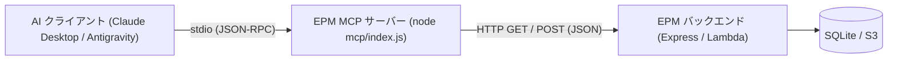

# 外部AI連携 MCP サーバー（参照・更新ツール）

電子パーツ管理アプリ（EPM）は、Model Context Protocol (MCP) を通じた外部 AI アシスタント（Claude Desktop や Antigravity 等）との連携に対応しています。
本 MCP サーバーは stdio トランスポートを用いたサーバーであり、在庫の検索・詳細確認・マスタデータ取得などの**参照系**に加え、新規部品の登録、在庫数量の増減・更新、保管場所の格納などの**更新系**操作を自然言語で行えます。

---

## 1. 概要とアーキテクチャ

MCP サーバーは EPM の REST API ラッパーとして動作します。
データベース（SQLite）へ直接アクセスせず、既存の HTTP API を経由してデータを取得・更新するため、DB ロック競合を回避し、LAN 内の Windows サーバーや AWS 本番環境に対しても安全に接続できます。



> [!IMPORTANT]
> **MCP プロセスは AI クライアントが動作するマシン上で起動します**。
> 例えば、Mac 上の Claude Desktop から Windows LAN 機の EPM サーバーに接続する場合、Mac 上に本リポジトリを clone してルートで `npm install` を実行し、Mac 上の Node で `mcp/index.js` を起動します。
> （Windows 機側では `update-and-restart.ps1` が自動更新時に `npm ci` を実行するため、依存関係は自動で解決されます）

---

## 2. 公開ツール一覧

本サーバーは 6 つのツールを公開します（参照系 3 ツール、書き込み系 3 ツール）。

| ツール名 | 分類 | 冪等性 | 説明 |
|---|---|---|---|
| `search_parts` | 参照 (`readOnlyHint: true`) | 冪等 (`idempotentHint: true`) | 電子部品の検索（キーワード・カテゴリ・保管場所） |
| `get_part_detail` | 参照 (`readOnlyHint: true`) | 冪等 (`idempotentHint: true`) | 部品 ID を指定した完全な詳細情報取得 |
| `get_part_image` | 参照 (`readOnlyHint: true`) | 冪等 (`idempotentHint: true`) | 部品写真の画像コンテンツ取得（刻印・型番・形状確認） |
| `list_master_data` | 参照 (`readOnlyHint: true`) | 冪等 (`idempotentHint: true`) | カテゴリ一覧・保管場所一覧の取得 |
| `create_part` | 更新 (`readOnlyHint: false`) | 非冪等 (`idempotentHint: false`) | 新規電子部品の登録（名前解決・型番重複チェック付き） |
| `update_part_quantity` | 更新 (`readOnlyHint: false`) | 非冪等 (`destructiveHint: true`) | 在庫数量の増減（delta）または絶対値上書き（absolute） |
| `store_part_location` | 更新 (`readOnlyHint: false`) | 冪等 (`idempotentHint: true`) | 部品の保管場所への格納（入出庫ログ記録） |

### 2-1. `search_parts`（電子部品検索）

電子部品の在庫をキーワードやカテゴリ、保管場所で検索します。通常のアクティブな部品のみが対象で、使用済みやゴミ箱の部品は除外されます。

- **入力パラメータ**:
  - `query` (string, 任意): 部品名・型番・説明の部分一致検索キーワード（最大200文字）
  - `category_id` (integer, 任意): カテゴリID（正の整数）
  - `location_id` (integer, 任意): 保管場所ID（正の整数）
  - `limit` (integer, 任意, 既定値: `50`): 返却件数の上限（1〜200）

- **返却例**:
  ```json
  {
    "total": 12,
    "returned": 12,
    "truncated": false,
    "parts": [
      {
        "id": 10,
        "name": "10kΩ 金属皮膜抵抗",
        "part_number": "MF25-10K",
        "quantity": 100,
        "description": "許容差±1%、1/4W…",
        "category": { "id": 1, "name": "抵抗" },
        "location": { "id": 3, "name": "引き出しA-1" },
        "tags": ["抵抗", "リード部品"],
        "image_url": "http://localhost:3001/uploads/mf25.jpg",
        "status": "active",
        "qr_code": "P-0010"
      }
    ]
  }
  ```

### 2-2. `get_part_detail`（部品詳細取得）

部品 ID を指定して、データシートURL、QRコード、作成・更新日時、使用記録などを含む完全な詳細情報を取得します。

- **入力パラメータ**:
  - `id` (integer, 必須): 部品ID（正の整数）

- **返却例**:
  ```json
  {
    "id": 10,
    "name": "10kΩ 金属皮膜抵抗",
    "part_number": "MF25-10K",
    "quantity": 100,
    "description": "許容差±1%、1/4W、金属皮膜抵抗器です。",
    "category": { "id": 1, "name": "抵抗" },
    "location": { "id": 3, "name": "引き出しA-1" },
    "tags": ["抵抗", "リード部品"],
    "image_url": "http://localhost:3001/uploads/mf25.jpg",
    "status": "active",
    "datasheet_url": "https://example.com/datasheet.pdf",
    "qr_code": "P-0010",
    "used_at": null,
    "used_for": null,
    "used_note": null,
    "deleted_at": null,
    "created_at": "2026-01-01T00:00:00.000Z",
    "updated_at": "2026-01-02T00:00:00.000Z"
  }
  ```

### 2-3. `get_part_image`（部品写真取得）

部品 ID を指定して、登録されている部品写真を画像コンテンツ（Base64）として取得します。マルチモーダル AI がチップの刻印や型番、形状、端子配置を視覚的に確認する用途に利用できます。読み取り専用モード（`EPM_MCP_READONLY=1`）でも使用可能です。

- **入力パラメータ**:
  - `id` (integer, 必須): 部品ID（正の整数）

- **対応画像形式**:
  - JPEG / PNG / GIF / WEBP に対応しています。
  - 先頭バイト（Magic Bytes）を最優先として判定し、次いで Content-Type、拡張子、既定値（`image/jpeg`）の順で MIME を決定します。

- **クライアントサイズ上限に関する注意**:
  - 一部のデスクトップ向け MCP クライアントには、ツール実行結果に約 1MiB のサイズ制限が存在することが報告されています。
  - Base64 エンコードによってデータ量は約 4/3 倍となるため、元画像が約 750KB を超える場合はクライアント側で表示エラーとなる可能性があります。
  - 750KB を超える画像の場合、返却テキストに注意文（目安）が付与されます。

- **返却例（画像登録時）**:
  ```json
  [
    {
      "type": "image",
      "data": "<Base64 エンコードされた画像バイナリ>",
      "mimeType": "image/jpeg"
    },
    {
      "type": "text",
      "text": "部品 ID 10 (10kΩ 金属皮膜抵抗) の登録写真です。"
    }
  ]
  ```

- **返却例（画像未登録時）**:
  ```json
  [
    {
      "type": "text",
      "text": "部品 ID 10 (10kΩ 金属皮膜抵抗) には画像が登録されていません。"
    }
  ]
  ```
  ※画像未登録の場合はエラーにならず、テキストのみが返却されます。

- **主なエラー応答**:
  - 部品が存在しない場合: `部品 ID 999 は見つかりません。`
  - 画像ファイルが見つからない場合: `部品 ID 10 (...) の画像を取得できませんでした: 画像ファイルが見つかりません`
  - 画像サイズ上限超過: `部品 ID 10 (...) の画像を取得できませんでした: 画像が大きすぎます（12.5 MB / 上限 10.0 MB）。EPM_IMAGE_MAX_BYTES で上限を変更できます。`
  - 非対応形式の場合: `部品 ID 10 (...) の画像形式（image/svg+xml）には対応していません。`

### 2-4. `list_master_data`（マスタデータ一覧取得）

カテゴリ一覧や保管場所一覧などのマスタデータを取得します。部品検索の条件設定や保管場所の把握に利用します。

- **入力パラメータ**:
  - `type` (enum, 任意, 既定値: `'all'`): `'all'` | `'categories'` | `'locations'`

---

### 2-5. `create_part`（電子部品登録）

新しい電子部品を登録します。実行するとデータが登録されます。必要に応じて事前に `search_parts` や `list_master_data` で既存データやマスタを確認してください。

- **入力パラメータ**:
  - `name` (string, 必須): 部品名（1〜200文字）
  - `part_number` (string, 任意): 型番（最大100文字）
  - `quantity` (integer, 任意, 既定値: `0`): 初期在庫数量（0以上の整数）
  - `category_id` (integer, 任意): カテゴリID（`category_name` との排他指定）
  - `category_name` (string, 任意): カテゴリ名（自動でIDに解決されます。`category_id` との排他指定）
  - `location_id` (integer, 任意): 保管場所ID（`location_name` との排他指定）
  - `location_name` (string, 任意): 保管場所名（自動でIDに解決されます。`location_id` との排他指定）
  - `description` (string, 任意): 説明文（最大2000文字）
  - `allow_duplicate` (boolean, 任意, 既定値: `false`): 型番が既存部品と重複していても強制的に登録するかどうか

- **名前解決の規則**:
  - 大文字・小文字、全角・半角、前後の空白の表記ゆれを吸収して完全一致を探します。
  - 完全一致が複数件ある場合はエラー（`ambiguous`）となり、該当IDを提示してIDでの指定を促します。
  - 完全一致が 0 件の場合は部分一致の候補（最大5件）を提示してエラーとなり、自動作成は行われません。

- **型番重複チェック**:
  - `part_number` が指定され、かつ `allow_duplicate: false` の場合、既存パーツ（アクティブ）と型番が一致すると登録を中断し、既存パーツの ID・数量・保管場所を示して `update_part_quantity` による在庫追加を案内します。

- **返却例**:
  ```json
  {
    "created": true,
    "part": {
      "id": 45,
      "name": "赤色LED 5mm",
      "part_number": "OSR5JA5111A",
      "quantity": 10,
      "category": { "id": 2, "name": "LED" },
      "location": { "id": 5, "name": "引き出しB-2" },
      "status": "active"
    }
  }
  ```

### 2-6. `update_part_quantity`（電子部品数量更新）

電子部品の在庫数量を増減（`delta`）または絶対値（`absolute`）で更新します。

- **入力パラメータ**:
  - `id` (integer, 必須): 部品ID（正の整数）
  - `delta` (integer, 任意): 増減値（0以外の整数。正数で入庫・加算、負数で出庫・減算）。`absolute` との排他指定。
  - `absolute` (integer, 任意): 設定する絶対数量（0以上の整数）。`delta` との排他指定。
  - `reason` (string, 任意): 変更理由（最大200文字。サーバーログおよびレスポンスに出力）。

- **返却例**:
  ```json
  {
    "id": 45,
    "previous_quantity": 10,
    "new_quantity": 15,
    "delta": 5,
    "reason": "秋月電子にて追加購入"
  }
  ```
  ※計算後の数量が負になる場合はエラー（`400`）となり更新されません。
  ※ゴミ箱内のパーツや使用済みパーツは対象外（`404`）です。

> [!NOTE]
> **SPA画面操作との競合について**:
> SPA の在庫一覧画面で数量の ± ボタンを連打している最中に MCP から数量更新が行われた場合、SPA 側のデバウンス同期によって値が上書きされる可能性があります。通常の単独運用では問題ありませんが、画面操作の直後はご留意ください。

### 2-7. `store_part_location`（電子部品保管場所格納）

電子部品を指定した保管場所に格納（移動）します。実行すると部品の保管場所が更新され、入出庫履歴（`storage_logs`）にメモ `MCP` 付きで記録されます。

- **入力パラメータ**:
  - `part_id` (integer, 必須): 部品ID（正の整数）
  - `location_id` (integer, 必須): 格納先の保管場所ID（正の整数）

- **返却例**:
  ```json
  {
    "part_id": 45,
    "location_id": 3,
    "previous_location_id": 1,
    "previous_location_name": "一時保管トレイ",
    "unchanged": false,
    "log_id": 89
  }
  ```
  ※既にその保管場所に格納されている場合は `unchanged: true` となり、入出庫ログは新規記録されません。

---

## 3. 環境変数

設定は環境変数で行います。未指定の場合はローカル開発環境用の既定値が適用されます。

| 環境変数 | 既定値 | 説明 |
|---|---|---|
| `EPM_API_URL` | `http://localhost:3001` | EPM バックエンドのベース URL。末尾のスラッシュや `/api` は自動的に除去・正規化されます。 |
| `EPM_AUTH_TOKEN` | なし | Bearer トークン認証用。サーバー側の環境変数 `EPM_API_TOKEN` と**同じ値**を設定します。 |
| `EPM_BASIC_AUTH` | なし | CloudFront やリモートホストへの Basic 認証情報（`username:password` 形式）。コロン必須。 |
| `EPM_MCP_READONLY` | `0` | `1` または `true` を設定すると、書き込み系ツール（`create_part`, `update_part_quantity`, `store_part_location`）を無効化し、参照専用モードとして起動します。 |
| `EPM_API_TIMEOUT_MS` | `10000` | API リクエストのタイムアウト時間（ミリ秒、正の整数）。 |
| `EPM_IMAGE_MAX_BYTES` | `10485760` (10MB) | `get_part_image` で取得を許可する画像ファイルの最大バイト数（正の整数、上限 50MB = 52428800）。 |

### トークン環境変数の対応表

| サービス / コンポーネント | 環境変数名 | 説明 |
|---|---|---|
| **EPM サーバー (Express)** | `EPM_API_TOKEN` | サーバー側で認証を有効化するためのシークレットトークン。 |
| **EPM MCP サーバー** | `EPM_AUTH_TOKEN` | MCP がリクエスト時に `Authorization: Bearer <token>` として付与するトークン。サーバーの `EPM_API_TOKEN` と同一の値を設定します。 |

> [!WARNING]
> `EPM_BASIC_AUTH` と `EPM_AUTH_TOKEN` は同じ `Authorization` ヘッダーを使用するため、同時に設定すると起動時エラー（終了コード 1）となります。

---

## 4. LAN でトークン認証を有効にする手順

LAN 内運用において外部 AI ツールからの安全なアクセスを担保し、不正なアクセスを防ぐための手順です。

1. **サーバー側のトークン設定**:
   Windows LAN 機などのサーバー環境の `server/.env` に `EPM_API_TOKEN` を設定します。
   ```bash
   # 生成例: node -e "console.log(require('crypto').randomBytes(32).toString('base64url'))"
   EPM_API_TOKEN=your-random-generated-token-string
   ```
2. **サーバーの再起動**:
   PM2 または Windows サービスでサーバーを再起動します。
   ```bash
   pm2 restart epm-server
   ```
3. **ブラウザ側での認証**:
   ブラウザで SPA アプリを開くと、初回 API 呼び出し時に「API トークンを入力してください」モーダルが表示されます。上記で設定したトークンを入力して「保存」をクリックします。トークンはブラウザの `localStorage` に安全に保持されます。
4. **MCP クライアントへの設定**:
   Claude Desktop や Antigravity の MCP 設定ファイル（`env` セクション）に `EPM_AUTH_TOKEN` を追加します。
   ```json
   "env": {
     "EPM_API_URL": "http://192.168.1.10:3001",
     "EPM_AUTH_TOKEN": "your-random-generated-token-string"
   }
   ```

---

## 5. MCP クライアント設定例

AI アプリケーションの MCP 設定ファイルに登録して利用します。

> [!CAUTION]
> **設定ファイルの `command` や `args` に `npm run mcp` を指定してはいけません。**
> npm は実行時にパッケージ名やバージョンのバナー行（`> electronic-parts-manager@1.0.0 mcp`）を標準出力（stdout）に出力します。stdio MCP プロトコルは stdout を JSON-RPC メッセージ専用とするため、バナーが混入するとプロトコルが破損しクライアントが接続不能になります。
> 必ず **node の絶対パス** と **`mcp/index.js` の絶対パス** を直接指定してください。

### 5-1. Claude Desktop (`claude_desktop_config.json`)

**LAN 内の Windows サーバー（192.168.1.10:3001）にトークン認証で接続する場合**:

```json
{
  "mcpServers": {
    "electronic-parts-manager": {
      "command": "/Users/<username>/.nvm/versions/node/v20.18.0/bin/node",
      "args": [
        "/Users/<username>/orca/electronic-parts-manager/mcp/index.js"
      ],
      "env": {
        "EPM_API_URL": "http://192.168.1.10:3001",
        "EPM_AUTH_TOKEN": "your-random-generated-token-string"
      }
    }
  }
}
```

**AWS 本番環境（CloudFront 経由、Basic 認証あり）に接続する場合**:

```json
{
  "mcpServers": {
    "electronic-parts-manager": {
      "command": "/Users/<username>/.nvm/versions/node/v20.18.0/bin/node",
      "args": [
        "/Users/<username>/orca/electronic-parts-manager/mcp/index.js"
      ],
      "env": {
        "EPM_API_URL": "https://dxxxxxxxxxxxx.cloudfront.net",
        "EPM_BASIC_AUTH": "admin:your-secret-password"
      }
    }
  }
}
```

### 5-2. Antigravity (`mcp_config.json`)

```json
{
  "mcpServers": {
    "electronic-parts-manager": {
      "command": "node",
      "args": [
        "/absolute/path/to/electronic-parts-manager/mcp/index.js"
      ],
      "env": {
        "EPM_API_URL": "http://localhost:3001",
        "EPM_AUTH_TOKEN": "your-random-generated-token-string"
      }
    }
  }
}
```

---

## 6. AWS 本番環境接続時の重要事項

1. **CloudFront ドメインの指定が必須**:
   EPM の Lambda バックエンドは CloudFront が付与する検証ヘッダー（`x-origin-verify`）を要求します。API Gateway や Lambda の URL を直接 `EPM_API_URL` に指定すると 403 Forbidden になります。必ず CloudFront ドメイン（`https://xxx.cloudfront.net`）を指定してください。
2. **Basic 認証との併用**:
   AWS 本番環境では CloudFront Function による Basic 認証で保護されています。CloudFront が Lambda へ転送するヘッダーは `Authorization` のみであるため、AWS 環境では `Authorization: Bearer` 方式のトークン認証は使用できません。MCP から AWS 環境へアクセスする際は、従来どおり `EPM_BASIC_AUTH` を指定してください（Basic 認証の内側にあるため、書き込み系ツールも安全に利用できます）。
3. **画像の Basic 認証と `get_part_image`**:
   `get_part_image` ツールは設定された `EPM_BASIC_AUTH` を用いて画像を取得するため、CloudFront 全体に Basic 認証が設定されている AWS 本番環境下でも、AI アシスタントへ安全に部品写真を渡すことができます。一方、`get_part_detail` 等で返却される `image_url` を AI クライアント自身が直接外部から開く場合は、引き続き認証情報が必要です。

---

## 7. トラブルシューティング

| 現象 | 主な原因と対処法 |
|---|---|
| **接続直後にクラッシュする / JSON-RPC parse error** | 設定ファイルで `npm run mcp` を使用していませんか？ `node` と `mcp/index.js` の絶対パス指定に修正してください。どうしても npm を使う場合は `npm run --silent mcp` を指定してください。 |
| **401 Unauthorized (サーバーが API トークンを要求しています)** | サーバーで `EPM_API_TOKEN` が設定されている一方、MCP 設定に `EPM_AUTH_TOKEN` が設定されていません。同じトークン文字列を `EPM_AUTH_TOKEN` に設定してください。 |
| **401 Unauthorized (API トークンが一致しません)** | MCP 設定の `EPM_AUTH_TOKEN` がサーバー側の `EPM_API_TOKEN` と一致していません。設定値を確認してください。 |
| **401 Unauthorized (Basic 認証に失敗しました)** | `EPM_BASIC_AUTH` のユーザー名またはパスワードが正しくありません。`username:password` のコロン区切り形式を確認してください。 |
| **403 Forbidden** | AWS 環境で API Gateway に直接接続していませんか？ `EPM_API_URL` を CloudFront の URL（`https://xxx.cloudfront.net`）に変更してください。 |
| **API サーバーに接続できません (network)** | バックエンドが起動していないか、IP アドレスやポート番号が間違っています。LAN 内の場合はファイアウォールや IP の変更を確認してください。 |
| **API から JSON 以外の応答が返りました (invalid_response)** | `EPM_API_URL` に SPA フロントエンド開発サーバー（Vite の `:5173` 等でプロキシ設定がされていないURL）を指定していませんか？ バックエンドポート（`:3001`）または正しいプロキシ・CloudFront URL を指定してください。 |
| **画像ではなく text/html が返りました** | 画像ファイルが削除されているか、S3 に存在しません。AWS 環境では S3 の 403/404 に対し CloudFront が index.html を 200 でフォールバック返却するため、このエラーメッセージとなります。 |
| **画像が大きすぎます** | 画像ファイルのサイズが `EPM_IMAGE_MAX_BYTES`（既定 10MB）を超えています。環境変数を調整するか、カメラの解像度を下げて再登録してください。 |
| **結果不明エラー (timeout / unknownOutcome)** | 書き込みリクエスト中にタイムアウトが発生しました。重複登録を防ぐため、自動再試行は行われません。`search_parts` または `get_part_detail` で反映状況を確認してから必要に応じて再実行してください。 |
| **Node.js バージョンについて** | MCP サーバーは SQLite 等のネイティブモジュールに依存しないため、Node.js 18 以上の任意の環境（Node 20, 22, 24等）で動作します。 |
