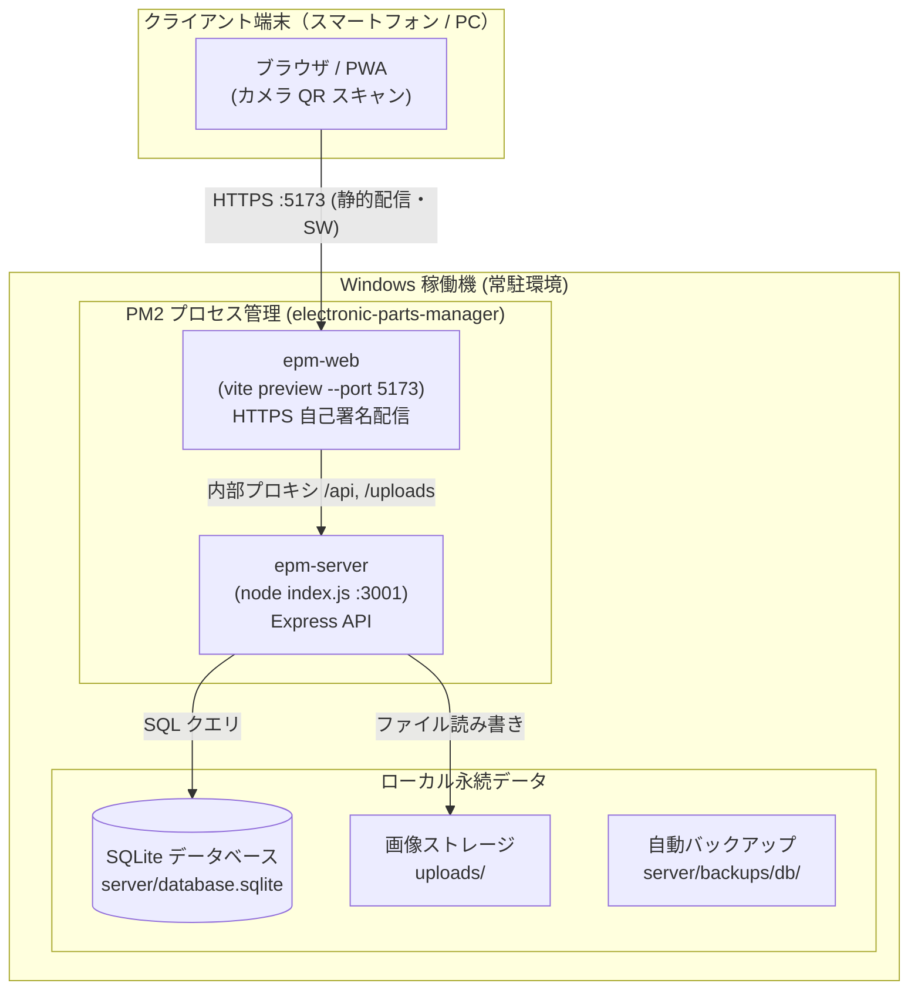

# Windows 稼働機向け 運用・自動更新・常駐ガイド

本ドキュメントは、自宅 LAN 内の Windows PC で「電子パーツ管理システム (Electronic Parts Manager)」を 24 時間安定稼働させ、ワンクリックで最新版への安全な自動更新および PC 再起動時の自動復旧を行うための完全運用ガイドです。

---

## 1. システム構成とアーキテクチャ

Windows 稼働機上では、Node.js プロセス管理ツール **PM2** を使用してバックエンド API サーバーとフロントエンド配信サーバーの 2 つを独立して常駐運用します。



### 常駐プロセスの仕様

| プロセス名 | 役割 | 起動コマンド | 待ち受けポート | ログファイル |
|---|---|---|---|---|
| `epm-server` | Express API サーバー | `node index.js` | `3001` (HTTP) | `logs/pm2/epm-server.*.log` |
| `epm-web` | ビルド済みクライアント配信 | `node .../vite.js preview` | `5173` (HTTPS) | `logs/pm2/epm-web.*.log` |

- **スマホからのアクセス URL**: これまでと同様に `https://<Windows機のIPアドレス>:5173` です。
- **カメラ・PWA 動作**: `vite preview` が HTTPS（自己署名証明書）で配信するため、スマホのカメラを使った QR コード読み取りや PWA 機能が正常に動作します。
- **静的ビルド配信**: 開発用 dev サーバーと異なり、ビルド済み成果物 (`dist`) を配信するため、メモリ消費が抑えられ高速かつ安定して動作します。

---

## 2. 前提ソフトウェア

Windows PC に以下の環境がインストールされている必要があります。

1. **Node.js**: **v20 LTS**（v18 〜 v22 に対応。v23 以上はネイティブモジュール `sqlite3` の互換性の都合上非対応）
2. **Git for Windows**: 公式インストーラーより導入
3. **PM2**: コマンドプロンプトまたは PowerShell を起動し、管理者権限でグローバルインストール
   ```cmd
   npm install -g pm2
   ```

---

## 3. 初回セットアップ（既存運用からの移行手順）

従来の `start_app.bat`（2つの黒いコンソールウィンドウを開きっぱなしにする方式）から、PM2 によるバックグラウンド常駐運用へ移行する手順です。

### 手順

1. **既存プロセスの終了**:
   `start_app.bat` で開いていた 2 つのコンソールウィンドウ（Backend Server と Frontend Client）を閉じます。
2. **最新コードの取得**:
   PowerShell または Git Bash でリポジトリディレクトリに移動し、最新コードを取得します。
   ```bash
   git switch main
   git pull
   ```
3. **サービス登録スクリプトの実行**:
   エクスプローラーでリポジトリを開き、`scripts\pm2-register.bat` を**ダブルクリック**して実行します。
   - 必要な依存関係（`npm ci`）の確認とビルドが自動で行われます。
   - PM2 に `epm-server` と `epm-web` が登録され、起動します。
   - ヘルスチェック（`GET /api/health`）により正常起動を確認します。
   - ログローテーション（`pm2-logrotate`）と自動起動ショートカットが自動設定されます。
4. **スマホからの動作確認**:
   スマホのブラウザから `https://<Windows機のIP>:5173` を開き、証明書警告を承認してアプリが正常に表示・操作できることを確認します。

> [!TIP]
> **Windows ファイアウォールの確認**:
> スマホから接続できない場合は、Windows Defender ファイアウォールで `Node.js`、または TCP ポート `5173` および `3001` の受信が許可されているか確認してください。

---

## 4. PC 再起動時の自動起動

### 仕組み（スタートアップ方式）

`scripts\pm2-register.bat` を実行すると、Windows のスタートアップフォルダ（`shell:startup`）に `EPM - pm2 resurrect.lnk` ショートカットが自動作成されます。

PC 起動後、Windows にサインインしたタイミングで自動的にバックグラウンド（非表示ウィンドウ）で `pm2 resurrect` が実行され、サービスが自動復元されます。

### 自動サインインの設定（推奨）

停電復帰後や PC の無人再起動後にも自動起動させたい場合は、Windows の自動サインインを設定してください。

1. `Win + R` キーを押し、`netplwiz` と入力して Enter を押します。
2. 「ユーザーがこのコンピューターを使うには、ユーザー名とパスワードの入力が必要」のチェックを**外します**。
3. 自動サインインするユーザーを選択し、パスワードを入力して「OK」をクリックします。
   - ※ Windows 10/11 のバージョンによっては、上記項目が非表示になっている場合があります。その場合は Microsoft 公式の [Sysinternals Autologon](https://learn.microsoft.com/sysinternals/downloads/autologon) ツールを利用すると安全かつ簡単に設定可能です。

### 動作確認手順

1. Windows PC を再起動します。
2. サインイン後、PowerShell で以下を実行します：
   ```cmd
   pm2 ls
   ```
3. `epm-server` と `epm-web` の status が両方とも `online` になっていれば成功です。

---

## 5. 常駐方式の比較

| 方式 | サインイン不要 | 導入の手間 | PM2 との相性 | ログ管理 | 注意事項 |
|---|---|---|---|---|---|
| **スタートアップ + `pm2 resurrect`（本システム既定）** | × | 小（自動設定） | ◎ | `pm2-logrotate` | ログオフするとプロセスが停止します（通常運用ではサインインのまま運用）。 |
| **タスクスケジューラ（ログオン時）** | × | 小 | ◎ | `pm2-logrotate` | 既定方式とほぼ同等。起動遅延を設定可能。 |
| **タスクスケジューラ（起動時、ログオン不問）** | ○ | 中 | △ | `pm2-logrotate` | パスワードの保存が必要。CLI からの一般ユーザー操作との競合検証が必要。 |
| **NSSM (Windows サービス)** | ○ | 中 | × (PM2非推奨) | NSSM ログ | LocalSystem 実行時に `PM2_HOME` や DB 所有者がずれる事故のリスクあり。 |
| **node-windows** | ○ | 中 | × | 独自ログ | 外部依存パッケージの追加が必要。 |

**結論**: 本システムでは最も安全でトラブルが少ない **「スタートアップ + `pm2 resurrect`」** を採用しています。複数の方式を同時に設定・混在させないでください。

---

## 6. ワンクリック自動更新

最新の開発内容を本番稼働機へ反映するための機能です。

### デスクトップショートカットの作成

1. エクスプローラーで `scripts\` フォルダを開きます。
2. `update-and-restart.bat` を右クリックし、「**送る**」→「**デスクトップ (ショートカットを作成)**」を選択します。
3. デスクトップ上に作成されたショートカットの名前を「**電子パーツ管理システム更新**」などに変更します（お好みでアイコンも変更可能）。

### 更新の実行方法

デスクトップのショートカットを**ダブルクリック**するだけで完了します。
処理が完了すると、画面に結果が表示され「続行するには何かキーを押してください...」で一時停止します。

### 終了コード一覧

| 終了コード | 判定 | サーバー状態 | 説明 |
|---|---|---|---|
| **0** | 成功 | 最新バージョンで稼働 | 更新および再ビルド・再起動が正常完了した。 |
| **1** | 中断 | **一切変更なし** | 事前チェック（未コミット、FF不可、ポート競合など）により安全に中断。 |
| **2** | ロールバック成功 | **旧バージョンで稼働** | 更新中にエラーが発生したが、旧バージョンへ安全に自動復帰完了。 |
| **3** | ロールバック失敗 | 停止または手動対応要 | 自動復帰にも失敗した状態。下記「手動ロールバック」を参照。 |

### 安全機能とフェイルセーフ

- **二重起動防止**: 名前付きミューテックスにより、同時に 2 つの更新が走るのを防止します。
- **事前チェック**: Git の未コミット変更がある場合や、ローカルに変更コミットがある場合はサーバーを一切停止せずに中断します。
- **アトミックビルド**: 新しいフロントエンドは一時ディレクトリ `dist.next` にビルドされ、検証（`index.html` と `sw.js` の存在）に合格した場合のみ旧 `dist` と入れ替えられます。
- **自動ロールバック**: ビルド失敗や新サーバーの起動失敗（ヘルスチェック不合格）が発生した場合、`finally` ブロックで直前のコミットへの `git reset --hard`、`npm ci`、DB の自動復元を行い、旧バージョンで稼働を再開します。

### よくあるトラブルと対処

- **「未コミットの変更が存在します」と表示される**:
  作業ツリーに変更が残っています。変更を退避するかコミットしてください：
  ```cmd
  git stash
  ```
- **「fast-forward できません」と表示される**:
  ローカルブランチに未プッシュの独自コミットが存在します。リモートと整合性を合わせてください。
- **「ポート 5173/3001 が別プロセスで使用されています」**:
  従来の `start_app.bat` などのウィンドウが開いたままになっている可能性があります。ウィンドウを閉じてください。
- **更新途中でウィンドウを閉じてしまった / Ctrl+C で中断した**:
  `node_modules` やビルド成果物が中途半端になっている可能性があります。PowerShell を開き、`-Reinstall` オプションを付けて実行してください：
  ```powershell
  .\scripts\update-and-restart.ps1 -Reinstall
  ```
- **更新スクリプトを強制再実行したい**:
  更新コミットがなくても再ビルド・再起動を行いたい場合は、PowerShell から直接実行する際に `-Force` を指定します：
  ```powershell
  .\scripts\update-and-restart.ps1 -Force
  ```
  ※ `update-and-restart.bat` から実行した場合は既定で `-Force` が有効となっており、リモートコミットに差分がない場合でも再ビルド・再起動が確実に実行されます。
- **`vite.config.js` の設定変更を反映したい**:
  `client/vite.config.js` の設定を変更した場合は `epm-web` の再起動が必要です（`update-and-restart.ps1` は更新時に毎回両プロセスを再起動するため、通常の自動更新フローでは自動的に反映されます）。手動で再起動する場合は `pm2 restart epm-web` を実行してください。

### サービスの手動起動・停止・再起動バッチ

PC 上で稼働中の他の PM2 アプリケーション（別プロジェクト等）に一切影響を与えず、EPM（`ecosystem.config.js`）のみを個別操作できるバッチファイルを用意しています。

| スクリプト | 用途 | 説明 |
|---|---|---|
| `scripts\pm2-start.bat` | 起動 | EPM のバックエンドおよびフロントエンドを PM2 で起動します。 |
| `scripts\pm2-stop.bat` | 停止 | EPM のプロセスのみを安全に停止します（他アプリは稼働継続）。 |
| `scripts\pm2-restart.bat` | 再起動 | EPM のプロセスのみを安全に再起動します。 |

※ いずれもエクスプローラーからダブルクリックで実行可能です。デスクトップにショートカットを作成して利用することもできます。

---

## 7. バックアップとデータ保全

### SQLite データベース

- 自動更新スクリプト実行時、PM2 停止直後に `server\backups\db\database-YYYYMMDD_HHmmss.sqlite` として自動バックアップされます。
- バックアップの世代管理は最新 **20 世代** を保持し、古いものは自動削除されます（`-KeepBackups 30` のように変更可能）。
- 新バージョン起動失敗時のロールバックでは、失敗直前の状態が `database-failed-YYYYMMDD_HHmmss.sqlite` として**削除されずに退避保存**されます。

### アップロード画像 (`uploads/`)

- 部品の写真は `uploads/` ディレクトリに保存されています。
- 自動更新スクリプトでは `git clean` 等の破壊的コマンドは一切使用せず、更新前後で画像ファイル数が減少していないか整合性チェックを実施します。
- 画像を含む完全なバックアップは、アプリ画面内の「バックアップ」機能（`/api/backup` による ZIP エクスポート）を定期的にダウンロードして保存することを推奨します。

---

## 8. 手動ロールバック手順

<a id="手動ロールバック"></a>

自動ロールバックでも復旧できなかった場合（終了コード 3）や、手動で過去の特定バージョンに戻したい場合の手順です。

> [!CAUTION]
> **警告**: `git clean -fdx` などのコマンドは**絶対に使用しないでください**。未追跡の SQLite データベースや `uploads/` 内の画像が完全に消去されてしまいます。

### 手順

1. **PM2 アプリケーションの停止**:
   ```cmd
   pm2 stop ecosystem.config.js
   ```
2. **直前のコミットハッシュの確認**:
   `logs\update\` 内の最新ログファイル（例: `update-20261011_120000.log`）を開き、冒頭に記録されている `更新前コミット: <ハッシュ>` を確認します。
3. **コードの巻き戻し**:
   ```cmd
   git reset --hard <更新前コミットハッシュ>
   ```
4. **依存関係の再インストール**:
   ```cmd
   npm ci
   cd server && npm ci && cd ..
   cd client && npm ci && cd ..
   ```
5. **フロントエンドの復旧**:
   `client\dist.prev` が存在する場合は、`dist` を削除して `dist.prev` を `dist` にリネームします。
   存在しない場合はビルドを実行します：
   ```cmd
   cd client
   npm run build
   cd ..
   ```
6. **データベースの復元（必要な場合）**:
   新バージョンのマイグレーション等で DB に不整合がある場合は、現在の `server\database.sqlite` を念のため `database-corrupt.sqlite` にリネーム退避し、`server\backups\db\` にある最新の正常バックアップファイルを `server\database.sqlite` にコピーします。
7. **アプリケーションの再起動**:
   ```cmd
   pm2 startOrRestart ecosystem.config.js
   pm2 save
   ```
8. **稼働確認**:
   ブラウザで `http://localhost:3001/api/health` にアクセスし、`{"status":"ok", ...}` が返ることを確認します。

---

## 9. ログの確認場所

- **自動更新・登録ログ**: `logs\update\` および `logs\register\`
- **PM2 プロセス標準出力 / エラー出力**:
  - `logs\pm2\epm-server.out.log`
  - `logs\pm2\epm-server.err.log`
  - `logs\pm2\epm-web.out.log`
  - `logs\pm2\epm-web.err.log`
- **リアルタイムログ監視**:
  ```cmd
  pm2 logs
  ```

---

## 10. サービスの登録解除

常駐運用を停止し、元の状態に戻したい場合の手順です。

1. エクスプローラーで `scripts\pm2-unregister.bat` を**ダブルクリック**して実行します。
2. 画面の確認プロンプトで `y` を入力して Enter を押します。
   - PM2 からプロセスが削除され、スタートアップの自動起動ショートカットが削除されます。
   - ※ データベース (`server/database.sqlite`) や画像 (`uploads/`)、過去のバックアップは一切削除されず安全に保持されます。
