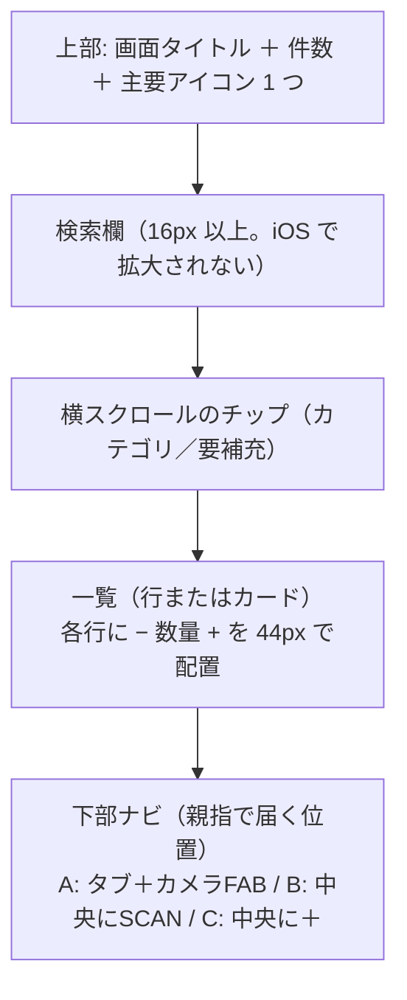
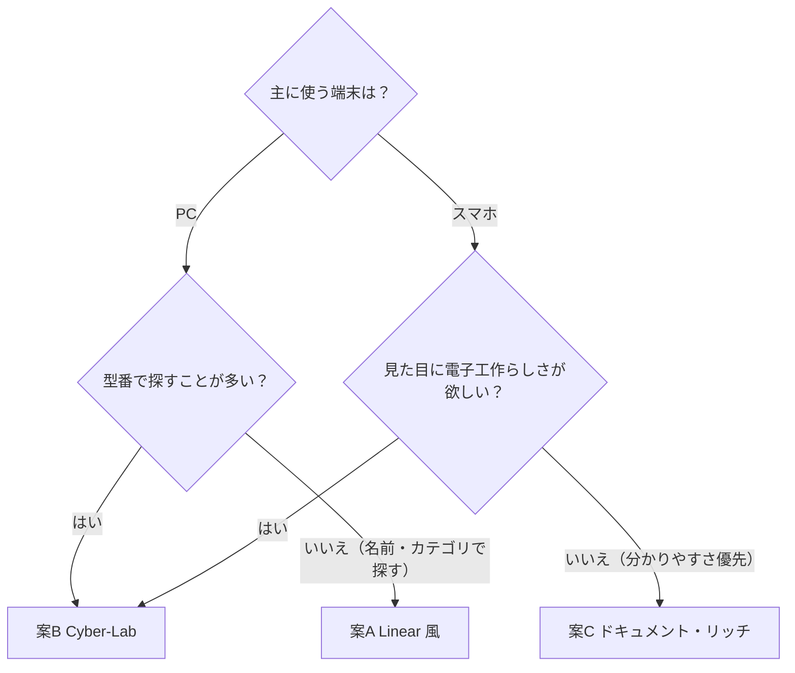

# デザイン刷新案（Issue #57 / #58）

現在の実装（テーマ変数化と微修正）では「見た目が変わった」と感じにくい、というフィードバックを受けて作った、抜本的な刷新案です。性格の異なる 3 案を用意しました。1 案を選ぶか、要素を組み合わせる指示をください。

## 見比べ方

| 方法 | 開き方 | できること |
|---|---|---|
| ローカルブラウザ | `cd client && npm run dev` を実行し、`https://localhost:5173/design-preview.html` を開く | 上部のボタンで「案 A / B / C」「ライト / ダーク / 自動」「デスクトップ / スマホ」を切り替える。検索、カテゴリの絞り込み、数量の − / + は実際に操作できる。各案の長所・短所も画面上で並べて見られる |
| Claude の Design キャンバス | https://claude.ai/artifact/YL4ZpZWMhz3aRiTH6aKfFL | 3 案のデスクトップ画面とスマホ画面（計 6 枚）を 1 枚のキャンバスに並べて俯瞰する。各画面の Tweaks でダーク / ライトを切り替えられる。Play で操作もできる |

- プレビューは一覧画面だけを対象にした見本です。部品データは 8 件のサンプルで、写真は枠だけを表示しています。
- `client/public/design-preview.html` は本番ビルドにも含まれます。案が決まったら削除してください。

---

## 3 案のひとこと比較

| | 案A Linear 風 | 案B Cyber-Lab | 案C ドキュメント・リッチ |
|---|---|---|---|
| ひとことで | 研ぎ澄まされた業務ツール | 測定器のような部品ラボ | やさしく迷わない部品帳 |
| 主役の情報 | 型番と名前を同じ重みで扱う | **型番** | **部品名** |
| ナビゲーション | 左サイドバー ＋ 上部コマンドバー | 上部の計器パネル風タブ ＋ 状態表示帯 | 上部中央のピル型タブ |
| 情報密度 | 高い（4〜5 列） | 中〜高（4〜5 列） | 低め（3 列） |
| 基準の文字サイズ | 13px | 13px（等幅を多用） | 14〜16px（UD フォント） |
| 角丸 | 8〜10px | 0（直角） | 12〜16px |
| 影 | ほぼ使わず、線で区切る | 使わず、線と発光で表現 | 柔らかい影を重ねる |
| 在庫の見せ方 | 細いバーと状態バッジ | LED セグメント 10 個と 3 桁表示 | 「在庫あり / 残りわずか / 在庫切れ」の言葉 |
| 数量ステッパー | 小さめ（26px）で控えめ | 計器風の読み取り表示 | 大きめ（40〜44px） |
| スマホのナビ | 下部タブ ＋ カメラの FAB | 下部バー中央に「SCAN」 | 下部タブ中央に「＋」 |
| 実装の重さ | 中（サイドバー化が必要） | 中（フォントとコンポーネントの作り直し） | 小〜中（現在の構造に最も近い） |

---

## 案A：Linear / Raycast 風 クリーン・モダン

### コンセプト
余計な装飾をなくし、1px の線、正確な余白、等幅数字で「道具としての精度」を出します。ガラス効果はやめ、ダークもライトもほぼ無彩色の地にインディゴ 1 色のアクセントを使います。キーボードで素早く操作できることを重視します。

### 配色

| 役割 | ライト | ダーク |
|---|---|---|
| 背景 | `#fbfbfc` | `#0e0f12` |
| サイドバー | `#f6f7f9` | `#0b0c0f` |
| サーフェス（カード） | `#ffffff` | `#15171c` |
| サーフェス 2（写真枠・入力） | `#f1f2f5` | `#1c1f25` |
| 枠線 | `#e4e6eb` | `#262a31` |
| 本文 / 補助 / 弱い文字 | `#111318` / `#4b5262` / `#646b7a` | `#e8eaed` / `#a8aebb` / `#8a909c` |
| アクセント（その上の文字） | `#4f46e5`（`#ffffff`） | `#8b93ff`（`#0e0f12`） |
| 在庫あり / 残りわずか / 在庫切れ | `#15803d` / `#b45309` / `#b91c1c` | `#4ade80` / `#fbbf24` / `#f87171` |

文字は Geist（欧文と数字）、Geist Mono（型番・QR・数量）、Noto Sans JP（和文）を使います。

### 画面構成（デスクトップ）

```
┌──────────────┬──────────────────────────────────────────────────────────┐
│ ■ 電子パーツ管理 │ パーツ / 全パーツ  [🔍 名前・型番・保管場所で絞り込み   /]  ▦ ☰ 📷 [+ パーツ追加 N] │
│ [🔍 コマンド ⌘K] ├──────────────────────────────────────────────────────────┤
│ ▦ 全パーツ   342 │ [+ フィルタ] [カテゴリ = IC ×] [状態 = 在庫あり…]      8 件 [⇅ 更新日] │
│ ✓ 使用済み    58 ├──────────────────────────────────────────────────────────┤
│ ◇ 保管庫ビュー 40 │ ┌────────┐ ┌────────┐ ┌────────┐ ┌────────┐            │
│ ✦ AI判定候補  (6) │ │ [写真]  ●在庫あり│ │        │ │        │ │        │            │
│ ▣ QR入出庫      │ │ NE555P     │ │ …      │ │ …      │ │ …      │            │
│ カテゴリ        │ │ タイマーIC   │ │        │ │        │ │        │            │
│ ■ IC       2 │ │ ■IC · BOX-03  QR-0012 │                                   │
│ ■ 抵抗      1 │ │ ━━━━━━──────  │                                   │
│ …              │ │ 最小 5   [− 12 +] │                                   │
│ ☀ ☾ 🖥     ⚙ │ └────────┘                                            │
└──────────────┴──────────────────────────────────────────────────────────┘
```

### カードの構造
1. 写真（4:3）。右上に状態バッジ（色の点と「在庫あり」などの文字）
2. 型番（等幅、13px、太字）と部品名（12px、補助色、1 行で省略）
3. カテゴリの色の点、カテゴリ名、保管場所、QR コード（右寄せ）
4. 在庫バー（3px。最小在庫の 4 倍を 100% とする）
5. 最小在庫数と数量ステッパー（− 数量 +）

### 検索とフィルタ
- 検索欄は入力と同時に一覧を絞り込みます。`/` キーで検索欄に、`⌘K` でコマンドパレットに移動します。
- 絞り込み条件は「カテゴリ = IC ×」のようなトークンとして並び、× で 1 つずつ外せます。
- 並び替えはボタン 1 つにまとめ、押すとメニューが開きます。

### 長所と短所
- **長所**：342 件規模でも一覧性が落ちません。カテゴリと件数がサイドバーに常に見えます。長時間使っても疲れにくい配色です。
- **短所**：スマホではサイドバーを下部タブに作り直す必要があります。文字が小さめなので、手元を見ながらの作業ではやや細かく感じます。電子工作らしさは出ません。
- **向いている使い方**：PC での棚卸しやデータ整理が中心で、キーボード操作が多い場合。

---

## 案B：電子工作・ハードウェア・ラボ風（Cyber-Lab）

### コンセプト
測定器のパネルとブレッドボードをモチーフにします。背景には 16px 間隔の点グリッドを敷き、角は直角にし、ラベルは等幅の英字にします。在庫状態は LED の点灯で表します。**型番を最も大きく表示**し、「部品は型番で探す」という使い方に合わせます。ダークでは LED の発光を、ライトでは紙のデータシートの質感を出します。

### 配色

| 役割 | ライト（データシート） | ダーク（ラボ） |
|---|---|---|
| 背景 / 点グリッド | `#f3f2ec` / `rgba(60,70,55,.13)` | `#0a0d0b` / `rgba(120,160,135,.14)` |
| ヘッダー | `#fbfaf6` | `#0d110e` |
| サーフェス / 読み取り表示の地 | `#ffffff` / `#f6f5ef` | `#101511` / `#060807` |
| 枠線（弱 / 強） | `#d3d1c6` / `#a9a698` | `#223029` / `#34463b` |
| 本文 / 補助 / 弱い文字 | `#161813` / `#43473e` / `#5c6056` | `#e6f0e9` / `#a3b8ab` / `#80968a` |
| アクセント（アンバー） | `#b45309`（文字 `#ffffff`） | `#ffb547`（文字 `#1a1200`） |
| OK / LOW / OUT（LED） | `#0f7a43` / `#b45309` / `#b42318` | `#39d98a` / `#ffb547` / `#ff6b5b` |
| 消灯中の LED | `#cfcdc2` | `#2b3a31` |

文字は JetBrains Mono（ラベル・型番・数字）と IBM Plex Sans JP（和文）を使います。

### 画面構成（デスクトップ）

```
┌──────────────────────────────────────────────────────────────────────────┐
│ [▣] EPM-01      ┌ ●PARTS 全パーツ │ ○USED 使用済み │ ○STORAGE 保管庫 ┐  [QR I/O] [✦AI QUEUE 06] [⚙] │
│     電子パーツ管理 └───────────────────────────────────────┘                              │
├────────────┬────────────┬────────────┬────────┬───────────┬─────────┤
│ TOTAL      │ LOW STOCK  │ OUT OF STOCK │ USED   │ LOCATIONS │ LINK    │
│ 342 items  │ 1 items    │ 1 items    │ 58     │ 40 boxes  │ ONLINE  │
├────────────┴────────────┴────────────┴────────┴───────────┴─────────┤
│ [> part_number / 名前 / 場所 で検索        8 HIT] [ALL 8][IC 2][R 1]…  SORT: PN ▲ [+ NEW PART] │
├──────────────────────────────────────────────────────────────────────────┤
│ ┌[IC] IC ──── LOC BOX-03┐ ┌──────────┐ ┌──────────┐ ┌──────────┐ │
│ │   [写真]      ● OK │ │          │ │          │ │          │ │
│ │ NE555P             │ │ 型番が主役  │ │          │ │          │ │
│ │ タイマーIC           │ │          │ │          │ │          │ │
│ │ ▮▮▮▮▮▮▯▯▯▯          │ │          │ │          │ │          │ │
│ │ QR-0012  [− │012│ +] │ │          │ │          │ │          │ │
│ └──────────────────┘ └──────────┘ └──────────┘ └──────────┘ │
└──────────────────────────────────────────────────────────────────────────┘
```

### カードの構造
1. 見出し帯：カテゴリコード（`[IC]`）とカテゴリ名、保管場所（`LOC BOX-03`）
2. 写真（16:10）。右上に LED と状態コード（`OK` / `LOW` / `OUT`）
3. **型番（17px、等幅、太字）**。その下に部品名を補助として表示
4. LED セグメントバー（10 個。点灯数が在庫レベル、色が状態を表す）
5. QR コードと最小在庫数、計器風のステッパー（`− │012│ +`。数字の色が状態を表す）

### 検索とフィルタ
- コマンドライン風の検索欄（`>` のプロンプト付き）で、ヒット件数を右端に `8 HIT` と表示します。
- カテゴリは `[IC]` のような角括弧のトグルで、件数も一緒に表示します。
- 上部の状態表示帯に、在庫少と欠品の件数を常に表示します。操作をしなくても補充が必要な数が分かります。

### 長所と短所
- **長所**：型番で探す使い方に最も合います。在庫状態は LED と数字でひと目で分かります。「電子パーツ管理らしさ」が最も強く、友人に見せたときの印象も強い案です。
- **短所**：等幅フォントと英字のラベルが多いので、慣れるまで硬く感じます。直角のデザインは好みが分かれます。ライトテーマでは、ダークほどの雰囲気は出ません。
- **向いている使い方**：作業机で QR スキャンを多用し、型番で部品を管理する場合。

---

## 案C：Notion / Stripe 風 ドキュメント・リッチ

### コンセプト
紙のノートのような温かみのある白地に、柔らかい影のカードを並べます。大きな検索窓、件数付きのチップ、言葉で書いた在庫状態で、**初めて触る人でも迷わない**ことを最優先にします。和文には読みやすさを重視したユニバーサルデザインフォント（BIZ UDPゴシック）を使います。

### 配色

| 役割 | ライト | ダーク |
|---|---|---|
| 背景 | `#fafaf9` | `#191817` |
| サーフェス / サーフェス 2 | `#ffffff` / `#f4f3f1` | `#23211f` / `#2d2a28` |
| 枠線 | `#e7e5e4` | `#3a3734` |
| 本文 / 補助 / 弱い文字 | `#1c1917` / `#57534e` / `#6b6560` | `#f5f5f4` / `#c7c2bc` / `#a8a29e` |
| アクセント（その上の文字） | `#2f5fd0`（`#ffffff`） | `#7ea6ff`（`#0f1420`） |
| 在庫あり（地 / 文字） | `#dcfce7` / `#166534` | 緑 14% / `#86efac` |
| 残りわずか（地 / 文字） | `#fef3c7` / `#92400e` | 黄 15% / `#fcd34d` |
| 在庫切れ（地 / 文字） | `#fee2e2` / `#991b1b` | 赤 16% / `#fca5a5` |
| カテゴリタグ | IC 紫、トランジスタ シアン、抵抗 オレンジ、コンデンサ 緑、モジュール ピンク、LED 赤（淡い地に濃い文字） | 同じ色相を半透明の地と明るい文字で表示 |
| 影 | `0 1px 2px` と `0 8px 24px` を重ね、不透明度 4〜6% | 不透明度 25〜35% |

文字は BIZ UDPゴシック（本文）と Outfit（見出しの欧文と数字）を使います。

### 画面構成（デスクトップ）

```
┌──────────────────────────────────────────────────────────────────────┐
│ [◇] パーツ箱          ( パーツ一覧 | 使用済み | 保管庫 )          [▣ QRで入出庫] [☀] [⚙] │
├──────────────────────────────────────────────────────────────────────┤
│   パーツ一覧                                         [📷 写真から追加] [+ パーツを追加] │
│   342 件のパーツを管理中です。残りわずかのものが 1 件、在庫切れが 1 件あります。            │
│  ╭──────────────────────────────────────────────────────────────╮  │
│  │ 🔍 部品名・型番・保管場所で探す（例: 555、抵抗、BOX-03）           8 件ヒット │  │
│  │ (すべて 8) (要補充 2) (IC 2) (抵抗 1) (コンデンサ 1) …      並び替え [新しい順 ▾] │  │
│  ╰──────────────────────────────────────────────────────────────╯  │
│  ╭───────────────╮  ╭───────────────╮  ╭───────────────╮            │
│  │ ╭───────────╮ │  │               │  │               │            │
│  │ │   [写真]   │ │  │               │  │               │            │
│  │ ╰───────────╯ │  │               │  │               │            │
│  │ (IC) (NE555P)   │  │               │  │               │            │
│  │ タイマーIC        │  │               │  │               │            │
│  │ 📍 BOX-03 に保管  │  │               │  │               │            │
│  │ ─────────────── │  │               │  │               │            │
│  │ (在庫あり) [−] 12個 [+] │  │               │  │               │            │
│  ╰───────────────╯  ╰───────────────╯  ╰───────────────╯            │
└──────────────────────────────────────────────────────────────────────┘
```

### カードの構造
1. 写真（3:2、角丸 10px、カードの内側に余白を取って配置）
2. カテゴリタグ（色分け）と型番タグ（等幅、控えめ）
3. **部品名（17px、太字。2 行まで表示）**
4. 保管場所（ピンのアイコンと「BOX-03 に保管」の文）
5. 区切り線の下に、在庫状態のピル（言葉で表示）と大きめのステッパー（40px、「12 個」の単位付き）

### 検索とフィルタ
- ページ上部に、入力欄の高さが 52px ある大きな検索パネルを置きます。入力すると同時に一覧が絞り込まれ、ヒット件数も表示されます。
- 件数付きのピル型チップに「要補充」を加え、補充が必要な部品をワンタップで一覧にできます。
- 並び替えは、ラベル付きの標準の `<select>` にします（分かりやすさを優先）。
- ページ見出しの下の 1 文（「残りわずかのものが 1 件…」）で、今の状況を言葉で伝えます。

### 長所と短所
- **長所**：初めて使う人でも迷いません。スマホでも押しやすい大きさです（ボタン 40〜44px）。今のアプリの構造（上部タブ、グリッド）に最も近く、移行が最も楽です。
- **短所**：1 画面に表示できる件数が少ないので、件数が増えるとスクロールが増えます。PC の大画面では間延びしやすく、型番の存在感も弱めです。
- **向いている使い方**：家族や友人と共有する場合、スマホ中心で使う場合、見せる用途（AWS のデモ）を重視する場合。

---

## スマホ画面の構造（3 案共通の考え方）



- 3 案とも、スマホではヘッダーのボタン群を **下部ナビ** に移します。今のヘッダーの折り返しをなくすためです。
- 下部ナビの中央に何を置くかで、各案の主な使い方が表れます。A はカメラで追加、B は QR スキャン、C はパーツ追加です。

## 選び方のガイド



### 組み合わせの例
要素ごとに組み合わせることもできます。
- **A の骨格 ＋ B の在庫表示**：サイドバーと高密度のグリッドに、LED セグメントと状態表示帯を載せる
- **C の骨格 ＋ B の型番表示**：やさしいカードのまま、型番を等幅の大きな文字で目立たせる
- **B のダーク ＋ C のライト**：ダークはラボ風、ライトはドキュメント風にする（テーマごとに性格を変える）

## Planner の推奨

**第一候補は案B、ただし B のライトテーマには C の要素を一部取り入れる**ことを推奨します。

1. このアプリは自宅 LAN で日常的に使う道具です。#61 で型番の欄を追加し、#54 では AI で型番を読み取るようにしました。型番を主役にする B は、ここまでの機能の流れと最も合っています。
2. 「見た目が変わった」とはっきり感じられるのは B です。A は洗練されていますが、今のダーク基調から見ると変化が穏やかです。
3. B の弱点である「硬さ」は、和文に IBM Plex Sans JP を使い、ラベルの英字に日本語の補足を付けることで和らげています。プレビューで受け入れられるかを確認してください。

C は「友人に見せる」用途を重視する場合の有力な代替案です。

## 案が決まった後の進め方

現在のブランチには、#57/#58 の実装途中の変更（`useTheme`、`useToast`、`SkeletonCard`、テーマ変数）がステージされています。どの案を選んでも、これらの仕組みはそのまま使えます。変わるのは主に次の 3 点です。

| 変える部分 | 内容 |
|---|---|
| トークンの値 | `style.css` の `[data-theme]` ごとの変数を、選んだ案の配色表の値に置き換える。角丸、影、フォント、余白のトークンを追加する |
| ヘッダーとナビ | `App.vue` のヘッダーを、選んだ案の構造（A はサイドバー、B と C は上部タブ、スマホは下部ナビ）に組み替える |
| カード | `PartsList.vue` のグリッドカードを、選んだ案の構造に作り直す。数量ステッパーは #58 の楽観的更新（400ms のデバウンス、直列送信、失敗時は確定値に戻す）につなぐ |

案が決まったら、この表を元に実装の詳細仕様を書きます。
